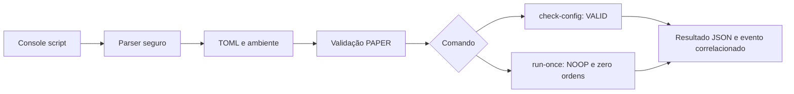
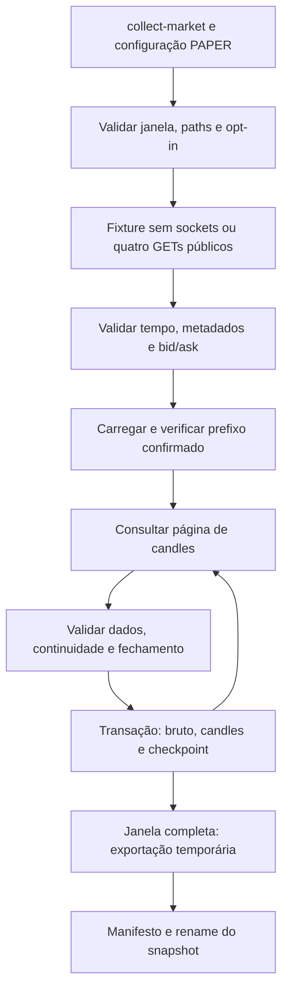
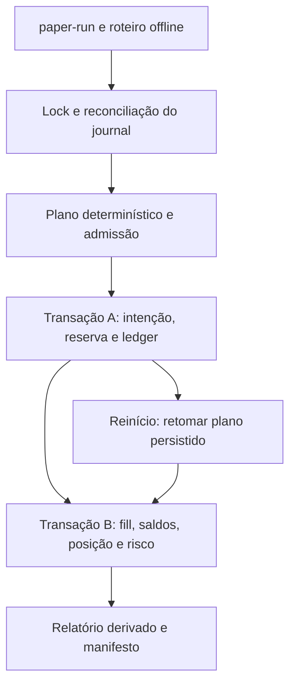

# Arquitetura — base local das Sprints 01 a 03

Atualizado em 24/10/2026. A implementação atual é um pacote Python 3.13, `cripto_bot`, instalado pelo manifest do repositório `/home/cams7/Dev/Cripto/cripto-bot`. O console script é `cripto-bot`.

## Componentes implementados

| Componente | Responsabilidade |
|---|---|
| `entrypoints/cli.py` | Parser, composição, correlação, apresentação JSON e exit codes |
| `adapters/config.py` | Leitura TOML e validação Pydantic antes da aplicação dos overrides |
| `domain/models.py` | Configuração tipada PAPER e conversor de strings decimais finitas |
| `domain/market.py` | Candles, validação temporal/decimal, metadados e cotação |
| `application/ports.py`, `collect_market.py` | Contratos e coordenação da coleta/paginação |
| `adapters/binance/` | Leituras públicas e fixture via transporte substituível |
| `adapters/storage/` | SQLite, checkpoint, flock e exportação com manifesto |
| `entrypoints/market.py` | Composição, opt-in e resultados da coleta |
| `domain/portfolio/`, `domain/risk/` | Carteira, ledger por ativo, precisão, filtros e limites persistentes |
| `adapters/execution/paper.py`, `adapters/paper_scenario.py` | Plano sintético determinístico e roteiro validado |
| `application/paper_run.py`, `paper_reconcile.py` | Replay, recuperação e reconciliação financeira |
| `adapters/storage/paper_sqlite.py`, `paper_report.py` | Journal financeiro, projeções e relatórios derivados |
| `entrypoints/paper.py` | Composição exclusivamente offline dos comandos financeiros |
| `application/run_once.py` | Resultado tipado NOOP, com zero ordens enviadas |
| `observability/logging.py` | Serialização JSON e timestamps UTC |

A configuração padrão não procura arquivo; `--config` lê exatamente o caminho recebido. A precedência é default → arquivo → `CRIPTO_BOT_MODE`, com validação do arquivo antes do override. Somente `mode="PAPER"` é aceito. A tabela opcional `market` configura fonte, paths e limites da coleta. Campos extras, variáveis desconhecidas `CRIPTO_BOT_*` e presença de `BINANCE_API_KEY`/`BINANCE_API_SECRET` falham antes do ciclo.

O domínio usa biblioteca padrão. Pydantic permanece no adapter. O ciclo vazio não conhece arquivo, ambiente, relógio, log ou cliente externo. O caso de uso da coleta recebe portas de fonte/store e verificador do orçamento, sem importar HTTPX ou SQLite. Relógio e geração de ID são injetáveis no entrypoint para testes determinísticos.

Em sucesso, stdout tem um objeto JSON e stderr um evento JSON. Compartilham `run_id`, timestamp UTC e modo validado. Falhas de configuração não incluem o modo recebido ou valores fornecidos. Falhas inesperadas retornam código 1 com evento sanitizado. A ajuda do argparse é textual.

## Limites atuais

A Sprint 03 implementa carteira e executor PAPER sintético. A Sprint 04 implementa SMA opt-in e carteira modular v2 exclusivamente em fixture offline. Integração privada Binance/AWS, backtest completo e operação contínua permanecem futuros. A fonte pública da Sprint 02 tem contrato implementado e testes com transporte em memória; a coleta real não foi executada. O conversor básico preserva entradas; o domínio financeiro separado aplica quantum, ticks, steps e arredondamentos explícitos. As etapas posteriores do [planejamento](planejamento.md) permanecem propostas.

O wheel inclui somente `cripto_bot` e metadados. Os testes ficam fora dele. O harness `tests/offline_runner.py` instala um audit hook que bloqueia eventos `socket.*` nos subprocessos; fixtures bloqueiam sockets nos testes unitários. Trata-se de verificação do código Python desta etapa, sem pretensão de sandbox para programas arbitrários.

A validação do wheel usa `.venv-wheel`, diretório neutro e Python com `-I`, sem `PYTHONPATH` do checkout. O pacote foi importado de `site-packages`.

## Organização do workspace

A raiz do workspace é `/home/cams7/Dev/Cripto`. `cripto-bot/` contém a aplicação e seu Git próprio; `docs/` contém a documentação central e seu Git independente. Cada novo módulo independente será criado em um diretório diretamente na raiz, com seu próprio controle de versão. Subpacotes internos da aplicação continuam no mesmo repositório.

A aplicação foi movida para `cripto-bot` por solicitação do responsável, resolvendo a pendência anterior de alcance do Git. O histórico de `docs` foi preservado. Na execução da Sprint 03, a base da aplicação já era o commit `a102223`; nenhum commit ou remoto foi criado por essa execução. Comandos Python/uv executam em `cripto-bot`.

Decisões: [ADR 0001](decisoes/0001-monolito-modular.md) e [ADR 0002](decisoes/0002-modos-e-decimais.md).

## Coleta e persistência da Sprint 02

O host público é fixo; um guard impede método, host, parâmetros e autenticação proibidos antes do transporte. Não há redirects, proxies herdados ou URLs configuráveis. Fonte pública requer `--allow-network`; fixture o rejeita. `run-once` continua NOOP sem banco/rede.

SQLite é a fonte de verdade. Cada página válida grava bruto, candles e próxima abertura na mesma transação; erro faz rollback. Verificar o prefixo inteiro antes de retomar. Um flock exclusivo protege o diretório de dados até a exportação. O checkpoint e os candles isolam datasets fixture/público; símbolo e intervalo são fixos em BTCUSDT/15m.

O snapshot exportado contém candles/bruto em JSONL gzip, snapshots, proveniência e manifesto com hashes, revisão e fingerprint dos fontes. A publicação ocorre por rename no mesmo filesystem. Se falhar após o commit, repetir a janela recompõe a exportação sem duplicar candles. Não existe atomicidade única entre SQLite e filesystem.

O hash canônico dos candles exclui horários locais e identidade da execução. A proveniência preserva raw_id, hash do bruto, recebimento e processamento. A cotação tem `market_timestamp=null`; não usar bid/ask atual para preencher preços históricos. Os metadados preservam filtros e campos aditivos, sem motor de admissão de ordens nesta etapa.

O orçamento monotônico é verificado entre operações; retries limitados e 429/418 não provocam repetição ilimitada. A restrição pública persistida é compartilhada apenas dentro do mesmo SQLite. Perda de energia, coordenação entre bancos/hosts e conectividade Binance real não foram validadas.

Validação: [guia 02](testes/sprint-02-validacao.md), [evidências](testes/sprint-02-evidencias.json) e [ADR 0003](decisoes/0003-coleta-publica-e-persistencia-local.md).

## Carteira e execução da Sprint 03

A tabela opcional `paper` configura carteira, paths e parâmetros sintéticos. `paper-run`, `paper-report` e `paper-reconcile` não constroem cliente HTTP e rejeitam `--allow-network`. O roteiro validado tem observações inline, relógio UTC de replay e eventos DAY_START/MARK/ORDER. `run-once` continua NOOP.

O domínio usa Decimal com contexto local de precisão 80 e quantum de 1e-8. O plano de fill integral fixa preço, quantidade, taxa e reserva antes da persistência; filtros sintéticos e risco são revalidados após normalização. Entrada, exposição, perda diária e drawdown são controles persistentes. Uma trava impede BUY; SELL de redução continua sujeito a dados e saldo íntegros, sem liquidação automática.

`paper.sqlite3` schema v1 é independente de `market.sqlite3`. O journal imutável e seus postings balanceados separadamente em BTC e USDT permitem reconstruir projeções, intenções e fills. Cada append reconcilia o histórico e verifica versão/estado dentro de BEGIN IMMEDIATE; flock protege escritores cooperantes. Identidades de ação/fill não dependem do run_id. Repetir o roteiro não reaplica capital, reserva ou fill.

Contexto associa carteira, modelo `paper-integral-v1`, parâmetros, regras e hash do roteiro. Alterá-lo no mesmo store gera conflito. Divergência bloqueia novos efeitos quando possível, sem reparação silenciosa. `paper-report` abre snapshot somente leitura e não cria banco nem persiste bloqueio. Exportações usam diretório temporário e rename; falha posterior ao commit permite reexportar sem negociar novamente.

São garantias locais testadas com interrupções de processos e corrupção injetada. Perda de energia, NFS, escritores não cooperantes e coordenação distribuída não foram validados. O modelo não comprova preço, liquidez ou reserva para uma ordem real.

Validação: 316 testes, cobertura combinada de 98,12%, ferramentas e wheel aprovados. Detalhes, lacunas e demonstração reproduzível no [guia 03](testes/sprint-03-validacao.md), [evidências](testes/sprint-03-evidencias.json) e [ADR 0004](decisoes/0004-carteira-paper-e-ledger.md).

## Validações futuras e isolamento — revisão documental de 25/10/2026

A implementação das Sprints 01–03 permanece exclusivamente PAPER. O roadmap passa a backtest (05), PAPER contínuo local (06), pacote/piloto PAPER AWS (07–08), Demo Spot com validação de solicitações (09), Spot Testnet complementar (10) e preparação LIVE (11). Ver [gates](planejamento.md#10-gates-entre-ambientes-e-modos) e [roteiro de validação](testes/validacao-pre-live.md). Nenhuma capacidade foi implementada ou teste repetido nesta revisão.

A futura composição separará fonte de dados, modelo de execução e destino privado. Backtest usa histórico/carteira fictícia; PAPER usa mercado real com execução interna, incluindo parcial, atraso e ausência de fill. Demo e Testnet usam chaves, hosts, stores e saldos virtuais próprios; somente esses adapters podem mutar ordens nos respectivos ambientes. order/test valida solicitações, sem substituir matching e reconciliação. Reset exige nova época rastreável sem apagar ledger.

O executor LIVE permanece bloqueado por padrão. Sua composição/envio futuros dependerão conjuntamente de todos os gates, limites reais, habilitação explícita e aprovação vigente vinculada a conta/release/estratégia/configuração. Modos virtuais não acessam segredos LIVE; inconsistência de host/conta/credencial falha antes do transporte. Não há troca automática para produção nem liberação por lucro simulado. Todos os módulos e documentos permanecem em `/home/cams7/Dev/Cripto`, com Python e Spot.

## Evolução modular e flags — revisão documental de 25/10/2026

A [arquitetura modular proposta](arquitetura-modular.md) separa estratégias, políticas de carteira, fontes de sinal e algoritmos de execução. A Sprint 04 planeja registro/contratos, flags por ambiente/modo/par, coordenação, risco central e SMA opt-in, sem ativar estratégia por padrão. Sprints 12–21 são incrementos independentes por capacidade, sem exigir todo o catálogo. Essa extensão não altera a implementação das Sprints 01–03 nem introduz schema/configuração executável nesta revisão.

Fluxo futuro: dados point-in-time → módulos explicitamente habilitados → coordenador/alocador → risco central → reserva/OMS → algoritmo de execução → adapter do modo → ledger/atribuições reconciliadas. Risco e monitoramento de ordens/posições sobrevivem à desativação da fonte. Não liquidar automaticamente; DRAINING, geração de configuração e propriedade de reservas/posições são explícitos. Ver [matriz de testes](testes/estrategias-modulares-validacao.md). Nenhuma flag autoriza LIVE ou elimina o gate SAM antes de publicação AWS.

## Documentação dos bancos

O [catálogo dos bancos](bancos/README.md) e os documentos [mercado SQLite v1](bancos/market-sqlite.md) e [carteira PAPER SQLite v1](bancos/paper-sqlite.md) descrevem o DDL consultado em 25/10/2026, sem inspeção de bases operacionais. Toda Sprint com mudança estrutural deve atualizar diagrama/modelo, dicionário, versão/compatibilidade, migração se existente e evidências na mesma entrega; pendência bloqueia conclusão conforme seção 4.8 do planejamento. Relações entre stores permanecem lógicas, sem FK/transação cruzada presumida.

## Base modular entregue na Sprint 04

`strategy-run` compõe somente fixture local, SMA pura, coordenador exclusive_owner,
dimensionamento/risco central, journal modular e relatório JSON/HTML. Default sem
configuração ou sem módulo habilitado retorna NOOP sem carteira. `strategy-report`
abre snapshot somente leitura e reexporta; `strategy-reconcile` verifica e bloqueia
quando necessário. `paper-*` continua no roteiro manual/v1 e `run-once` NOOP.

O schema v2 preserva o DDL financeiro e acrescenta configurações, instâncias,
ciclos e atribuições no mesmo banco/transação. Não há migração v1 automática.
CYCLE/HOLD grava estado/cursor; CYCLE direcional une reserva e decisão; FILL
confirma custos/posição/atribuição. Replay inicial/final reconstrói tudo; CAS e
assinatura SQLite do escritor exclusivo evitam reconstrução integral redundante
entre commits conhecidos. Postings e históricos continuam verificáveis por ativo.

Snapshot temporal contém só candles fechados disponíveis, Decimal local de
precisão 80 e relógio de replay. Envelopes identificam instância/geração/época,
prefixo e execução; acrescentar futuro não altera identidade passada. DAY_START
precede decisões do dia UTC, inclusive candle que fecha à meia-noite.
Desativação mantém recuperação e DRAINING com BTC residual, sem liquidação.

Relatório HTML autocontido não depende de browser ou bibliotecas gráficas no
runtime; o browser foi usado somente na revisão visual. Exportação após commit
não é operação financeira. Ver [ADR 0005](decisoes/0005-estrategia-modular-e-persistencia.md),
[SMA](estrategias/trend_sma.md), [banco v1/v2](bancos/paper-sqlite.md) e
[guia/evidências 04](testes/sprint-04-validacao.md). Outros módulos e modelos de
execução permanecem não implementados e desabilitados.
