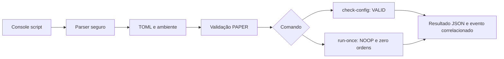
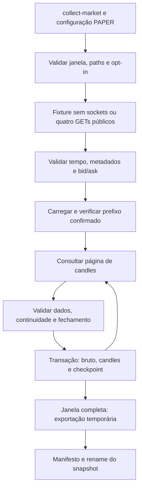

# Arquitetura — base local das Sprints 01 e 02

Atualizado em 24/10/2026. A implementação atual é um pacote Python 3.13, `cripto_bot`, instalado pelo manifest do repositório `/home/cams7/Dev/Cripto/cripto-bot`. O console script é `cripto-bot`.

## Componentes implementados

| Componente | Responsabilidade |
|---|---|
| `entrypoints/cli.py` | Parser, composição, correlação, apresentação JSON e exit codes |
| `adapters/config.py` | Leitura TOML e validação Pydantic antes da aplicação dos overrides |
| `domain/models.py` | Configuração tipada PAPER e conversor de strings decimais finitas |
| `domain/market.py` | Candles, validação temporal/decimal, metadados e cotação |
| `application/ports.py`, `collect_market.py` | Contratos e coordenação da coleta/paginação |
| `adapters/binance/` | Leituras públicas e fixture via transporte substituível |
| `adapters/storage/` | SQLite, checkpoint, flock e exportação com manifesto |
| `entrypoints/market.py` | Composição, opt-in e resultados da coleta |
| `application/run_once.py` | Resultado tipado NOOP, com zero ordens enviadas |
| `observability/logging.py` | Serialização JSON e timestamps UTC |

A configuração padrão não procura arquivo; `--config` lê exatamente o caminho recebido. A precedência é default → arquivo → `CRIPTO_BOT_MODE`, com validação do arquivo antes do override. Somente `mode="PAPER"` é aceito. A tabela opcional `market` configura fonte, paths e limites da coleta. Campos extras, variáveis desconhecidas `CRIPTO_BOT_*` e presença de `BINANCE_API_KEY`/`BINANCE_API_SECRET` falham antes do ciclo.

O domínio usa biblioteca padrão. Pydantic permanece no adapter. O ciclo vazio não conhece arquivo, ambiente, relógio, log ou cliente externo. O caso de uso da coleta recebe portas de fonte/store e verificador do orçamento, sem importar HTTPX ou SQLite. Relógio e geração de ID são injetáveis no entrypoint para testes determinísticos.

Em sucesso, stdout tem um objeto JSON e stderr um evento JSON. Compartilham `run_id`, timestamp UTC e modo validado. Falhas de configuração não incluem o modo recebido ou valores fornecidos. Falhas inesperadas retornam código 1 com evento sanitizado. A ajuda do argparse é textual.

## Limites atuais

A Sprint 02 implementa coleta e banco local. Não existem saldo, carteira, ledger financeiro, estratégia, integração privada Binance/AWS ou executor financeiro. A fonte pública tem contrato implementado e testes com transporte em memória; a coleta real não foi executada. O conversor decimal não quantiza valores nem define regras de preço/quantidade. O roadmap do [planejamento](planejamento.md) permanece uma proposta futura.

O wheel inclui somente `cripto_bot` e metadados. Os testes ficam fora dele. O harness `tests/offline_runner.py` instala um audit hook que bloqueia eventos `socket.*` nos subprocessos; fixtures bloqueiam sockets nos testes unitários. Trata-se de verificação do código Python desta etapa, sem pretensão de sandbox para programas arbitrários.

A validação do wheel usa `.venv-wheel`, diretório neutro e Python com `-I`, sem `PYTHONPATH` do checkout. O pacote foi importado de `site-packages`.

## Organização do workspace

A raiz do workspace é `/home/cams7/Dev/Cripto`. `cripto-bot/` contém a aplicação e seu Git próprio; `docs/` contém a documentação central e seu Git independente. Cada novo módulo independente será criado em um diretório diretamente na raiz, com seu próprio controle de versão. Subpacotes internos da aplicação continuam no mesmo repositório.

A aplicação foi movida para `cripto-bot` por solicitação do responsável, resolvendo a pendência anterior de alcance do Git. O histórico de `docs` foi preservado. Não houve commit inicial nem configuração de remoto da aplicação. Comandos Python/uv agora executam em `cripto-bot`.

Decisões: [ADR 0001](decisoes/0001-monolito-modular.md) e [ADR 0002](decisoes/0002-modos-e-decimais.md).

## Coleta e persistência da Sprint 02

O host público é fixo; um guard impede método, host, parâmetros e autenticação proibidos antes do transporte. Não há redirects, proxies herdados ou URLs configuráveis. Fonte pública requer `--allow-network`; fixture o rejeita. `run-once` continua NOOP sem banco/rede.

SQLite é a fonte de verdade. Cada página válida grava bruto, candles e próxima abertura na mesma transação; erro faz rollback. Verificar o prefixo inteiro antes de retomar. Um flock exclusivo protege o diretório de dados até a exportação. O checkpoint e os candles isolam datasets fixture/público; símbolo e intervalo são fixos em BTCUSDT/15m.

O snapshot exportado contém candles/bruto em JSONL gzip, snapshots, proveniência e manifesto com hashes, revisão e fingerprint dos fontes. A publicação ocorre por rename no mesmo filesystem. Se falhar após o commit, repetir a janela recompõe a exportação sem duplicar candles. Não existe atomicidade única entre SQLite e filesystem.

O hash canônico dos candles exclui horários locais e identidade da execução. A proveniência preserva raw_id, hash do bruto, recebimento e processamento. A cotação tem `market_timestamp=null`; não usar bid/ask atual para preencher preços históricos. Os metadados preservam filtros e campos aditivos, sem motor de admissão de ordens nesta etapa.

O orçamento monotônico é verificado entre operações; retries limitados e 429/418 não provocam repetição ilimitada. A restrição pública persistida é compartilhada apenas dentro do mesmo SQLite. Perda de energia, coordenação entre bancos/hosts e conectividade Binance real não foram validadas.

Validação: [guia 02](testes/sprint-02-validacao.md), [evidências](testes/sprint-02-evidencias.json) e [ADR 0003](decisoes/0003-coleta-publica-e-persistencia-local.md).
