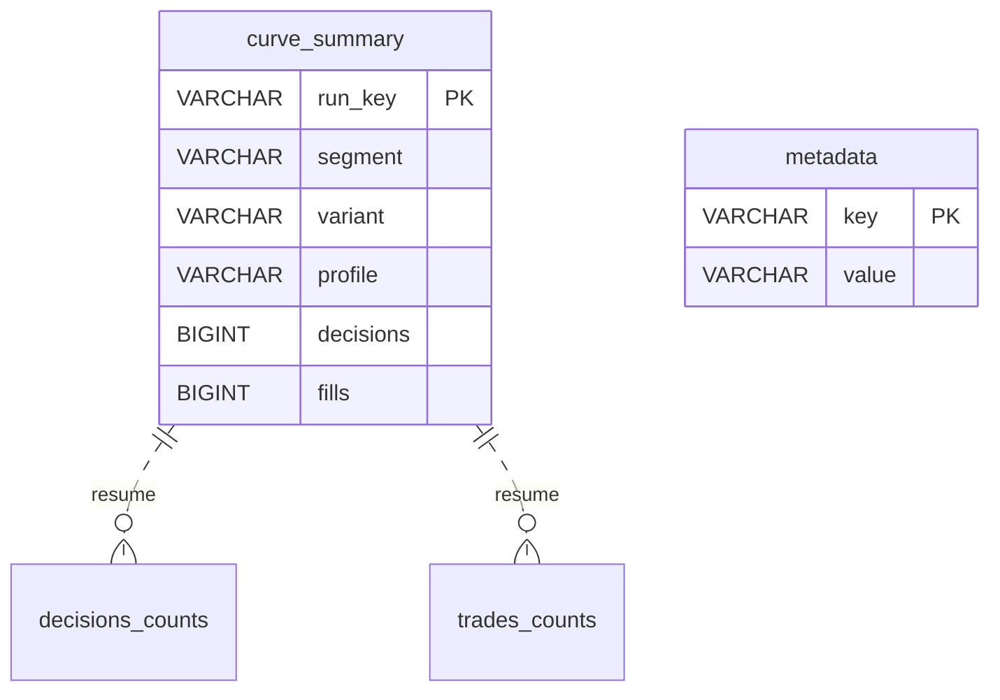

# Backtest — DuckDB e Parquet

Camada analítica acrescentada após a entrega da Sprint 05, por solicitação de integração de DuckDB + Parquet. O [SQLite histórico](backtest-sqlite.md) permanece o ledger autoritativo: reservas, fills, recuperação, checkpoints e reconciliação não são transferidos para DuckDB. Não há migração dos bancos ou alteração de resultado financeiro.

## Fluxo e publicação

`backtest-run` e `backtest-report` publicam automaticamente, no mesmo diretório de exportação:

- `report.html`, `report.json`, `equity.csv`, `trades.csv`, `decisions.csv`: contratos anteriores preservados.
- `equity.parquet`, `trades.parquet`, `decisions.parquet`: séries completas, comprimidas com ZSTD, consultáveis com DuckDB. A escrita usa `ROW_GROUP_SIZE=8192` para controlar memória com payloads largos; esse parâmetro é um mínimo/alvo e o motor pode arredondar o grupo por vetores.
- `analytics.duckdb`: catálogo de resumos por curva e contagens por motivo/lado, calculadas por SQL sobre os Parquets.
- `analytics.json`: versão, schema analítico, tipos, contagens e hashes lógicos do protocolo/resultado.
- `manifest.json`: SHA256 de cada arquivo publicado, incluindo catálogo e Parquets.

A ordem é reconciliação SQLite → snapshot oficial → CSVs → DuckDB lê os CSVs com schema explícito → Parquets → consultas SQL e confronto de contagens → fechamento do catálogo → manifesto → rename do diretório temporário. Uma falha analítica impede a publicação do conjunto; o ledger permanece confirmado e pode ser reexportado com `backtest-report`. Não se refazem sinais/fills para corrigir uma falha de relatório. Um diretório `.pending-*` deixado por morte de processo não é um export publicado.

O catálogo não depende de caminhos absolutos para os arquivos Parquet. Pode ser movido com o export; suas tabelas contêm os resumos, não uma segunda cópia das séries completas. As consultas às séries usam `read_parquet` com o caminho fornecido pelo usuário. Cada export é um snapshot independente; reexportar cria outro diretório, sem alterar os anteriores.

## Formatos e precisão

Schema analítico 1. Colunas dos CSVs são preservadas no Parquet, com `export_row` adicional, BIGINT e iniciado em 1 por arquivo, para reconstruir a ordem de exportação. Ele não é a geração do journal. `at`, `fill_at`, `scheduled_at` e `valid_until` são BIGINT em milissegundos UTC; `as_of` mantém a representação ISO UTC original em VARCHAR. Campos opcionais vazios do CSV tornam-se NULL.

Valores financeiros, razões, identificadores e `data_json` permanecem VARCHAR. Isso conserva as casas decimais e os JSONs originais sem passar por float ou impor o limite de precisão 38 de DECIMAL do DuckDB. As métricas oficiais continuam sendo calculadas pelo núcleo Decimal de precisão 80; não são recalculadas por agregações de ponto flutuante. CAST para DECIMAL em consultas exploratórias é uma escolha explícita do usuário, sujeita ao tamanho dos valores e ao limite do tipo.

| Tabela do catálogo | Campos e função |
|---|---|
| `metadata` | `key VARCHAR PRIMARY KEY`, `value VARCHAR NOT NULL`; valores serializados como JSON canônico |
| `curve_summary` | `run_key VARCHAR PRIMARY KEY`; `segment`, `variant`, `profile` VARCHAR; `completed BOOLEAN`; `measured_until BIGINT`; `final_equity`, `net_return`, `maximum_drawdown`, `fees` VARCHAR; `equity_rows`, `decisions`, `fills` BIGINT |
| `decisions_counts` | `run_key`, `status`, `reason` VARCHAR; `count BIGINT`; agregação sobre decisões Parquet |
| `trades_counts` | `run_key`, `side` VARCHAR; `count BIGINT`; agregação sobre fills Parquet |

Não há foreign keys entre o catálogo e o SQLite, nem triggers financeiros no DuckDB. A chave de curva é uma relação lógica; as contagens são verificadas na geração. Fora das PKs e de `metadata.value`, as colunas são anuláveis e não têm defaults. O catálogo é fechado antes da publicação e tratado como snapshot em leitura. A aplicação não reabre um catálogo existente para continuar uma simulação.



O diagrama mostra relações lógicas, sem FK imposta. DDL efetivo das tabelas persistidas:

```sql
CREATE TABLE metadata (key VARCHAR PRIMARY KEY, value VARCHAR NOT NULL);
CREATE TABLE curve_summary (
  run_key VARCHAR PRIMARY KEY, segment VARCHAR, variant VARCHAR, profile VARCHAR,
  completed BOOLEAN, measured_until BIGINT, final_equity VARCHAR,
  net_return VARCHAR, maximum_drawdown VARCHAR, fees VARCHAR,
  equity_rows BIGINT, decisions BIGINT, fills BIGINT
);
-- CTAS: uma linha por grupo; caminhos são parâmetros vinculados no código.
CREATE TABLE decisions_counts AS
  SELECT run_key, status, reason, count(*) AS count
  FROM read_parquet('decisions.parquet') GROUP BY ALL;
CREATE TABLE trades_counts AS
  SELECT run_key, side, count(*) AS count
  FROM read_parquet('trades.parquet') GROUP BY ALL;
```

As contagens por curva dos três Parquets são confrontadas com o SQLite. Fills e decisões também devem coincidir com os acumuladores do relatório. Curvas desconhecidas e divergências bloqueiam a publicação. `ANALYTICS_ROW_COUNT_DIVERGENCE`, `ANALYTICS_METRIC_COUNT_DIVERGENCE`, `ANALYTICS_UNKNOWN_CURVE` e `ANALYTICS_EXPORT_FAILED` seguem o contrato operacional de falha do backtest, exit code 3.

## Uso

A aplicação usa a biblioteca Python DuckDB 1.5.6, instalada por `uv sync --locked --group dev`. Docker não é um serviço exigido pelo bot. A conexão de exportação usa um thread, limite de memória de 256 MB, spill temporário no próprio diretório pendente, instalação/carregamento automático de extensões desabilitados e acesso externo bloqueado, com exceção somente para o diretório local da publicação. A configuração é travada antes das consultas de dados.

No diretório de um export, a imagem Docker já instalada pode abrir o catálogo em leitura:

```bash
docker run --rm -it \
  --mount "type=bind,source=$PWD,target=/data,readonly" \
  -w /data duckdb/duckdb \
  duckdb -readonly /data/analytics.duckdb
```

```sql
SELECT segment, variant, profile, final_equity, decisions, fills
FROM curve_summary
ORDER BY segment, variant, profile;

SELECT run_key, side, count(*) AS fills
FROM read_parquet('/data/trades.parquet')
GROUP BY run_key, side;

SELECT export_row, "at", equity, drawdown
FROM read_parquet('/data/equity.parquet')
WHERE run_key = 'SUBSTITUA_PELO_RUN_KEY'
ORDER BY export_row;
```

Para reproduzir a versão da aplicação, prefira a imagem `duckdb/duckdb:1.5.6` ou o cliente Python do lock; a tag Docker `latest` pode apontar para outra versão. O arquivo DuckDB binário e os bytes Parquet não são uma identidade financeira estável entre versões do motor. A identidade econômica continua sendo `result_sha256`, e os hashes do manifesto verificam os bytes de cada export específico.

## Compatibilidade e desempenho

Exportações antigas continuam legíveis e não são modificadas automaticamente. Um banco histórico existente pode ser reexportado por `backtest-report`; não executar novamente `backtest-run` sob um protocolo cujo código/lock mudou, nem tentar reutilizar sua janela final como amostra intocada. Defaults e demais comandos das Sprints 01–04 permanecem iguais.

Esta integração disponibiliza um caminho colunar para consultas analíticas repetidas; não elimina a reconciliação financeira em Python. A primeira publicação inclui o custo adicional de conversão dos CSVs. Ganhos efetivos, tamanhos e validações desta alteração são registrados no [guia complementar](../testes/duckdb-parquet-validacao.md), sem substituir as [evidências originais da Sprint 05](../testes/sprint-05-evidencias.json).

Fontes oficiais: [Python DB API](https://duckdb.org/docs/1.5/clients/python/dbapi), [Parquet](https://duckdb.org/docs/1.5/data/parquet/overview.html), [restrição de acesso](https://duckdb.org/docs/1.5/operations_manual/securing_duckdb/overview). Implementação: `adapters/storage/backtest_analytics.py` e `backtest_report.py`.


## Revisão de compatibilidade — Sprint 06A

Fontes do bot em `src/cripto_bot`; helpers financeiros puros compartilhados vêm de `cripto_core`. DDL, tabelas/constraints/triggers, versão, transações e ownership deste store foram preservados; nenhuma migração/reset foi introduzida. Alteração da identidade do código não regrava journal/contexto selado ou concede nova amostra independente. O protocolo histórico rejeita retomada sob composição diferente; reexportação somente leitura permanece disponível. Regressões/limitações: [guia 06A](../testes/sprint-06a-validacao.md) e [ADR 0008](../decisoes/0008-core-e-identidade-da-composicao.md).


## Extração analítica — Sprint 06C

Implementação de conversão/catálogo em `cripto-analytics/src/cripto_analytics/adapters/duckdb_export.py`; schemas em domain/contracts.py, publicação em application/publish.py. Bot conserva fachada backtest_analytics.py e adapter AnalyticsRows, mantendo SQL financeiro/reconciliação no consumidor. DDL/schema1, tipos/NULL/precisão, contagens, dez arquivos e configuração do motor preservados. CLI própria valida/consulta export publicado em read_only, sem spill/criação de banco/alteração na entrada e sem SQL livre. Constatar compatibilidade e medições na [validação 06C](../testes/sprint-06c-validacao.md); resultados anteriores permanecem históricos.
