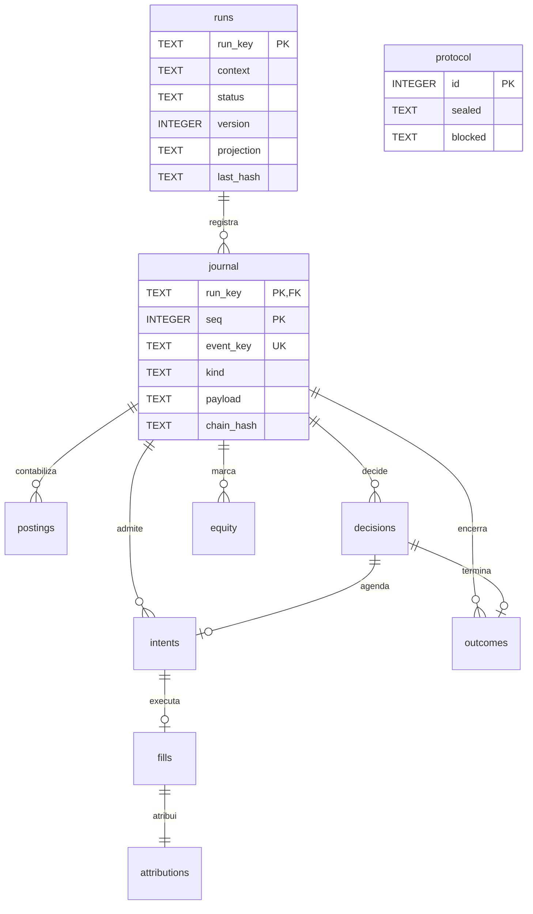

# Banco histórico PAPER — SQLite

Implementação da Sprint 05, 25/10/2026. Código: `cripto-bot/modules/trading/src/cripto_bot/adapters/storage/backtest_sqlite.py`; domínio em `domain/backtest`. Arquivo `backtest.data_dir/backtest.sqlite3`, `user_version=1`, modelo `paper-backtest-v1`. Este banco é independente dos schemas v1/v2 de `paper.sqlite3` e do mercado. Não há migração ou transferência de capital. Resultados funcionais e hashes ficam no [guia 05](../testes/sprint-05-validacao.md).

O protocolo singleton precede qualquer carteira. Há até 48 curvas: três segmentos, quatro variantes e quatro perfis independentes, cada um com 10000 USDT iniciais. `run_key` deriva do hash do protocolo, segmento, variante e perfil. O run_id da CLI identifica tentativa/exportação; não concede outra identidade financeira.



`protocol` e `runs` se relacionam pelo hash no contexto JSON, sem FK adicional. `event_key` é UNIQUE junto de run_key, e não global. `attributions` permite zero ou uma linha por fill pelas constraints; o reconciliador exige exatamente uma. Os demais atributos/constraints constam do DDL abaixo.

Todos os campos TEXT são obrigatórios, sem defaults. `sealed`, `context`, `projection`, `payload` e `data` contêm JSON canônico; os demais TEXT são identificadores, hashes ou estados. Valores financeiros são strings de oito casas; razões derivadas têm dezesseis casas com HALF_EVEN. `seq` é geração/cursor de evento; `at` é UTC em milissegundos; `idx` ordena postings de um evento. `request_hash` identifica kind/payload; `previous_hash` e `chain_hash` encadeiam contexto, evento, projeção e linhas derivadas.

O estado JSON contém carteira financeira, janela de até slow+1 fechamentos (máximo 501), hash incremental do prefixo, uma pendência lógica, intenções financeiras ativas, métricas acumuladas, relógios e cursor. Terminais permanecem nas tabelas, sem crescer dentro do checkpoint. Prefixo inicial são 64 zeros; cada candle fechado atualiza SHA256 do JSON canônico `[hash_anterior, candle_normalizado]`. O hash completo do dataset tem função distinta e pertence ao protocolo congelado.

## Escrita, leitura e recuperação

Writer local exclusivo por flock não bloqueante em `.backtest.lock`; CAS compara geração/projeção e UPDATE condicional da linha runs. SQLite: foreign_keys ON, synchronous FULL, journal_mode WAL no escritor, timeout de 1 s, transações explícitas com BEGIN IMMEDIATE. A conexão somente leitura usa URI mode=ro e BEGIN para snapshot consistente. O código valida os objetos SQL, user_version e quick_check ao abrir; schema/modelo/arquivos incompatíveis são rejeitados. Diretório com paper.sqlite3 ou market.sqlite3 é recusado; não alterar user_version para forçar compatibilidade.

INIT cria a carteira e o aquecimento sem operações. BOUNDARY confirma decisão, métricas e cursor. Um novo SCHEDULED força commit próprio antes da admissão. HOLDs e marcações sem reserva podem compartilhar um lote atômico de até 64 eventos; journal e checkpoint do lote são confirmados juntos, sem publicação de cursor/resultado não confirmado. SCHEDULED guarda teto de orçamento, não reserva USDT/BTC. OBSERVE disponibiliza open sintético +1 ms e, se devido, confirma A: plano, intenção e reserva. FILL confirma B separadamente, no instante +2 ms do plano já persistido. END marca o último close, expira pendência sem preço posterior e não liquida BTC. Eventos sem novo agendamento/reserva podem ser agrupados até 64; nunca unir os commits de A e B. Nenhuma transação fica aberta durante rede ou geração de HTML.

Journal e tabelas derivadas históricas têm 16 triggers que proíbem UPDATE/DELETE, dois por tabela: journal, postings, decisions, intents, fills, outcomes, attributions e equity. Outros dois proíbem alterar protocol.sealed e runs.context. Não há views. Correção por diferença, edição de lançamento e reset financeiro não existem. O reconciliador reexecuta o journal em streaming, verifica hashes, postings, projeções, terminais, fills/atribuições, métricas e checkpoint final. Divergência grava bloqueio durável quando o banco permite escrita. Relatório em leitura apenas falha sem reparar.

Na entrada e saída, reconstrução integral; entre commits conhecidos do escritor, assinatura `(run_key, seq, total_changes, data_version, schema_version)` evita replay a cada candle. Isso é proteção local e não coordenação distribuída. Recuperação retoma SCHEDULED no relógio congelado e RESERVED pelo plano confirmado; FILLED não contabiliza novamente. A tentativa posterior exige dados/fontes/configuração/código iguais ao protocolo. Os testes matam processos antes/depois de decisões, A/B, término e dentro da transação inicial, em cópias sintéticas.

O registro auxiliar `data/backtest-usage/test-usage.sqlite3` guarda `consumed(identity PK, protocol, source, start, end)` com TEXT/INTEGER NOT NULL. É uma declaração local de uso, sem saldo ou FK entre bancos. Uma janela real sobreposta já consumida impede outro protocolo de alegar teste intocado. Replay exato é permitido. Copiar/apagar esse registro ou conhecimento humano prévio está fora do que hashes podem provar.

Backup exige SQLite backup API ou parada do escritor e checkpoint/fechamento consistente; copiar apenas o arquivo principal durante WAL ativo não é backup aprovado. Não há CLI de backup/migration/reset. Preservar diretório e diagnosticar cópia em caso de falha; não remover perdas para retomar. Arquivos operacionais e exportações ficam ignorados no Git. Não há limpeza automática do histórico.

## DDL do schema 1

DDL extraído do código candidato; confrontar com sqlite_schema/foreign_key_list/index_list na fixture pelos testes da Sprint. Índices por `(run_key,seq)` nas tabelas de decisões, intenções e terminais permitem reconciliar cada evento sem buscas quadráticas.

```sql
CREATE TABLE protocol (id INTEGER PRIMARY KEY CHECK(id=1), sealed TEXT NOT NULL, blocked TEXT NOT NULL);
CREATE TABLE runs (run_key TEXT PRIMARY KEY, context TEXT NOT NULL, status TEXT NOT NULL, version INTEGER NOT NULL, projection TEXT NOT NULL, last_hash TEXT NOT NULL);
CREATE TABLE journal (run_key TEXT NOT NULL REFERENCES runs(run_key), seq INTEGER NOT NULL, event_key TEXT NOT NULL, kind TEXT NOT NULL, payload TEXT NOT NULL, request_hash TEXT NOT NULL, previous_hash TEXT NOT NULL, chain_hash TEXT NOT NULL, PRIMARY KEY(run_key,seq), UNIQUE(run_key,event_key));
CREATE TABLE postings (run_key TEXT NOT NULL, seq INTEGER NOT NULL, idx INTEGER NOT NULL, data TEXT NOT NULL, PRIMARY KEY(run_key,seq,idx), FOREIGN KEY(run_key,seq) REFERENCES journal(run_key,seq));
CREATE TABLE decisions (run_key TEXT NOT NULL, decision_id TEXT NOT NULL, seq INTEGER NOT NULL, data TEXT NOT NULL, PRIMARY KEY(run_key,decision_id), FOREIGN KEY(run_key,seq) REFERENCES journal(run_key,seq));
CREATE TABLE intents (run_key TEXT NOT NULL, action_key TEXT NOT NULL, seq INTEGER NOT NULL, data TEXT NOT NULL, PRIMARY KEY(run_key,action_key), FOREIGN KEY(run_key,action_key) REFERENCES decisions(run_key,decision_id), FOREIGN KEY(run_key,seq) REFERENCES journal(run_key,seq));
CREATE TABLE fills (run_key TEXT NOT NULL, fill_id TEXT NOT NULL, action_key TEXT NOT NULL, data TEXT NOT NULL, PRIMARY KEY(run_key,fill_id), UNIQUE(run_key,action_key), FOREIGN KEY(run_key,action_key) REFERENCES intents(run_key,action_key));
CREATE TABLE outcomes (run_key TEXT NOT NULL, action_key TEXT NOT NULL, seq INTEGER NOT NULL, data TEXT NOT NULL, PRIMARY KEY(run_key,action_key), FOREIGN KEY(run_key,action_key) REFERENCES decisions(run_key,decision_id), FOREIGN KEY(run_key,seq) REFERENCES journal(run_key,seq));
CREATE TABLE attributions (run_key TEXT NOT NULL, fill_id TEXT NOT NULL, instance_id TEXT NOT NULL, data TEXT NOT NULL, PRIMARY KEY(run_key,fill_id), FOREIGN KEY(run_key,fill_id) REFERENCES fills(run_key,fill_id));
CREATE TABLE equity (run_key TEXT NOT NULL, seq INTEGER NOT NULL, at INTEGER NOT NULL, data TEXT NOT NULL, PRIMARY KEY(run_key,seq), FOREIGN KEY(run_key,seq) REFERENCES journal(run_key,seq));
CREATE INDEX decisions_sequence ON decisions(run_key,seq);
CREATE INDEX intents_sequence ON intents(run_key,seq);
CREATE INDEX outcomes_sequence ON outcomes(run_key,seq);
```

Histórico: Sprint 05 cria schema1, sem converter bases anteriores. As identidades e o plano financeiro reutilizam o núcleo integral, preservando seus arredondamentos. [ADR 0006](../decisoes/0006-backtest-historico-e-protocolo.md), [especificação](../sprints/sprint-05.md) e fontes oficiais [sqlite3/transações](https://docs.python.org/3.13/library/sqlite3.html#transaction-control), [Decimal](https://docs.python.org/3.13/library/decimal.html), consultadas em 25/10/2026. Nenhum resultado deste store autoriza execução contínua ou LIVE.


## Projeção analítica posterior à Sprint 05

A publicação de relatórios acrescenta [DuckDB + Parquet](backtest-analytics.md), com catálogo de resumos SQL e séries completas comprimidas. O schema SQLite, suas transações, locks, CAS, triggers, ledger e reconciliação permanecem iguais. A conversão ocorre fora das transações financeiras e é publicada com o mesmo manifesto/rename dos relatórios. Falha analítica pode ser repetida por `backtest-report`, sem novos fills. Não há migração de carteira nem substituição da fonte financeira autoritativa. [ADR 0007](../decisoes/0007-duckdb-parquet-analitico.md).
