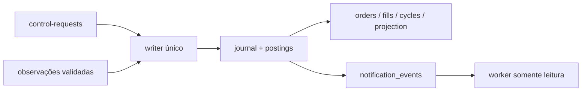
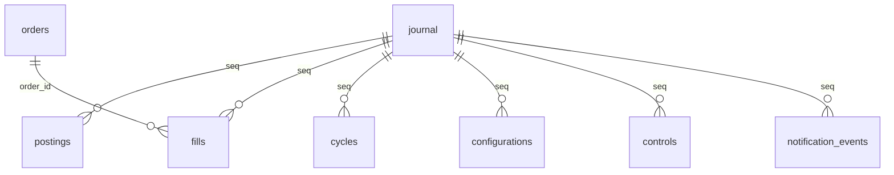

# continuous.sqlite3 — paper-continuous-v1, schema 1

Implementação: `cripto-bot/src/cripto_bot/adapters/storage/continuous_sqlite.py`. Domínio: `domain/continuous/{models,engine,execution}.py`. Banco autoritativo exclusivo do bot; não é export analítico e não substitui bancos anteriores.

| Tabela | Chave / conteúdo | Relações e invariantes |
|---|---|---|
| journal | seq INTEGER PK; event_key UNIQUE; kind/at/payload/payload_hash/previous_hash/chain_hash/state_hash NOT NULL | Seq contígua, tempo não regressivo, hashes de payload/estado/partidas; chave repetida com corpo diferente falha |
| postings | (seq,idx) PK; asset USDT/BTC, account, quantity TEXT | FK journal; Decimal exato; soma zero por ativo/evento |
| projection | id=1 PK CHECK; version INTEGER, data TEXT | Estado completo derivado; CAS contra versão/cabeça do journal |
| orders | order_id TEXT PK, data TEXT | Projeção mutável verificada por replay; um owner e um compromisso ativo |
| fills | fill_id TEXT PK, order_id, seq, data TEXT | FK orders/journal; IDs e cumulativos sem duplicação |
| cycles | close_time INTEGER PK, decision_id UNIQUE, seq, data TEXT | FK journal; slot fixo imutável; late commit fica em evento separado |
| configurations | generation INTEGER PK, seq, data TEXT | FK journal; parâmetros/owner congelados; novas gerações explícitas |
| controls | request_id TEXT PK, seq, data TEXT | FK journal; reconhecimento do pedido durável |
| notification_events | event_id TEXT PK, seq, source_hash, data TEXT | FK journal; mesma transação financeira; fila de entrega é derivada |

Nulabilidade é a do DDL/introspecção abaixo: as colunas com NOT NULL explícito são obrigatórias no SQL. PKs TEXT sem NOT NULL explícito permitem NULL no SQLite; IDs válidos são exigidos pela aplicação e projeções extras/divergentes são recusadas pelo replay. Não atribuir essa validação ao SQL. Índice `notification_seq(seq)`. UPDATE/DELETE proibidos por triggers em journal/postings/fills/cycles/configurations/controls/notification_events. `projection` e `orders` são reconstruíveis/verificáveis; não há comando de reparo/reset. Textos JSON canônicos carregam dados tipados e strings decimais; geração/versão, hashes, limites e reservas são verificados pelo reducer/replay, além das constraints SQL.



Abertura confere DDL exato, user_version=1 e quick_check; bancos incompatíveis ou marcadores de bancos antigos são recusados. Writer com flock não bloqueante, BEGIN IMMEDIATE, WAL, synchronous FULL, FK ON. Abertura readonly usa URI mode=ro e BEGIN. Replay completo recomputa estados, cadeia, partidas, projeções e eventos antes de operar/reportar. Nunca somar financeiros no analytics.

`pilot-manifest.json` é derivado do ARM: contexto, T0/Tend, regras, 672/666, caps temporais/execução e hash. Gravação fsync + link exclusivo; conteúdo divergente bloqueia. Crash após ARM pode deixar o arquivo ausente: writer recompõe exatamente a partir do journal antes de continuar; não muda T0. Inbox guarda pedidos com hash em arquivos exclusivos fsync; ack financeiro em controls. Não apagar inbox para reaplicar controle.

Backup: `ContinuousStore.backup(target)` usa sqlite backup, destino novo dentro da árvore do pai; não copiar somente o arquivo principal com WAL ativo. Restaurar apenas em diretório sintético separado, abrir, reconciliar e recriar manifesto derivado. Não substituir carteira operacional ou apagar journal; rollback é parar entradas/pausar, preservar posição e evidência. Reabrir com composição congelada; divergência não se resolve alterando hashes ou apagando histórico.

Sem retenção destrutiva automática. Monitorar disco: 5GiB antes do início, aviso <2GiB, pausa de entradas/cancelamento do restante <1GiB. Arquivar dados brutos/exports apenas por procedimento revisado; nunca truncar journal para caber no orçamento. Dicionário de entrega: [notifications.sqlite3](notification-sqlite.md). [Runbook](../operacao/continuous-runbook.md).

## Relações físicas e versão

Criação inicial06D/schema1, sem upgrade/conversão de bancos anteriores. Versão desconhecida é recusada; não editar user_version. DDL e introspecção reproduzível ficam nas evidências locais do guia06D.



`projection` e `orders` não têm FK para journal; consistência é auditada por replay. Não há FK entre arquivos SQLite. Ordens/fills/ciclos contêm JSON canônico gerado por ContinuousState.data/record, com decimais em strings, tempos ms UTC e parâmetros/modelo definidos no contexto.

## DDL efetivo e inspeção offline

Extraído do banco sintético dos oráculos instalados em 26/10/2026, schema1. Não é dump operacional. [Introspecção completa](../testes/sprint-06d-schema.json) contém tipos/nulabilidade/defaults/PK/FK/índices, incluindo autoíndices UNIQUE. Fonte: `cripto-bot/src/cripto_bot/adapters/storage/continuous_sqlite.py`; hashes no guia/evidências.

```sql
CREATE TABLE journal (seq INTEGER PRIMARY KEY,event_key TEXT NOT NULL UNIQUE,kind TEXT NOT NULL,at INTEGER NOT NULL,payload TEXT NOT NULL,payload_hash TEXT NOT NULL,previous_hash TEXT NOT NULL,chain_hash TEXT NOT NULL,state_hash TEXT NOT NULL);
CREATE TABLE postings (seq INTEGER NOT NULL REFERENCES journal(seq),idx INTEGER NOT NULL,asset TEXT NOT NULL CHECK(asset IN ('USDT','BTC')),account TEXT NOT NULL,quantity TEXT NOT NULL,PRIMARY KEY(seq,idx));
CREATE TABLE projection (id INTEGER PRIMARY KEY CHECK(id=1),version INTEGER NOT NULL,data TEXT NOT NULL);
CREATE TABLE orders (order_id TEXT PRIMARY KEY,data TEXT NOT NULL);
CREATE TABLE fills (fill_id TEXT PRIMARY KEY,order_id TEXT NOT NULL REFERENCES orders(order_id),seq INTEGER NOT NULL REFERENCES journal(seq),data TEXT NOT NULL);
CREATE TABLE cycles (close_time INTEGER PRIMARY KEY,decision_id TEXT NOT NULL UNIQUE,seq INTEGER NOT NULL REFERENCES journal(seq),data TEXT NOT NULL);
CREATE TABLE configurations (generation INTEGER PRIMARY KEY,seq INTEGER NOT NULL REFERENCES journal(seq),data TEXT NOT NULL);
CREATE TABLE controls (request_id TEXT PRIMARY KEY,seq INTEGER NOT NULL REFERENCES journal(seq),data TEXT NOT NULL);
CREATE TABLE notification_events (event_id TEXT PRIMARY KEY,seq INTEGER NOT NULL REFERENCES journal(seq),source_hash TEXT NOT NULL,data TEXT NOT NULL);
CREATE INDEX notification_seq ON notification_events(seq);
CREATE TRIGGER immutable_journal_UPDATE BEFORE UPDATE ON journal BEGIN SELECT RAISE(ABORT,'immutable continuous history'); END;
CREATE TRIGGER immutable_journal_DELETE BEFORE DELETE ON journal BEGIN SELECT RAISE(ABORT,'immutable continuous history'); END;
CREATE TRIGGER immutable_postings_UPDATE BEFORE UPDATE ON postings BEGIN SELECT RAISE(ABORT,'immutable continuous history'); END;
CREATE TRIGGER immutable_postings_DELETE BEFORE DELETE ON postings BEGIN SELECT RAISE(ABORT,'immutable continuous history'); END;
CREATE TRIGGER immutable_fills_UPDATE BEFORE UPDATE ON fills BEGIN SELECT RAISE(ABORT,'immutable continuous history'); END;
CREATE TRIGGER immutable_fills_DELETE BEFORE DELETE ON fills BEGIN SELECT RAISE(ABORT,'immutable continuous history'); END;
CREATE TRIGGER immutable_cycles_UPDATE BEFORE UPDATE ON cycles BEGIN SELECT RAISE(ABORT,'immutable continuous history'); END;
CREATE TRIGGER immutable_cycles_DELETE BEFORE DELETE ON cycles BEGIN SELECT RAISE(ABORT,'immutable continuous history'); END;
CREATE TRIGGER immutable_configurations_UPDATE BEFORE UPDATE ON configurations BEGIN SELECT RAISE(ABORT,'immutable continuous history'); END;
CREATE TRIGGER immutable_configurations_DELETE BEFORE DELETE ON configurations BEGIN SELECT RAISE(ABORT,'immutable continuous history'); END;
CREATE TRIGGER immutable_controls_UPDATE BEFORE UPDATE ON controls BEGIN SELECT RAISE(ABORT,'immutable continuous history'); END;
CREATE TRIGGER immutable_controls_DELETE BEFORE DELETE ON controls BEGIN SELECT RAISE(ABORT,'immutable continuous history'); END;
CREATE TRIGGER immutable_notification_events_UPDATE BEFORE UPDATE ON notification_events BEGIN SELECT RAISE(ABORT,'immutable continuous history'); END;
CREATE TRIGGER immutable_notification_events_DELETE BEFORE DELETE ON notification_events BEGIN SELECT RAISE(ABORT,'immutable continuous history'); END;
```
