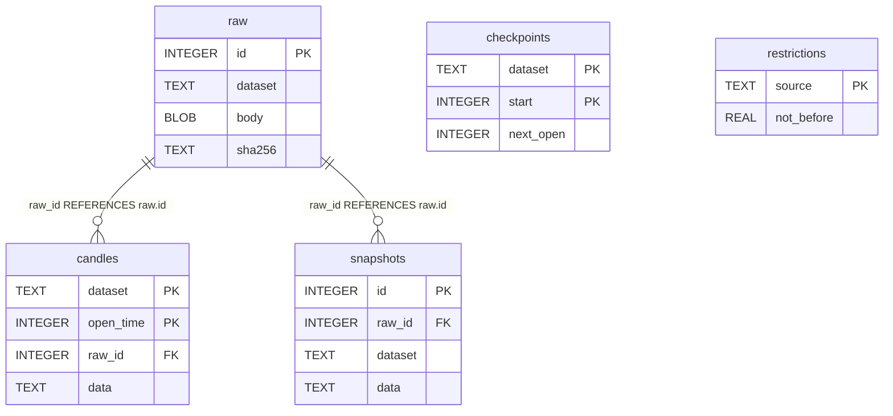

# Mercado — SQLite schema v1

Revisão documental: 25/10/2026. **Schema implementado no código; instalação/banco de dados não inspecionados nesta revisão.** Origem: Sprint 02. Arquivo operacional: `market.sqlite3` dentro do diretório configurado/validado pela aplicação; não é um arquivo a versionar junto desta documentação.

Fonte do DDL: [adapter market_sqlite.py](../../cripto-market-data/src/cripto_market_data/adapters/storage/sqlite.py). SHA-256 histórico do arquivo consultado em 25/10/2026 (antes da extração): `6ec43ee9658e1cfe91234ced17061deae9f8668e00322c4b1126b7dd325651dc`. Essa identificação vincula o documento ao conteúdo, sem presumir checkout sem alterações ou versão instalada. Diagrama resume atributos; o DDL abaixo é a referência completa dos tipos, defaults, nulabilidade e constraints declarados.

## Diagrama relacional físico



## Dicionário e DDL efetivo

| Tabela | Finalidade |
|---|---|
| raw | Resposta original e proveniência: rota/parâmetros, corpo BLOB, hash, status, headers, recebimento e parser |
| candles | Candle normalizado JSON, hash, origem raw e instante de processamento; identidade por dataset/abertura |
| checkpoints | Próxima abertura por dataset e início de janela; atualização transacional com os dados coletados |
| snapshots | JSON de metadados/cotação com origem raw e dataset |
| restrictions | Bloqueio de fonte até `not_before`, REAL em segundos de época UTC; não é valor financeiro |

```sql
CREATE TABLE raw (id INTEGER PRIMARY KEY, dataset TEXT NOT NULL, route TEXT NOT NULL, params TEXT NOT NULL, body BLOB NOT NULL, sha256 TEXT NOT NULL, status INTEGER NOT NULL, headers TEXT NOT NULL, received_at TEXT NOT NULL, parser TEXT NOT NULL);
CREATE TABLE candles (dataset TEXT NOT NULL, open_time INTEGER NOT NULL, data TEXT NOT NULL, sha256 TEXT NOT NULL, raw_id INTEGER NOT NULL REFERENCES raw(id), processed_at TEXT NOT NULL, PRIMARY KEY(dataset, open_time));
CREATE TABLE checkpoints (dataset TEXT NOT NULL, start INTEGER NOT NULL, next_open INTEGER NOT NULL, PRIMARY KEY(dataset, start));
CREATE TABLE snapshots (id INTEGER PRIMARY KEY, dataset TEXT NOT NULL, raw_id INTEGER NOT NULL REFERENCES raw(id), data TEXT NOT NULL);
CREATE TABLE restrictions (source TEXT PRIMARY KEY, not_before REAL NOT NULL);
```

Defaults, índices adicionais e nulabilidade não devem ser inferidos pelo diagrama. O DDL não declara `DEFAULT` nem `CREATE INDEX` separado; PK/UNIQUE geram as estruturas implícitas que o SQLite aplicar. As marcações NOT NULL/CHECK explícitas estão no SQL; não acrescentar constraint inexistente à documentação.

## Representação e operação

Não há FK por `dataset` entre candles, checkpoints e snapshots; associação é lógica da aplicação. `open_time`, `start` e `next_open` usam milissegundos de época; horários de recebimento/processamento são texto UTC. `data`, `params` e `headers` têm formato JSON produzido pelo código, sem constraint JSON SQL. Dados decimais normalizados usam strings; `raw.body` preserva bytes da resposta. [Modelos/parser](../../cripto-bot/src/cripto_bot/domain/market.py) definem os campos internos.

A transação `BEGIN IMMEDIATE` grava cada página válida (bruto, candles e checkpoint); snapshots têm transação própria. `flock` em `.writer.lock` protege o diretório de um escritor cooperante. `foreign_keys=ON` e `synchronous=FULL` são definidos pela conexão. Código não configura WAL explicitamente; não presumir essa política. Abertura valida versão, conjunto de tabelas e `quick_check`; isso não substitui validação de todos os objetos/constraints em uma instalação arbitrária.

O store é fonte de verdade de mercado; exportações JSONL/manifestos são derivadas e publicadas após commit, recuperáveis sem duplicar coleta. Não contém saldo ou ledger financeiro e não há transação/FK cruzada com `paper.sqlite3`.

## Versionamento, compatibilidade e recuperação

O adapter cria a base vazia com `PRAGMA user_version=1` e exige versão 1/conjunto esperado de tabelas ao reabrir. **Não existe rotina de migração entre versões implementada neste adapter.** Versão incompatível é rejeitada; criação inicial não equivale a upgrade. Não alterar manualmente user_version, apagar tabelas, ledger ou triggers para contornar erro. Preservar original e diagnosticar em cópia; qualquer migração futura deve ser implementada, testada e documentada antes do uso.

| Registro | Mudança | Evidência |
|---|---|---|
| Sprint 02 | Criação do schema v1 | [Guia histórico 02](../testes/sprint-02-validacao.md) |
| 25/10/2026 | Documentação do DDL existente e diagrama | Leitura estática do fonte; nenhuma migration ou reexecução funcional |

## Inspeção e testes

Testes relacionados: [integração de persistência](../../cripto-bot/tests/integration/test_market_storage.py). Comando planejado para revalidar em fixtures, a partir de `/home/cams7/Dev/Cripto/cripto-bot`: `uv run --locked pytest tests/integration/test_market_storage.py -q`. **Não executado nesta revisão.** Conferir versões/dependências antes da execução; resultados históricos estão no guia da Sprint.

Na Sprint que alterar o schema, comparar DDL/diagrama com fixture via sqlite_schema e pragmas de tabelas/FKs/índices; testar constraints e fluxos alterados, compatibilidade e migração somente se implementada, além de integridade/reconciliação. Procedimento e critérios: [catálogo dos bancos](README.md). Não abrir banco operacional de escrita só para gerar diagrama. Não foram lidos dados de carteira, credenciais ou registros pessoais.


## Revisão de compatibilidade — Sprint 06A

Fontes do bot em `src/cripto_bot`; helpers financeiros puros compartilhados vêm de `cripto_core`. DDL, tabelas/constraints/triggers, versão, transações e ownership deste store foram preservados; nenhuma migração/reset foi introduzida. Alteração da identidade do código não regrava journal/contexto selado ou concede nova amostra independente. O protocolo histórico rejeita retomada sob composição diferente; reexportação somente leitura permanece disponível. Regressões/limitações: [guia 06A](../testes/sprint-06a-validacao.md) e [ADR 0008](../decisoes/0008-core-e-identidade-da-composicao.md).


## Extração do store na Sprint 06B

A implementação está em `cripto-market-data/src/cripto_market_data/adapters/storage/sqlite.py`; o caminho antigo no bot reexporta a mesma classe e DDL. A extração preserva os cinco CREATE TABLE, a implementação dos métodos/transações e o user_version=1; somente a origem dos imports mudou. Nenhum banco foi movido, convertido, reiniciado ou copiado para o novo projeto como estado operacional.

A CLI standalone recebe root absoluto de contenção e data_dir configurado; o bot mantém a descoberta de raiz anterior. Apontar ambas ao mesmo diretório conserva dataset/checkpoint/not_before e disputa o mesmo `.writer.lock`. Proveniência do exportador é recebida do consumidor: bot identificado como bot, standalone como market-data/core; parser/schema e conjunto de quatro arquivos de dados no manifesto permanecem iguais. Metadata extra não altera o hash canônico dos candles. Compatibilidade e limites no [guia 06B](../testes/sprint-06b-validacao.md) e [ADR 0009](../decisoes/0009-market-data-e-proveniencia-do-produtor.md).
