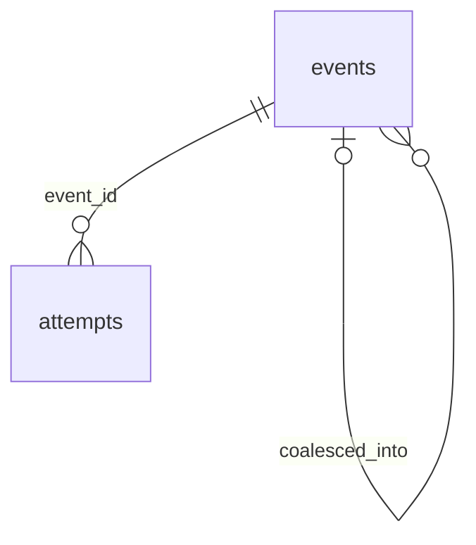

# notifications.sqlite3 — fila de entrega, schema 1

Implementação: `cripto-bot/src/cripto_bot/adapters/storage/notification_sqlite.py`. Fila derivada; nunca contém saldos autoritativos. Diretório e writer independentes do financeiro/mercado; WAL, synchronous FULL, FK, flock não bloqueante, quick_check e DDL exato.

| Tabela | Campos/chaves | Contrato |
|---|---|---|
| events | event_id TEXT PK, source_hash, data, status, preferred, retry_at NOT NULL; coalesced_into nullable FK events | Payload/hash imutáveis; origem conferida contra evento financeiro; identidade repetida não duplica evento |
| attempts | (event_id,channel,attempt_no) PK; started_at, lease_until, outcome NOT NULL; finished_at nullable | FK events; lease 60s; resultado terminal imutável e DELETE proibido |
| clock | id INTEGER PK CHECK(id=1), last_attempt_at NOT NULL | Rate global persistente de 1 tentativa/s |

Nulabilidade/defaults exatos estão no DDL/introspecção: event_id TEXT PRIMARY KEY sem NOT NULL explícito admite NULL no SQLite; a aplicação exige identidade/hash válidos antes de inserir. As três colunas da PK composta de attempts têm NOT NULL explícito. Índice `queue_ready(status,retry_at)`. `immutable_event_payload` bloqueia UPDATE das colunas da origem; `immutable_attempt` só permite conclusão de IN_FLIGHT; `immutable_attempt_delete` preserva tentativas. Estados e transições adicionais são validados pela aplicação: PENDING → IN_FLIGHT → CONFIRMED / RETRY_WAIT / UNKNOWN / FAILED. Originais coalescidos ficam COALESCED com referência ao primeiro; DATA_UNAVAILABLE com mesmo piloto/motivo no mesmo bucket UTC de 5min é agrupado sem apagar evidência.

Claim+lease+clock são atômicos. Envio ocorre sem transação SQLite e sem writer financeiro. Lease vencido vira UNKNOWN; próximo envio declara possível duplicação. WhatsApp falho/desconhecido encaminha para mail; até três tentativas por canal, esperas mail 60/300s. CONFIRMED não é reenviado. A confirmação é semântica do serviço, não recibo do destinatário final e não prova de disponibilidade do canal durante sete dias.

Worker importa o `notification_events` em snapshot readonly reconciliado, verifica piloto/configuração/hashes e só então cria/atualiza sua fila. Falha de canal não repete evento de negociação. Limites HTTP: resposta 16KiB, payload 64KiB, connect/pool1s, read/write≤3s e processo isolado≤10s. Sem proxy/redirect/auth; URLs loopback explícitas, somente rotas e campos aprovados. Detalhes na [API](../api/continuous.md).

`inspect` retorna estados/tentativas readonly com `as_of`, separado do instante financeiro de um relatório diário. `NotificationStore.backup(target)` exige destino novo na árvore do pai. Restore somente em scratch sintético: validar hashes/origem/tentativas; não reenviar evento confirmado. Restaurar fila antiga pode perder recibos posteriores e gerar duplicação; não promove restauração operacional automática. Dados de destinatários requerem acesso local restrito. Sem limpeza destrutiva automática ou promessa exactly-once.

## Relações físicas e versão

Criação inicial06D/schema1, sem upgrade/conversão de bancos anteriores. Versão desconhecida é recusada; não editar user_version. DDL e introspecção reproduzível ficam nas evidências locais do guia06D.



`clock` é singleton sem FK; vínculo com notification_events financeiro é lógico por event_id/source_hash, nunca FK entre bancos. JSON de evento inclui piloto/categoria/instante/seq/motivo/dia/hash financeiro/event_id; os IDs são determinísticos. A fila não reinterpreta a decisão de estratégia.

## DDL efetivo e inspeção offline

Extraído do banco sintético dos oráculos instalados em 26/10/2026, schema1. Não é dump operacional. [Introspecção completa](../testes/sprint-06d-schema.json) contém tipos/nulabilidade/defaults/PK/FK/índices, incluindo autoíndices UNIQUE. Fonte: `cripto-bot/src/cripto_bot/adapters/storage/notification_sqlite.py`; hashes no guia/evidências.

```sql
CREATE TABLE events (event_id TEXT PRIMARY KEY,source_hash TEXT NOT NULL,data TEXT NOT NULL,status TEXT NOT NULL,preferred TEXT NOT NULL,retry_at INTEGER NOT NULL,coalesced_into TEXT REFERENCES events(event_id));
CREATE TABLE attempts (event_id TEXT NOT NULL REFERENCES events(event_id),channel TEXT NOT NULL,attempt_no INTEGER NOT NULL,started_at INTEGER NOT NULL,lease_until INTEGER NOT NULL,finished_at INTEGER,outcome TEXT NOT NULL,PRIMARY KEY(event_id,channel,attempt_no));
CREATE TABLE clock (id INTEGER PRIMARY KEY CHECK(id=1),last_attempt_at INTEGER NOT NULL);
CREATE INDEX queue_ready ON events(status,retry_at);
CREATE TRIGGER immutable_event_payload BEFORE UPDATE OF event_id,source_hash,data ON events BEGIN SELECT RAISE(ABORT,'immutable notification event'); END;
CREATE TRIGGER immutable_attempt BEFORE UPDATE ON attempts WHEN OLD.outcome!='IN_FLIGHT' BEGIN SELECT RAISE(ABORT,'immutable completed attempt'); END;
CREATE TRIGGER immutable_attempt_delete BEFORE DELETE ON attempts BEGIN SELECT RAISE(ABORT,'immutable attempt'); END;
```
