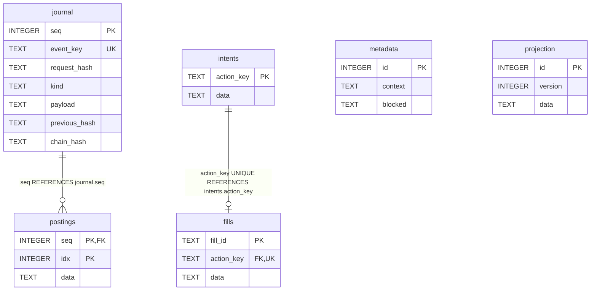
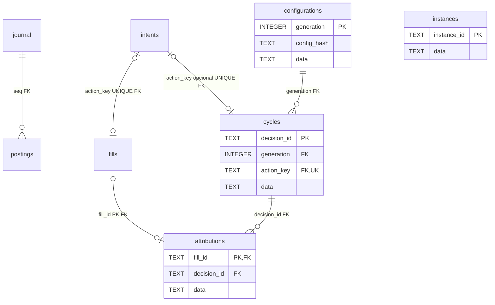

# Carteira PAPER — SQLite schemas v1 e v2

Revisão documental: 25/10/2026. **V1: origem na Sprint 03, preservada. V2 modular: implementada na Sprint 04, validada em fixtures e na demonstração local.** A inspeção v2 não audita instalações externas.  Arquivo operacional: `paper.sqlite3` dentro do diretório configurado/validado pela aplicação; não é um arquivo a versionar junto desta documentação.

Fonte do DDL: [adapter paper_sqlite.py](../../cripto-bot/src/cripto_bot/adapters/storage/paper_sqlite.py). SHA-256 do arquivo consultado: `25154d175f5cb67032a13a12608fac1f5da33eda1b786a8707142cd4e5ef02d6`. Essa identificação vincula o documento ao conteúdo, sem presumir checkout sem alterações ou versão instalada. Diagrama resume atributos; o DDL abaixo é a referência completa dos tipos, defaults, nulabilidade e constraints declarados.

## Schema v1 — diagrama relacional físico



## Dicionário e DDL efetivo

| Tabela | Finalidade |
|---|---|
| metadata | Linha singleton `id=1`: contexto imutável validado pela aplicação e motivo persistente de bloqueio |
| projection | Linha singleton `id=1`: versão da carteira e projeção JSON de saldos/posição/risco |
| journal | Evento ordenado, chave única, hash de requisição e cadeia de hashes; payload JSON |
| postings | Lançamentos por evento, com índice por sequência; conteúdo JSON balanceado por ativo pelo domínio |
| intents | Intenção/plano JSON pela identidade de ação |
| fills | Fill JSON pela identidade própria; `action_key UNIQUE` limita a no máximo um fill por intenção neste modelo integral v1 |

```sql
CREATE TABLE metadata (id INTEGER PRIMARY KEY CHECK(id=1), context TEXT NOT NULL, blocked TEXT NOT NULL);
CREATE TABLE projection (id INTEGER PRIMARY KEY CHECK(id=1), version INTEGER NOT NULL, data TEXT NOT NULL);
CREATE TABLE journal (seq INTEGER PRIMARY KEY, event_key TEXT UNIQUE NOT NULL, request_hash TEXT NOT NULL, kind TEXT NOT NULL, payload TEXT NOT NULL, previous_hash TEXT NOT NULL, chain_hash TEXT NOT NULL);
CREATE TABLE postings (seq INTEGER NOT NULL REFERENCES journal(seq), idx INTEGER NOT NULL, data TEXT NOT NULL, PRIMARY KEY(seq,idx));
CREATE TABLE intents (action_key TEXT PRIMARY KEY, data TEXT NOT NULL);
CREATE TABLE fills (fill_id TEXT PRIMARY KEY, action_key TEXT UNIQUE NOT NULL REFERENCES intents(action_key), data TEXT NOT NULL);
```

Defaults, índices adicionais e nulabilidade não devem ser inferidos pelo diagrama. O DDL não declara `DEFAULT` nem `CREATE INDEX` separado; PK/UNIQUE geram as estruturas implícitas que o SQLite aplicar. As marcações NOT NULL/CHECK explícitas estão no SQL; não acrescentar constraint inexistente à documentação.

## Representação e operação

`metadata` e `projection` possuem `CHECK(id=1)`, mas não há FK entre esses singletons. Vínculos de journal com intenções/fills/projeções além das duas FKs desenhadas são mantidos pela aplicação/reconciliação. A cardinalidade física permite um journal sem postings; a regra financeira do evento é mais específica e verificada no domínio. Não representar associação JSON como tabela/constraint SQL.

Campos `context`, `data` e `payload` persistem JSON canônico; decimais financeiros são strings. Valores contábeis, ativos, timestamps do replay e estados estão nos modelos/payloads, sem validação JSON SQL. Consultar [modelos financeiros](../../cripto-bot/src/cripto_bot/domain/portfolio/models.py) e [motor de transições](../../cripto-bot/src/cripto_bot/domain/portfolio/engine.py).

O código cria seis triggers `immutable_{journal|postings|fills}_{UPDATE|DELETE}`: cada um aborta a mutação correspondente com `immutable paper history`. Não há trigger equivalente em metadata/projection/intents. Restrições e UNIQUE não substituem validação contábil. As projeções são reconstruídas/comparadas com journal/postings para reconciliação; divergência bloqueia novos efeitos quando possível, sem ajuste por diferença.

`BEGIN IMMEDIATE`, `flock` em `.paper.lock`, `foreign_keys=ON`, `synchronous=FULL` e controle de versão protegem operações locais. O modelo usa transação de reserva/intenção e outra de fill; retomada recupera o plano persistido sem duplicar efeito. Snapshot de leitura usa abertura `mode=ro` e transação de leitura. Nenhum WAL é configurado explicitamente por este adapter. Banco separado de mercado, sem FK/transação cruzada.

## Versionamento, compatibilidade e recuperação

O adapter histórico `PaperStore` cria a base vazia com `PRAGMA user_version=1` e exige versão 1/conjunto esperado de tabelas ao reabrir. O adapter modular `StrategyStore` usa exclusivamente v2, conforme seção abaixo. **Não existe rotina de migração entre versões implementada neste adapter.** Versão incompatível é rejeitada; criação inicial não equivale a upgrade. Não alterar manualmente user_version, apagar tabelas, ledger ou triggers para contornar erro. Preservar original e diagnosticar em cópia; qualquer migração futura deve ser implementada, testada e documentada antes do uso.

| Registro | Mudança | Evidência |
|---|---|---|
| Sprint 03 | Criação do schema v1 | [Guia histórico 03](../testes/sprint-03-validacao.md) |
| 25/10/2026 | Documentação do DDL existente e diagrama | Leitura estática do fonte; nenhuma migration ou reexecução funcional |

## Inspeção e testes

Testes relacionados: [integração de persistência](../../cripto-bot/tests/integration/test_paper_storage.py). Comando planejado para revalidar em fixtures, a partir de `/home/cams7/Dev/Cripto/cripto-bot`: `uv run --locked pytest tests/integration/test_paper_storage.py -q`. **Não executado nesta revisão.** Conferir versões/dependências antes da execução; resultados históricos estão no guia da Sprint.

Na Sprint que alterar o schema, comparar DDL/diagrama com fixture via sqlite_schema e pragmas de tabelas/FKs/índices; testar constraints e fluxos alterados, compatibilidade e migração somente se implementada, além de integridade/reconciliação. Procedimento e critérios: [catálogo dos bancos](README.md). Não abrir banco operacional de escrita só para gerar diagrama. Não foram lidos dados de carteira, credenciais ou registros pessoais.


## Schema v2 — carteira modular da Sprint 04

Arquivo `paper.sqlite3` em diretório próprio configurado por `strategy.data_dir`; modelo `paper-modular-v1`. Não é o banco de mercado e não é upgrade de carteira v1. `strategy-*` rejeita v1 e `paper-*` rejeita v2, inclusive se o operador apontar o comando ao diretório errado. Não há migração automática/manual implementada entre versões; criação v2 somente em diretório novo/vazio.

Fonte: [strategy_sqlite.py](../../cripto-bot/src/cripto_bot/adapters/storage/strategy_sqlite.py), que herda o mecanismo financeiro v1 com hooks explícitos de schema/modelo/redução/serialização. O DDL de seis tabelas financeiras permanece o da seção v1, acrescido dos objetos abaixo. Os testes de regressão preservam saldos/hash histórico de v1. As novas tabelas são projeções de um único journal, sem commits financeiros em outro banco.



`instances` se relaciona logicamente com envelopes JSON de ciclos/atribuições, sem FK SQL; não inventar essa ligação física. A cardinalidade de várias atribuições por decisão é permitida pelo DDL, mas a aplicação desta Sprint admite no máximo um fill integral por intenção/proprietário. Metadados/projeção e links ao journal continuam lógicos, conforme seção v1.

### DDL adicional e dicionário

```sql
CREATE TABLE configurations (generation INTEGER PRIMARY KEY, config_hash TEXT NOT NULL, data TEXT NOT NULL);
CREATE TABLE instances (instance_id TEXT PRIMARY KEY, data TEXT NOT NULL);
CREATE TABLE cycles (decision_id TEXT PRIMARY KEY, generation INTEGER NOT NULL REFERENCES configurations(generation), action_key TEXT UNIQUE REFERENCES intents(action_key), data TEXT NOT NULL);
CREATE TABLE attributions (fill_id TEXT PRIMARY KEY REFERENCES fills(fill_id), decision_id TEXT NOT NULL REFERENCES cycles(decision_id), data TEXT NOT NULL);
```

| Tabela | Campos e significado |
|---|---|
| configurations | generation: geração inteira; config_hash: SHA-256 do snapshot canônico; data: snapshot/identificação JSON da geração |
| instances | instance_id: proprietário lógico; data: estado, época, watermark, quantidade/custo/taxas/resultado atribuídos |
| cycles | decision_id: identidade de negócio; generation: FK obrigatória; action_key: FK opcional para intenção financeira, UNIQUE; data: envelope/médias/alvo/motivos/estado |
| attributions | fill_id: PK/FK de fill; decision_id: FK obrigatória de ciclo; data: proprietário/envelope/quantidade/taxa e deltas de custo/resultado |

Não há DEFAULT nem CREATE INDEX adicional. PK/UNIQUE geram índices implícitos verificados por `index_list/index_info`. `action_key` é nullable para HOLD/não execução sem intenção. As PKs TEXT não recebem NOT NULL explícito neste DDL; a aplicação exige identidades string válidas. Não inferir constraints JSON/financeiras do diagrama.

Além dos seis triggers financeiros da v1, v2 cria quatro triggers `immutable_{configurations|attributions}_{UPDATE|DELETE}` com `RAISE(ABORT,'immutable modular history')`. Cycles/instances continuam projeções atualizáveis, comparadas integralmente à reconstrução. São dez triggers ao todo. Inserts adicionais fora do caminho normal não são autorizados pelo domínio; reconciliação detecta linhas/projeções sem origem.

### Formatos JSON, identidade e transações

`projection.data` contém `StrategyWallet`: os campos financeiros da 03 mais generation/config_hash/configuration/generations/instances/candles/day_starts/cycles/attributions/watermark/owner. Candles usam timestamps em ms e strings decimais; day_starts identifica marcação de meia-noite por instante UTC. O journal registra GENESIS, CONFIG, DAY_START, CYCLE e FILL (ou cancelamento/rejeição local testados por API).

Envelope inclui módulo/instância/versão/schema, geração/época, ambiente/modo/avaliação, carteira/par/intervalo, candle, as_of/valid_until, hash do prefixo e da observação de execução, alvo/motivo/médias/estado/limites efetivos. Intent/fill/posting e atribuição referenciam o envelope. Os valores contábeis são strings com oito casas; médias preservam representação Decimal de precisão 80 sem arredondar antes da decisão.

HOLD confirma decisão/estado/cursor sem postings. CYCLE que admite ordem grava decisão/envelope/atribuição/reserva/ledger atomicamente; FILL confirma carteira/custos/posição/ciclo em outra transação. Morte após reserva recupera o mesmo plano; nova configuração não autoriza recalcular sua execução. Cancelamento local libera uma única vez e bloqueia fill posterior. Uma geração idêntica não é recriada pelo caso de uso.

Usar `BEGIN IMMEDIATE`, flock `.paper.lock`, `foreign_keys=ON`, `synchronous=FULL` e CAS. Sem WAL configurado explicitamente. Replay integral na entrada e ao final, inclusive das projeções modulares. Entre commits do escritor exclusivo, a assinatura de versão/total_changes/data_version/schema_version e o CAS da projeção evitam reconstrução repetida por candle; qualquer escrita desconhecida invalida essa verificação. Isso não é garantia contra coordenação distribuída ou adulteração arbitrária do processo.

Abertura v2 compara os objetos SQL efetivos ao DDL/triggers esperados, além de versão/conjunto de tabelas/quick_check. Escritas de relatório ocorrem fora da transação financeira; report abre snapshot `mode=ro` e nunca corrige bloqueio ou projeção. Falha financeira/atribuição divergente bloqueia quando possível; ausência de reconstrução segura torna relatório indisponível.

### Compatibilidade, inspeção e evidências

Sem upgrade, downgrade, backfill, comando de reset ou desbloqueio. Não editar user_version, apagar triggers/tabelas ou substituir carteira para fazer o gate passar. Preservar diretório e diagnosticar em cópia. Os schemas/modelos só compartilham redução/invariantes de código, sem copiar o capital ou os lançamentos de uma carteira para outra.

Na Sprint 04 foram confrontados SQL/diagrama/dicionário e schema em fixture, com PK/FK/índices/triggers e constraints, e inspecionada a demonstração final por conexão somente leitura. Resultados completos de table_info/foreign_key_list/index_list/index_info, sqlite_schema, integrity_check e foreign_key_check constam nas [evidências 04](../testes/sprint-04-evidencias.json). Contagens finais: 76 eventos de journal, 18 postings, 71 ciclos, 1 geração/instância, 2 intenções/fills/atribuições.

Testes: [persistência modular](../../cripto-bot/tests/integration/test_strategy_storage.py) e [integração CLI](../../cripto-bot/tests/integration/test_strategy_cli.py). Comandos reproduzíveis na raiz da aplicação: `uv run --locked pytest tests/integration/test_strategy_storage.py tests/integration/test_strategy_cli.py -q`; a execução final incluiu toda a suíte. O guia registra o resultado realmente obtido, sem alterar as evidências v1 históricas.

| Sprint/data | Mudança | Migração / evidência |
|---|---|---|
| 04 / 25/10/2026 | Schema v2 modular em diretório novo, DDL v1 preservado nos comandos históricos | Sem migração; regressão, crash/replay, constraints e introspecção documentados no guia 04 |


## Revisão de compatibilidade — Sprint 06A

Fontes do bot em `src/cripto_bot`; helpers financeiros puros compartilhados vêm de `cripto_core`. DDL, tabelas/constraints/triggers, versão, transações e ownership deste store foram preservados; nenhuma migração/reset foi introduzida. Alteração da identidade do código não regrava journal/contexto selado ou concede nova amostra independente. O protocolo histórico rejeita retomada sob composição diferente; reexportação somente leitura permanece disponível. Regressões/limitações: [guia 06A](../testes/sprint-06a-validacao.md) e [ADR 0008](../decisoes/0008-core-e-identidade-da-composicao.md).
