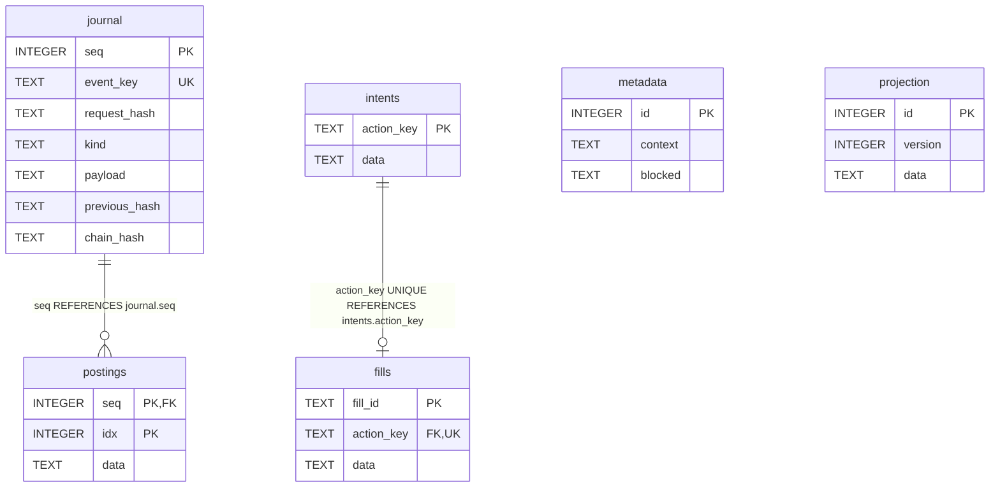

# Carteira PAPER — SQLite schema v1

Revisão documental: 25/10/2026. **Schema implementado no código; instalação/banco de dados não inspecionados nesta revisão.** Origem: Sprint 03. Arquivo operacional: `paper.sqlite3` dentro do diretório configurado/validado pela aplicação; não é um arquivo a versionar junto desta documentação.

Fonte do DDL: [adapter paper_sqlite.py](../../cripto-bot/modules/trading/src/cripto_bot/adapters/storage/paper_sqlite.py). SHA-256 do arquivo consultado: `7553602a32941fdc351cbc2e9f5bfc0ebaad58dd39efab9e429716e3b5d7a5bc`. Essa identificação vincula o documento ao conteúdo, sem presumir checkout sem alterações ou versão instalada. Diagrama resume atributos; o DDL abaixo é a referência completa dos tipos, defaults, nulabilidade e constraints declarados.

## Diagrama relacional físico



## Dicionário e DDL efetivo

| Tabela | Finalidade |
|---|---|
| metadata | Linha singleton `id=1`: contexto imutável validado pela aplicação e motivo persistente de bloqueio |
| projection | Linha singleton `id=1`: versão da carteira e projeção JSON de saldos/posição/risco |
| journal | Evento ordenado, chave única, hash de requisição e cadeia de hashes; payload JSON |
| postings | Lançamentos por evento, com índice por sequência; conteúdo JSON balanceado por ativo pelo domínio |
| intents | Intenção/plano JSON pela identidade de ação |
| fills | Fill JSON pela identidade própria; `action_key UNIQUE` limita a no máximo um fill por intenção neste modelo integral v1 |

```sql
CREATE TABLE metadata (id INTEGER PRIMARY KEY CHECK(id=1), context TEXT NOT NULL, blocked TEXT NOT NULL);
CREATE TABLE projection (id INTEGER PRIMARY KEY CHECK(id=1), version INTEGER NOT NULL, data TEXT NOT NULL);
CREATE TABLE journal (seq INTEGER PRIMARY KEY, event_key TEXT UNIQUE NOT NULL, request_hash TEXT NOT NULL, kind TEXT NOT NULL, payload TEXT NOT NULL, previous_hash TEXT NOT NULL, chain_hash TEXT NOT NULL);
CREATE TABLE postings (seq INTEGER NOT NULL REFERENCES journal(seq), idx INTEGER NOT NULL, data TEXT NOT NULL, PRIMARY KEY(seq,idx));
CREATE TABLE intents (action_key TEXT PRIMARY KEY, data TEXT NOT NULL);
CREATE TABLE fills (fill_id TEXT PRIMARY KEY, action_key TEXT UNIQUE NOT NULL REFERENCES intents(action_key), data TEXT NOT NULL);
```

Defaults, índices adicionais e nulabilidade não devem ser inferidos pelo diagrama. O DDL não declara `DEFAULT` nem `CREATE INDEX` separado; PK/UNIQUE geram as estruturas implícitas que o SQLite aplicar. As marcações NOT NULL/CHECK explícitas estão no SQL; não acrescentar constraint inexistente à documentação.

## Representação e operação

`metadata` e `projection` possuem `CHECK(id=1)`, mas não há FK entre esses singletons. Vínculos de journal com intenções/fills/projeções além das duas FKs desenhadas são mantidos pela aplicação/reconciliação. A cardinalidade física permite um journal sem postings; a regra financeira do evento é mais específica e verificada no domínio. Não representar associação JSON como tabela/constraint SQL.

Campos `context`, `data` e `payload` persistem JSON canônico; decimais financeiros são strings. Valores contábeis, ativos, timestamps do replay e estados estão nos modelos/payloads, sem validação JSON SQL. Consultar [modelos financeiros](../../cripto-bot/modules/trading/src/cripto_bot/domain/portfolio/models.py) e [motor de transições](../../cripto-bot/modules/trading/src/cripto_bot/domain/portfolio/engine.py).

O código cria seis triggers `immutable_{journal|postings|fills}_{UPDATE|DELETE}`: cada um aborta a mutação correspondente com `immutable paper history`. Não há trigger equivalente em metadata/projection/intents. Restrições e UNIQUE não substituem validação contábil. As projeções são reconstruídas/comparadas com journal/postings para reconciliação; divergência bloqueia novos efeitos quando possível, sem ajuste por diferença.

`BEGIN IMMEDIATE`, `flock` em `.paper.lock`, `foreign_keys=ON`, `synchronous=FULL` e controle de versão protegem operações locais. O modelo usa transação de reserva/intenção e outra de fill; retomada recupera o plano persistido sem duplicar efeito. Snapshot de leitura usa abertura `mode=ro` e transação de leitura. Nenhum WAL é configurado explicitamente por este adapter. Banco separado de mercado, sem FK/transação cruzada.

## Versionamento, compatibilidade e recuperação

O adapter cria a base vazia com `PRAGMA user_version=1` e exige versão 1/conjunto esperado de tabelas ao reabrir. **Não existe rotina de migração entre versões implementada neste adapter.** Versão incompatível é rejeitada; criação inicial não equivale a upgrade. Não alterar manualmente user_version, apagar tabelas, ledger ou triggers para contornar erro. Preservar original e diagnosticar em cópia; qualquer migração futura deve ser implementada, testada e documentada antes do uso.

| Registro | Mudança | Evidência |
|---|---|---|
| Sprint 03 | Criação do schema v1 | [Guia histórico 03](../testes/sprint-03-validacao.md) |
| 25/10/2026 | Documentação do DDL existente e diagrama | Leitura estática do fonte; nenhuma migration ou reexecução funcional |

## Inspeção e testes

Testes relacionados: [integração de persistência](../../cripto-bot/tests/integration/test_paper_storage.py). Comando planejado para revalidar em fixtures, a partir de `/home/cams7/Dev/Cripto/cripto-bot`: `uv run --locked pytest tests/integration/test_paper_storage.py -q`. **Não executado nesta revisão.** Conferir versões/dependências antes da execução; resultados históricos estão no guia da Sprint.

Na Sprint que alterar o schema, comparar DDL/diagrama com fixture via sqlite_schema e pragmas de tabelas/FKs/índices; testar constraints e fluxos alterados, compatibilidade e migração somente se implementada, além de integridade/reconciliação. Procedimento e critérios: [catálogo dos bancos](README.md). Não abrir banco operacional de escrita só para gerar diagrama. Não foram lidos dados de carteira, credenciais ou registros pessoais.
