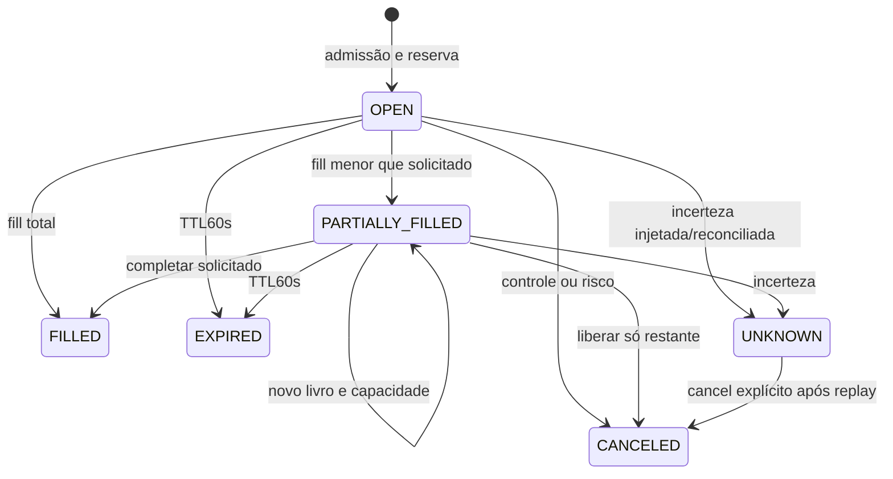

# Módulo PAPER contínuo e entrega local — implementação 06D

Implementado no `cripto-bot`, distribuição0.1.0, modelo `paper-continuous-v1`, novos bancos schema1. Python local/PAPER/Spot/BTCUSDT15m, uma SMA20/50, owner exclusivo. Este documento descreve software offline; piloto/autorização/canais e período real continuam pendentes. [API](../api/continuous.md), [ADR0011](../decisoes/0011-paper-continuous-e-entrega-local.md), [runbook](../operacao/continuous-runbook.md), [validação](../testes/sprint-06d-validacao.md).

## Componentes e fronteiras

| Local em src/cripto_bot | Responsabilidade |
|---|---|
| domain/continuous/models.py | ContinuousState, Order, constantes/cumulativos/reservas/validação estrutural |
| domain/continuous/engine.py | Reducer puro e determinístico, Decimal80, admissão/fill/controle/ciclos/partidas |
| domain/continuous/execution.py | Plano parcial por core.make_plan, steps/filtros/preço/cap/capacidade |
| adapters/continuous_config.py | Input estrito e paths/caps/escopos, configuração e destinatários locais |
| adapters/continuous_market.py | Clock/Feed/Frame, fixture explícita e composição PublicSource/SQLiteMarketStore existentes |
| application/continuous_run.py | Calendário UTC, deadlines, controles após I/O, pausas/expiração, diários e término |
| application/continuous_control.py | Inbox fsync/link exclusivo, idempotência e ack no journal |
| adapters/storage/continuous_sqlite.py | Writer/CAS/replay/projeções, outbox financeiro e manifesto |
| application/continuous_reconcile.py | Porta de replay sem reparo/transporte |
| adapters/storage/continuous_report.py | Snapshot reconciliado, métricas no bot e publicação por analytics |
| adapters/storage/notification_sqlite.py | Fila/lease/retry/confirmados/UNKNOWN e inspeção readonly |
| application/notifications.py | Importação readonly dos eventos, Sender e processo isolado de entrega |
| adapters/notifications/http.py e delivery_worker.py | Contratos locais, sem proxy/redirect, total10s e semântica de confirmação |
| entrypoints/continuous.py e cli.py | Configuração/composição/gates, comandos e JSON sanitizado |

Core fornece Decimal/precificação/filtros/sizing/SMA; Wallet e limites de admissão/risco existentes são reutilizados pelo bot. Transições integrais e stores anteriores não mudam. Analytics0.1.1 só renderiza o snapshot fornecido; não lê carteira ou decide risco. A configuração do mecanismo não cria estratégia ou flag nova.

## Modelo financeiro e estado

PREPARE grava identidade/owner/parâmetros e zero capital. ARM só ocorre após preflight válido, inicializa capital e congela regras/janela. RUNNING processa slots; PAUSED/KILLED/DRAINING conservam custódia. END não liquida posição, termina ENDED ou END_BLOCKED se houver UNKNOWN. Nenhuma transição atribui piloto aprovado.

Order guarda order_id/owner/side/requested/cap/created_at/earliest_at/expires_at/kind/state; filled/notional/fees/reserved/spent; quote_ids/book_signatures/fills/last_poll. Quantidades monetárias são Decimal com serialização canônica em strings. IDs de fill derivam da ordem/quote, da decisão pelo piloto/slot/geração. Conteúdo/ID já consumido na ordem não gera nova capacidade; somente um compromisso ativo. UNKNOWN não expira/libera automaticamente nem sob pause/kill/disable; bloqueia retomada até resolução.

Cada fill é no máximo min(restante,10% da quantidade do lado oposto), arredondado para baixo no step; preço/cap, saldo reservado, fees e filtros são novamente verificados. Sem qty/preço/notional válido pode não ocorrer fill. Não pressupõe fila/reabastecimento/execução pelo toque. BUY reserva notional+fee e acumula custo; SELL exige BTC próprio e baixa custo proporcional com arredondamento existente. Não há alavancagem, pooling ou redistribuição entre owners. A soma das partidas por ativo/evento é zero, reconciliada com saldo/reserva e cumulativos.

Capital máximo10% por entrada/exposição, perda diária≤1% e drawdown≤5%; override só reduz. Reserva participa do orçamento; parcial não abre orçamento extra. Nova entrada com inventário existente é recusada pela política atual. Pause/kill/disable cancelam o restante conhecido, mantêm custo/inventário e não inventam venda. Limites mais restritivos permanecem na identidade mesmo ao desabilitar; isso não seleciona/ativa o módulo. Resume/reload exigem flags ativas, mesmo contexto, risco permitido e nenhuma UNKNOWN, com nova geração/epoch. Owner/parâmetros/composição congelados não são trocados por reload.

## Eventos e atomicidade

Eventos financeiros reconhecidos: PREPARE, ARM, CYCLE, MISSED, ADMIT, POLL, LATE_COMMIT, METADATA, CONTROL, UNKNOWN, DAILY, END. ADMIT direto/LIMIT são portas de drill interno; operação normal admite a partir de CYCLE/SMA. Cada redução copia estado, valida relógio/invariantes e produz partidas; fonte de verdade é journal+postings. Hashes ligam payload/estado anterior/cadeia/partidas. Projeções/ordens/fills/ciclos/config/controles/eventos de notificação são confirmados juntos. DDL/constraints/dicionário/backup: [financeiro](../bancos/continuous-sqlite.md) e [fila](../bancos/notification-sqlite.md).

Controle chega por pedido durável independente do lock financeiro, com hash/contexto/piloto/request_id. ACCEPTED/PENDING não é ack; o daemon aplica antes de cliente/admissão/fill e após I/O. Requests idênticos não reaplicam, conflitantes falham. Replay completo precede operação e valida projeções; comparação de contexto é canônica para suportar tuplas convertidas em listas pelo JSON. Não resetar/reparar histórico para fazer replay passar. Manifesto derivado ausente após crash de ARM é recomposto exatamente pelo writer; manifesto divergente bloqueia.

## Dados e temporização

PublicFeed apenas compõe os quatro GETs do pacote de dados, host data-api.binance.vision e guards/retries/budgets/not_before existentes. Não relaxar filtros, ignorar regra desconhecida ou ampliar rota para tornar símbolo elegível. Recebimento local do book define freshness; market_timestamp=None é mantido. Public run requer opt-in; public prepare exige quatro wheels. Composição inválida é recusada antes de criar banco. Fixture tem relógio/observações próprios e nunca é rotulada como pública.

UTC identifica slots/dias; monotonic controla duração e detecta salto com wall clock. Preflight50 fechados correntes congela T0 futuro, próxima meia-noite com≥15min. Primeiro score reconfirma51 candles causais; não consultar futuro. Ciclos C+2…90s, quote≤5s ou override menor, metadata≤1h, sync5min com RTT/offset≤1s. Quote vem depois dos candles. Budget de aquisição é min(30s, tempo restante até C+90s); erros MarketError do pacote são normalizados em PaperError no adapter do bot para registrar MISSED/diagnóstico coerentes. Lacunas/clock/futuro/stale/erro/atraso produzem falha/MISSED; não reexecutar sinal vencido. LATE_COMMIT mantém ciclo imutável e marca invalidade separada; pausa/cancela compromisso conhecido.

Poll nominal5s, latência mínima1s, TTL60s. Expiração conhecida não depende de quote. Metadados diferentes pausam sem substituir regras congeladas, sem publicar continuamente a mesma falha sob pausa. Salto durante coleta persiste pausa antes de retornar --once. Pausa já aplicada não gera controle repetido a cada falha. Recursos/uptime/restarts reais precisam do supervisor e não são fabricados a partir de um teste.

672 slots e sete dias fixos; ≥666 válidos no prazo. Todos permanecem no denominador. Recusa legítima por risco/posição/custódia com dados válidos pode ser processada; falha sem dados não vira HOLD. DAILY e END são marcadores de estado, não comprovantes de parede ou relatórios já revisados. --once limita um passo, sem acelerar calendário real.

## Entrega e relatórios

notification_events imutáveis são derivados no mesmo commit de início/controle/dados/bloqueio/custódia/diário/término. Worker independente importa por leitura financeira reconciliada e só escreve sua fila. Claim/lease60s é durável antes de HTTP; resultado é durável depois. Crash ou timeout após POST deixa UNKNOWN/possível duplicação; não repetir negociação. Mail até3 tentativas, backoff60/300s, inclusive após recuperar segunda lease abandonada. WhatsApp consulta sessão e envia somente aberta; fallback para mail configurado. Confirmado não é reenviado. Coalescência de erro5min preserva originais; rate global1 tentativa/s. Sem promessa exactly-once ou recibo humano.

Processo de entrega separado com deadline10s, connect/pool1s, read/write≤3s (ou timeout menor WhatsApp), payload64KiB/resposta16KiB. Somente allowlist local definida na API; sem browser/QR/sessão-start-stop, AWS ou segredo de negociação. Mocks/FakeSender não comprovam disponibilidade/entrega efetiva.

Snapshot diário ou consolidado não avalia sinal/fill. Saldos/custo/fees/realizado são conhecidos pelo journal; equity/unrealized/frações atuais ficam indisponíveis sem marca fresca, mantendo última marca e métricas conhecidas separadas. Cálculo Decimal80 permanece no bot, usando money/ratio existentes; renderer somente escapa/apresenta. JSON/HTML/manifest são derivados, atômicos e não substituem banco. Estado da fila é separado com as_of próprio. Uptime/restarts/crescimento real permanecem indisponíveis até evidência do supervisor.

## Evolução e verificação

Testes unitários de engine/notifications e integração de storage/composition no bot cobrem oráculos/risco/freshness/guard/clock, crash de commits de reserva/fill e publicação de controle, duplicação/CAS/lock, UNKNOWN, fila/timeout/backoff, restore e relatórios. Smokes usam wheels e sockets bloqueados em raiz neutra; analytics testado sem bot. Fontes/artefatos/execuções e limites no guia06D, sem somar contagens sobrepostas ou atribuir fixtures a desempenho prospectivo.

Rollback pausa entradas e conserva dados/posição/inbox/fila. Release antiga continua lendo seu modelo e rejeita configuração continuous; não converter banco novo para o integral. Backup/restore só ensaiados em scratch. Pré-protocolo tem T0/Tend nulos; somente autorização/preflight reais permitem congelá-los. D-M4/D-M5 e gate07 permanecem pendentes; ausência de alternativa elegível ou de trade espontâneo é resultado permitido.
