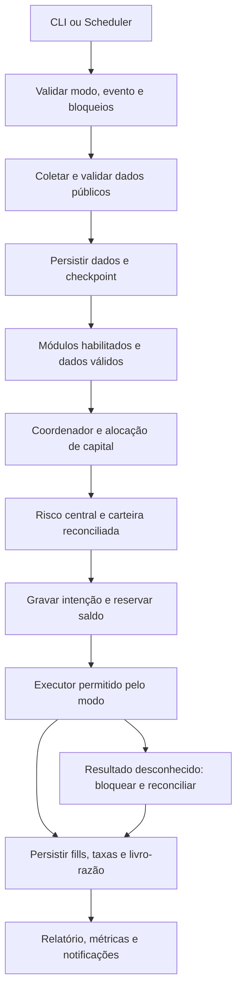
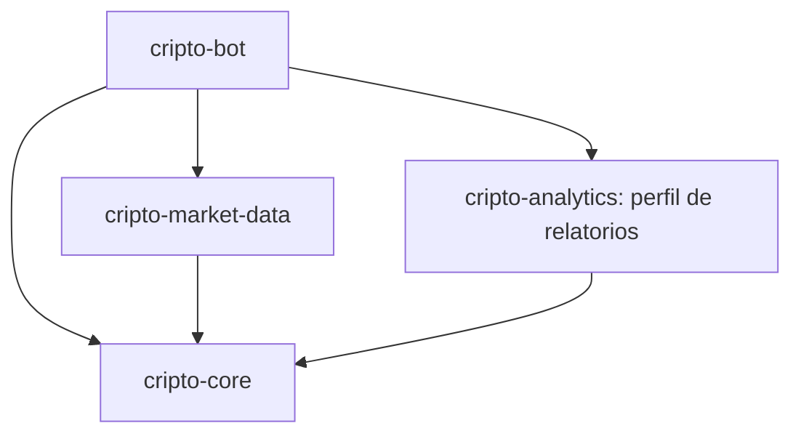

# Planejamento incremental — robô Binance Spot em Python

Data da análise: 24/10/2026. Atualização das integrações de mensagens e das etapas de validação: 25/10/2026. Revisão da organização em projetos, bibliotecas compartilhadas e evolução do backtesting: 26/10/2026. Raiz do workspace: `/home/cams7/Dev/Cripto`. Comandos da aplicação executam em `/home/cams7/Dev/Cripto/cripto-bot`, conforme a organização da seção 5.

**Estado em 24/10/2026: Sprints 01 a 03 implementadas e validadas localmente; Sprint 03 aprovada no escopo offline.** A entrega original era somente este planejamento. A implementação da Sprint 01 foi posteriormente solicitada pelo responsável; isso não autoriza provisionamento, envio de notificações ou ordens, acesso a credenciais nem alterações nos projetos de referência. Os caminhos de Sprints futuras continuam sendo propostas.

**Registro histórico do detalhamento em 24/10/2026:** Sprint 01 especificada em [docs/sprints/sprint-01.md](sprints/sprint-01.md), com contratos de configuração/CLI, entregáveis, matriz de aceite e prompt de execução. Implementação e validação permanecem pendentes. Na inspeção atual, a raiz Git é `/home/cams7/Dev/Cripto/docs`, distinta da raiz funcional prevista; a especificação registra essa condição sem alterar o repositório.

**Registro histórico da execução antes da reorganização em 24/10/2026:** pacote/CLI PAPER offline entregues; AC01–AC16 aprovados, com 79 testes, 100% de cobertura de linhas/ramificações, lint, formatação, tipagem e wheel instalado verificados. Consulte o [guia de validação](testes/sprint-01-validacao.md) e as [evidências](testes/sprint-01-evidencias.json). A raiz Git foi preservada; fontes e lock fora de `docs` ainda não são cobertos pelo repositório. A conclusão global aguarda essa decisão, sem liberação automática da Sprint 02.

**Registro histórico após a reorganização e o detalhamento da Sprint 02 (24/10/2026):** Sprint 01 com critérios técnicos aprovados e repositório da aplicação independente, agora com commit `2224caf`. A documentação consultada está no commit `a36baf9`; as referências a pendências acima registram etapas anteriores, já resolvidas. Os 14 hashes de fontes/configuração das evidências 01 conferem com o módulo atual. A [Sprint 02 — coleta pública, validação e persistência](sprints/sprint-02.md) está especificada, com implementação e validação pendentes. A criação de sua especificação não executa coleta nem autoriza implementação ou rede pública automaticamente.

**Registro histórico da execução da Sprint 02 (24/10/2026):** coleta fixture, SQLite transacional, checkpoint, exportações e adapter público implementados em `cripto-bot`. AC01–AC17 aprovados offline, com 204 testes, cobertura combinada de 98,82%, Ruff, mypy e wheel instalado verificados. Consulte o [guia 02](testes/sprint-02-validacao.md) e as [evidências](testes/sprint-02-evidencias.json). Coleta pública real NÃO EXECUTADA. Sprint 03 não iniciada; próxima ação é revisar as evidências da Sprint 02 antes de seu detalhamento.

**Registro histórico do detalhamento da Sprint 03 (24/10/2026):** evidências 02 revisadas e 24 hashes dos artefatos conferidos com a aplicação no commit `a102223`; documentação consultada no commit `552b3f2`. A [Sprint 03 — carteira PAPER, reservas e execução simulada](sprints/sprint-03.md) está especificada, com implementação e validação pendentes. O incremento será offline, no repositório existente `cripto-bot`, com banco financeiro separado e sem estratégia automática. Esta especificação não executa operações simuladas ou reais.

**Execução atual da Sprint 03 (24/10/2026):** carteira PAPER, ledger por ativo, reservas, risco persistente, execução sintética, reconciliação e relatórios implementados no módulo existente. AC01–AC18 aprovados offline: 316 testes, cobertura combinada de 98,12%, Ruff, mypy, build e wheel instalado verificados. A repetição do roteiro gerou zero fills novos e preservou o hash financeiro. Consulte o [guia 03](testes/sprint-03-validacao.md), as [evidências](testes/sprint-03-evidencias.json) e a seção 19. Próxima ação: revisar as evidências antes do detalhamento da Sprint 04.


**Revisão documental em 25/10/2026:** sequência de validação definida como backtest → `PAPER` local → `PAPER` AWS → Demo Spot (Sprint 09) → Spot Testnet complementar (Sprint 10) → preparação de LIVE (Sprint 11). As Sprints 01–03 e suas evidências históricas não comprovam essas etapas futuras. Nenhum teste externo, acesso à conta, implementação ou ativação foi autorizado por esta revisão. `LIVE` permanece bloqueado por padrão. Todos os módulos e documentos permanecem no workspace `/home/cams7/Dev/Cripto`, com Python como linguagem principal e Spot como mercado inicial.

**Execução da Sprint 04 em 25/10/2026:** base modular/flags, SMA20/50 opt-in, coordenação/risco, carteira schema v2 e relatório JSON/HTML implementados e aprovados exclusivamente em fixture local/PAPER/BTCUSDT/15m. Suíte acumulada: 428 testes, cobertura combinada 96,52%, qualidade/build/wheel aprovados. Default sem habilitados retorna NOOP; demonstração com 71 ciclos/2 fills e replay sem efeitos, inclusive com resultado negativo esperado. Documentação incremental de estratégia/banco atualizada. Ver [guia 04](testes/sprint-04-validacao.md), [evidências](testes/sprint-04-evidencias.json) e seção 20. Próximo passo: revisar evidências 04 para detalhar 05; nenhuma liberação de backtest/contínuo/privado ou execução automática da próxima Sprint.

**Decisão de planejamento em 26/10/2026:** preparar três novos projetos irmãos de `cripto-bot`: `cripto-core` (biblioteca compartilhada), `cripto-market-data` (coleta pública e dados) e `cripto-analytics` (análises e relatórios). A implementação continua concentrada em `cripto-bot` até a extração ser executada e validada. A Sprint 06 passa a ter etapas 06A–06D, descritas na seção 9.2; o PAPER contínuo sucede as três extrações. `cripto-backtest` e bibliotecas menores ficam adiados. Esta revisão altera somente o planejamento, sem criar repositórios, mover código/dados ou executar Sprints. Os registros anteriores conservam seu contexto histórico; a entrega 05 e o ajuste DuckDB/Parquet estão documentados nas seções 21–22.

**Estado atual após 06B (26/10/2026):** core e dados extraídos/integrados e validados offline; 06A/06B aprovadas, 06C implementada/validada, com reconstrução externa esclarecida e verificada. Piloto 06D e Sprint 07 pendentes. Resultados/limites nas seções 28–31.

## 1. Visão do produto e premissas

Construir um sistema pessoal e modular que colete dados, avalie estratégias explicáveis e módulos de carteira/sinais/execução independentes, simule carteira e execução, controle risco e produza evidências para decidir se uma operação real limitada é justificável. Consistência operacional e resultados líquidos ajustados ao risco serão avaliados separadamente. Não existe promessa de rentabilidade; desempenho histórico não garante desempenho futuro.

Decisões estabelecidas: Python, Linux, AWS, início em `PAPER`, Binance Spot sem margem, empréstimos, vendas a descoberto ou alavancagem. Derivativos ficam apenas no horizonte do roadmap, sujeitos a nova análise e aprovação explícita, sem componentes antecipados.

Premissas de planejamento, revisáveis mediante evidência:

- Primeiro incremento com um operador, uma carteira simulada, uma estratégia simples opt-in e um par inicial, `BTCUSDT`, condicionado à disponibilidade do símbolo. O par é um exemplo de engenharia, não recomendação de investimento.
- Candles de 15 minutos, somente fechados; um ciclo por intervalo, sem exigência de execução no segundo exato. Consulta REST síncrona; nenhum WebSocket no MVP.
- Saldo fictício inicial de `10000.00 USDT`. USDT é a moeda de cotação do experimento e pode perder paridade; não equivale a saldo em reais ou dólares garantidos.
- Execução local até a avaliação histórica. Primeiro piloto AWS sem credenciais Binance, utilizando dados públicos e executor simulado.
- Região AWS definitiva pendente de verificação de acesso permitido à Binance, elegibilidade da conta, disponibilidade e custo. Avaliar `sa-east-1`; não transplantar automaticamente a região dos projetos de referência. As tarifas de Virgínia usadas adiante são apenas uma base comparativa.
- Não é necessário decidir capital real agora. Capital, moeda de reporte fiscal, perda monetária tolerada, atendimento a incidentes e limites reais são decisões bloqueantes apenas para a etapa de operação real.

## 2. Análise das referências consultadas

### 2.1 Método e limites da inspeção

Na análise original, os seis diretórios estavam acessíveis. Foram lidos documentos, manifests, templates, workflows de CI e trechos de aplicação pertinentes. Não foram executados seus testes, aplicações, scripts de deploy ou consultas à conta AWS. Não foram lidos arquivos de credenciais, estados Terraform, perfis de navegador ou bases de produção. Uma busca de instruções encontrou permissões negadas em subdiretórios de dados MongoDB de `loto-bot`; esses dados não são necessários à análise arquitetural.

A raiz Cripto continha apenas os diretórios de metadados `.agents`, `.codex` e `.git`, sem código ou documentação de produto. Não foram encontrados arquivos `AGENTS.md` na raiz ou nos ancestrais consultados. A inspeção considera o conteúdo do checkout, que pode diferir do commit e da instalação AWS. Os hashes abaixo identificam o HEAD observado, não certificam ausência de alterações locais.

| Projeto e HEAD observado | Organização e funcionamento constatados | Reutilização proposta e limites |
|---|---|---|
| `mail-sender-aws` — `fd44378` | Python 3.12, handler nativo, schemas Pydantic, domínio/portas/caso de uso/adaptador SES v2. SAM, invocação Lambda por IAM, sem API Gateway no template; logs por sete dias; pytest com fakes. | Reaproveitar a separação das camadas e o contrato de notificação. Usar esta aplicação para e-mail no ambiente AWS, por invocação direta Lambda, seguindo o cliente do `loto-bot`; não criar adaptador SES próprio no Cripto nem alterar a função existente. |
| `gmail-reader-aws` — `d66dade` | Python 3.12, handler, serviço, repositório, configuração e autenticação separados. OAuth local versus Secrets Manager na AWS; espera limitada; SAM, CloudWatch e X-Ray declarados; CI executa pytest, validação e build SAM. | Reutilizar configuração externa, limites de espera, proteção de logs e testes isolados. Gmail e autenticação por e-mail não pertencem ao fluxo Binance; não trazer esse componente. |
| `whatsapp-notify` — `e2e8d9f` | Python, FastAPI/Uvicorn, Playwright/Chromium com perfil persistente e autenticação QR; templates EC2, API privada na integração, testes e CI. | Referência útil de processo persistente e recuperação operacional. Quando WhatsApp for habilitado, usar esta aplicação por HTTP em ambos os ambientes; manter navegador, perfil e QR Code no serviço externo. Alertas críticos precisam de canal independente. |
| `loto-bot` — `345269d` | API FastAPI, domínio/aplicação/infraestrutura, Playwright, adapters MongoDB/Beanie e DynamoDB, integrações locais/AWS. `PaymentAuthorization` bloqueia pagamento não autorizado. pytest, Ruff, cobertura e testes arquiteturais via grimp no manifest. | Reutilizar portas, relógio substituível, valor de autorização e mascaramento. Não importar automação de portal, modelos de aposta, MongoDB ou framework web. Tornar a separação de modos mais forte que um booleano. |
| `loto-scheduler-aws` — `f07a81f` | EventBridge Scheduler → Lambda Python; HTTP privado, DynamoDB para deduplicação e guard persistente, orçamento de tempo, Mail Sender para falhas. Agendamentos desabilitados por padrão; testes SAM com Moto, MockTransport, Stubber e bloqueio de sockets. Não foi encontrado `.github/workflows/ci.yml` neste checkout. | Reutilizar identidade do evento, persistência antes do efeito externo, retenção de bloqueio em incerteza, deadline e ensaio local. Não copiar a política de repetir POST de negócio após resposta incerta. |
| `loto-infra-terraform` — `5ee672c` | Terraform ≥1.10/<2 gerencia stacks CloudFormation; SAM prepara/publica artefatos; Ansible atualiza EC2 e faz recuperação. Fundação separada: rede IPv6, endpoints, bucket, contêineres de secrets, SES e tabelas. Implantação local, sem pipeline de deploy GitHub Actions. | Reutilizar separação de fundação/aplicação, artefatos identificáveis, plano antes de apply, pausa de agendamento e runbooks. Criar recursos e state próprios de Cripto; não importar stacks existentes. |

**Decisão de integração atualizada em 25/10/2026:** quando a aplicação precisar enviar mensagens, reutilizar `mail-sender` nos testes locais, `mail-sender-aws` no ambiente AWS e `whatsapp-notify` para WhatsApp nos dois ambientes. O `loto-bot` é a referência dos clientes e da composição dessas integrações, sem se tornar intermediário de execução. A releitura incluiu os clientes, configurações e contratos abaixo, sem executar serviços ou enviar mensagens.

Evidências principais, todas somente consultadas:

- [Mail Sender local](/home/cams7/Dev/LotoBot/mail-sender/README.md), [cliente de e-mail do LotoBot](/home/cams7/Dev/LotoBot/loto-bot/src/infrastructure/clients/mail_sender_client.py), [cliente WhatsApp](/home/cams7/Dev/LotoBot/loto-bot/src/infrastructure/clients/whatsapp_notify_client.py), [gateway de notificações](/home/cams7/Dev/LotoBot/loto-bot/src/infrastructure/clients/notification_gateway.py) e [configuração das integrações](/home/cams7/Dev/LotoBot/loto-bot/src/infrastructure/config/settings.py).
- [README e organização do Mail Sender](/home/cams7/Dev/LotoBot/mail-sender-aws/README.md), [template efetivo](/home/cams7/Dev/LotoBot/mail-sender-aws/template.yaml) e [schema de entrada](/home/cams7/Dev/LotoBot/mail-sender-aws/src/api/schemas.py).
- [Gmail Reader](/home/cams7/Dev/LotoBot/gmail-reader-aws/README.md), [CI](/home/cams7/Dev/LotoBot/gmail-reader-aws/.github/workflows/ci.yml) e [logging](/home/cams7/Dev/LotoBot/gmail-reader-aws/src/infra/logger.py).
- [WhatsApp Notify](/home/cams7/Dev/LotoBot/whatsapp-notify/README.md) e [dependências](/home/cams7/Dev/LotoBot/whatsapp-notify/pyproject.toml).
- [Manifest do bot](/home/cams7/Dev/LotoBot/loto-bot/pyproject.toml), [autorização de pagamento](/home/cams7/Dev/LotoBot/loto-bot/src/domain/value_objects/payment_authorization.py), [logging](/home/cams7/Dev/LotoBot/loto-bot/src/infrastructure/logging/logging_config.py) e [CI](/home/cams7/Dev/LotoBot/loto-bot/.github/workflows/ci.yml).
- [README do scheduler](/home/cams7/Dev/LotoBot/loto-scheduler-aws/README.md), [store condicional](/home/cams7/Dev/LotoBot/loto-scheduler-aws/src/loto_scheduler_aws/infrastructure/store.py), [workflow](/home/cams7/Dev/LotoBot/loto-scheduler-aws/src/loto_scheduler_aws/application/workflow.py), [handler](/home/cams7/Dev/LotoBot/loto-scheduler-aws/src/loto_scheduler_aws/handler.py) e [SAM local](/home/cams7/Dev/LotoBot/loto-scheduler-aws/docs/SAM_LOCAL.md).
- [Integração Terraform](/home/cams7/Dev/LotoBot/loto-infra-terraform/README.md), [stacks](/home/cams7/Dev/LotoBot/loto-infra-terraform/main.tf), [fundação](/home/cams7/Dev/LotoBot/loto-infra-terraform/foundation/main.tf) e [deploy Ansible](/home/cams7/Dev/LotoBot/loto-infra-terraform/ansible/deploy.yml).

### 2.2 Pontos que exigem adaptação

1. **Idempotência financeira:** o README do scheduler reconhece que repetir uma aposta pode duplicar seu efeito; um correlation ID não é chave de idempotência da operação remota. O robô deve preservar intenção e investigar qualquer resultado desconhecido antes de decidir sobre novo envio.
2. **Documentação versus template:** o README do Mail Sender ainda contém instruções de `sam local start-api`, embora o template consultado não tenha eventos HTTP. No novo projeto, cada guia deve validar o entrypoint efetivamente empacotado, por `sam local invoke` quando aplicável.
3. **Observabilidade:** há correlação e mascaramento aproveitáveis; os formatadores de Gmail e LotoBot consultados são textuais. JSON estruturado será uma melhoria explícita, não algo presumidamente pronto em todos os repositórios.
4. **Cobertura:** alguns manifests exigem 100% com exclusões. Não transportar o número como prova de confiabilidade; testar invariantes financeiras, falhas entre etapas e o artefato distribuído.
5. **Rede e execução:** EC2 e navegador são necessários ao fluxo daqueles projetos, não ao acesso REST Binance. Não replicar túnel residencial/SOCKS nem usá-lo para contornar restrições geográficas. Validar acesso legítimo antes de escolher a região.
6. **Estado e segredos:** preservar o padrão de preencher secrets fora do Terraform. Não copiar IDs de conta, ARNs, nomes de tabelas, tokens ou configuração de produção. Endpoints privados, IPv6 e políticas `prevent_destroy=false` da referência não serão defaults indiscriminados.

## 3. Requisitos

### 3.1 Funcionais

| ID | Requisito | Evidência de aceite planejada |
|---|---|---|
| RF01 | Inicializar exclusivamente em `PAPER`; rejeitar outros modos até sua Sprint | Teste de CLI/configuração, sem construir cliente privado |
| RF02 | Coletar candles fechados, regras de símbolo e preços públicos, com paginação e checkpoint | Coleta repetida sem duplicação, lacunas identificadas |
| RF03 | Persistir dados brutos, versão normalizada e origem | Reprodução por manifesto e hash |
| RF04 | Simular saldos livres/reservados, posições, taxas e fills | Livro-razão reconciliado após reinício |
| RF05 | Gerar sinais explicáveis e separar decisão de execução | Mesmos sinais para mesma entrada/versão |
| RF06 | Aplicar limites antes de cada intenção; rejeitar dados inválidos | Testes de exposição, perda, precisão e freshness |
| RF07 | Backtest cronológico com custos e período não usado no desenvolvimento | Relatório reproduzível e teste contra look-ahead |
| RF08 | Executar `PAPER` contínuo, notificar incidentes e permitir pausa | Ensaio de falha e recuperação, com serviços e contratos da seção 4.5, sem ordens externas |
| RF09 | Validar API privada em Demo Spot e Spot Testnet complementar somente após os gates | Elegibilidade confirmada, ordens virtuais, saldos e reconciliação comprovados separadamente |
| RF10 | Habilitar Spot real somente após aprovação e limites explícitos | Checklist assinado, release e configuração identificados |

### 3.2 Não funcionais

- Tipagem explícita e validação nas fronteiras; domínio independente de HTTP, boto3, relógio de parede e variáveis de ambiente.
- Valores monetários em `Decimal`, recebidos de strings; proibir conversão intermediária por `float`, NaN e infinito. Persistir strings decimais canônicas em JSON/SQLite, com escala e arredondamento definidos por operação.
- Instantes UTC com timezone; registrar horário do mercado, de recebimento e de processamento. Relógio injetável nos testes.
- Execuções repetíveis, dependências travadas, versão do código/configuração/modelo de execução/dataset registrada.
- Estado durável antes de efeitos externos, transações locais e controle de concorrência. Nenhuma promessa de exactly-once entre banco e corretora.
- Em incerteza de estado, dados ou permissão, suspender novas ordens. Falha de notificação não reexecuta negociação.
- Primeira meta `PAPER`: p95 do ciclo <60 s, timeout de aplicação 90 s e Lambda 120 s, sujeitos a medição. Eventos com atraso >120 s não negociam; registrar e recuperar dados sem executar sinais antigos.
- Para candles de 15 min, exigir o último candle esperado fechado e contínuo; não aceitar automaticamente o anterior como atual. No futuro envio real, cotação de execução com idade máxima inicial de 5 s, a validar na homologação.
- Meta do piloto AWS: ≥99% dos ciclos elegíveis concluídos em 30 dias, exclusões de manutenção declaradas. Qualquer ordem duplicada ou divergência contábil inexplicada reprova o gate, mesmo com disponibilidade alta.
- Recuperação pretendida: RPO zero para lançamentos confirmados no store transacional; efeitos remotos pendentes exigem reconciliação. RTO de 30 min para o piloto é meta a testar, não SLA. Dados públicos podem ser coletados novamente.

## 4. Arquitetura proposta

### 4.1 Monólito modular e ferramentas

Até a Sprint 05, a aplicação possui um único pacote instalável, `cripto_bot`. A evolução planejada extrai bibliotecas e aplicações com fronteiras próprias, conforme seção 4.10, mantendo chamadas Python síncronas e composição explícita. Repositório independente não exige processo remoto: `cripto-bot` pode consumir os wheels dos demais projetos no mesmo processo. Cada release de aplicação identifica as versões e hashes da composição utilizada. Registro estático e flags continuam sem exigir importar dependências dos opcionais desabilitados. Não se introduzem microsserviços, API web, filas ou processamento assíncrono apenas para separar o código.

| Escolha | Justificativa e momento |
|---|---|
| Python 3.13, patch fixado na implementação | Runtime estável suportado no Lambda/AL2023; conserva proximidade com referências 3.12 sem exigir versão preview. Validar wheels no Linux e reconsultar suporte antes do deploy. [Runtimes AWS](https://docs.aws.amazon.com/lambda/latest/dg/lambda-runtimes.html). |
| `pyproject.toml`, setuptools e wheel | Empacotamento padrão, já utilizado nas referências; o pacote usa `src` desde a 06A (antes `modules/trading/src`); cada projeto extraído terá manifest, versão, testes e wheel próprios, com `src/<pacote>/` na raiz de cada projeto, conforme seção 5. [Setuptools](https://setuptools.pypa.io/en/latest/userguide/pyproject_config.html). |
| uv com `uv.lock` versionado | Ambiente e resolução reproduzíveis; `uv sync --locked` no CI. Exportação de requirements para SAM deriva do lock, nunca é mantida separadamente. Fixar também a versão da ferramenta. [Lock e sincronização](https://docs.astral.sh/uv/concepts/projects/sync/). |
| dataclasses/Protocol/Decimal da biblioteca padrão | Objetos de domínio simples, portas testáveis e precisão sem dependências financeiras externas. |
| Pydantic nas entradas | Validar configuração, payloads e DTOs; parsers explícitos para strings decimais e UTC, evitando coerções permissivas. Não aplicar strict mode cegamente a strings de ambiente. [Validação estrita](https://docs.pydantic.dev/latest/concepts/strict_mode/). |
| HTTPX síncrono, a partir da Sprint 02 | Poucos endpoints públicos, timeouts e transporte substituível. Sem SDK comunitário amplo nem cliente de trading instalado antecipadamente. [Transportes e mocks](https://www.python-httpx.org/advanced/transports/). |
| pytest/pytest-cov, Ruff e mypy strict | Testes, cobertura de ramificações, lint/formatação e tipos são verificações complementares. Adicionar Hypothesis apenas quando invariantes contábeis justificarem testes gerativos. [pytest](https://docs.pytest.org/en/stable/), [Ruff](https://docs.astral.sh/ruff/), [mypy](https://mypy.readthedocs.io/en/stable/). |
| SQLite local; DynamoDB no piloto AWS | SQLite evita dependências de infraestrutura local. DynamoDB atende consultas conhecidas por carteira, intenção, execução e período, com escritas condicionais/transacionais; equivalência contratual precisa ser testada. |
| JSONL compactado e manifestos; DuckDB + Parquet analíticos; S3 somente na etapa AWS | Histórico bruto e relatórios fora do store financeiro. DuckDB + Parquet foram implementados após a 05; sua extração para `cripto-analytics` preservará CSV/JSON/HTML, métricas oficiais e publicação atômica. |
| boto3 apenas na etapa AWS | Empacotar versão resolvida no lock em vez de depender do SDK embutido no runtime. |

Não fixar neste planejamento versões numéricas de todas as bibliotecas sem testar compatibilidade. A Sprint que introduzir cada dependência verifica documentação, manutenção, licença e resolução com Python 3.13, registrando versões exatas no lock.

### 4.2 Limites dos módulos

| Módulo interno | Responsabilidade | Interface/limite |
|---|---|---|
| `domain/market` e `adapters/binance` | Candle, metadados, cotação, coleta e tradução de erros | `MarketDataPort`; não acessa executor |
| `domain/strategy` | Transformar histórico fechado em alvo/sinal com justificativa | Sem I/O, dinheiro movimentado ou relógio implícito |
| `domain/risk` | Avaliar proposta com carteira, limites e dados atuais | Resultado permitido/rejeitado e motivos; não envia ordem |
| `domain/portfolio` | Saldos, reservas, custo, posições, taxas e patrimônio | Atualizado por fills/lançamentos, não por sinais |
| `application` | Coordenar coleta, estratégia, risco, persistência e recuperação | Recebe portas e unidade de trabalho; decide fluxo |
| `adapters/execution` | Implementar execução `PAPER`; Demo/Testnet/real apenas depois | `ExecutionPort`; executor não muda política de risco |
| `adapters/storage` | Repositórios, atomicidade, deduplicação e checkpoints | `UnitOfWork`, `ExecutionRepository`, `MarketRepository` |
| `adapters/notifications` e `observability` | Avisos, logs, métricas e correlação | Consome eventos persistidos; falha não desfaz fill |
| `entrypoints` | CLI e, depois, handler Lambda | Valida modo e compõe somente adapters autorizados |
| `infra/` e `scripts/` | Build, instalação, deploy e runbooks | Não contêm estratégia ou credenciais |

Portas e modelos surgem quando houver uso na Sprint, sem framework de plugins ou adapters vazios para integrações futuras.

### 4.3 Fluxo de dados



O backtest troca relógio e fonte de dados e utiliza um modelo histórico de execução. `PAPER` contínuo usa preços observados após a decisão. Demo/Testnet/real consomem confirmações externas. Estratégia e risco permanecem compartilhados; não fingir que os modelos de execução são equivalentes.

Dados mínimos: `run_id`, ambiente/modo, carteira, símbolo, timeframe, candle de decisão, versão de estratégia/configuração/dados, intenção, identidade externa quando existir, estado, timestamps UTC e motivo de cada transição. Ledger registra ativo, quantidade, contrapartida, taxa e referência única do fill. Fills duplicados não geram novos lançamentos.

Na AWS, acessos previstos: carteira por ID; intenção por ID; execução por horário programado; intenções pendentes por carteira; candles/ledger por símbolo ou carteira e intervalo. DynamoDB é escolhido por esses acessos, não por escala hipotética. Relatórios extensos leem exportações. Se passarem a exigir JOINs e consultas ad hoc no store primário, reconsiderar PostgreSQL gerenciado antes de proliferar índices/Scans. [Transações DynamoDB](https://docs.aws.amazon.com/amazondynamodb/latest/developerguide/transaction-apis.html).

Atualização de reserva, versão da carteira, intenção e lançamentos precisa ser atômica. No DynamoDB, utilizar transação e condições de versão; o token de transação tem janela limitada e não substitui a deduplicação persistente de negócio. Não colocar o banco SQLite no `/tmp` da Lambda nem tratar S3 como banco transacional. Exportação para S3 é posterior ao commit e recuperável por checkpoint/outbox.

### 4.4 Computação e infraestrutura AWS

| Opção | Quando cabe | Decisão inicial |
|---|---|---|
| EventBridge Scheduler + Lambda | Ciclos curtos, independentes e REST, sem conexão persistente | Preferida para `PAPER` AWS, condicionada ao benchmark e ao acesso permitido |
| ECS/Fargate | Processo duradouro, WebSocket, reconciliação frequente, backtest pesado em lote | Reavaliar se o ciclo crescer ou se Demo/Testnet/real precisar de conexão contínua |
| EC2 com systemd/container | Necessidade de IP estável com menor custo fixo, controle do host e disponibilidade operacional do responsável | Alternativa para real; assumir patching, recuperação e risco de instância única |

Scheduler possui precisão de 60 segundos; programar após o fechamento esperado, validar candle e tolerância, sem pressupor pontualidade. Lambda de eventos tem execução limitada, portanto backfills longos são paginados em jobs ou executados localmente/em container. Backtest pesado não ocupa o handler de negociação. [Scheduler](https://docs.aws.amazon.com/scheduler/latest/UserGuide/schedule-types.html).

No piloto `PAPER`, preferir Lambda fora da VPC, sem NAT ou IP estático, enquanto não precisar acessar o `whatsapp-notify` privado, nem chaves de trading. E-mail por invocação direta de `mail-sender-aws` não exige que o robô compartilhe a VPC do serviço. Se WhatsApp privado for habilitado no piloto, revisar antes a conectividade, a saída para Binance e os custos, conforme a seção 4.5. Não supor que uma Lambda em subnet pública recebe IPv4 público. Para real, a restrição da chave por IP exige projeto de saída estável: EC2 com Elastic IP ou computação em subnets privadas com NAT de saída fixa, conforme custos e disponibilidade. IP público de task Fargate não deve ser tratado como permanente. Não reduzir segurança da chave para preservar a arquitetura barata de simulação.

Terraform será a autoridade de deploy: fundação própria com state remoto protegido e separado por ambiente; stack de aplicação gerenciada por `aws_cloudformation_stack`. SAM define Lambda, role da função, agendamento e seu papel IAM, logs e alarmes da aplicação; prepara e empacota artefatos. Terraform gerencia tabelas, buckets, estrutura de secrets e recursos de fundação, passando referências à stack. Não declarar o mesmo recurso nas duas ferramentas e não executar `sam deploy` por fora dessa autoridade. A bootstrap do backend é uma etapa explícita futura.

Agendamento começa desabilitado. Antes de atualizar: pausar novos disparos, aguardar/verificar execuções em andamento e bloqueios, salvar versão/configuração, publicar pacote imutável, testar, retomar explicitamente. Rollback de código não reverte ordens nem migrações de dados; esquema precisa manter compatibilidade ou procedimento de migração/reversão ensaiado. Ansible só entra se EC2 for escolhida. Não criar API Gateway, ALB, Step Functions ou um serviço separado de scheduler sem necessidade demonstrada.

### 4.5 Envio de mensagens por serviços existentes

A integração será implementada em `adapters/notifications`, por uma porta de notificação consumida pela aplicação. A escolha de transporte depende do ambiente de execução (`LOCAL` ou `AWS`), independentemente do modo financeiro (`PAPER`, futuramente `DEMO`, `TESTNET` ou `LIVE`). Operar em `PAPER` na AWS continua usando `mail-sender-aws`. Os caminhos abaixo identificam projetos externos existentes; não são novos módulos de Cripto nem imports de seus fontes.

| Canal e ambiente | Aplicação a utilizar | Contrato observado no `loto-bot` |
|---|---|---|
| E-mail em desenvolvimento/testes locais | `/home/cams7/Dev/LotoBot/mail-sender` | HTTP `POST {MAIL_SENDER_URL}/api/v1/mail/send` |
| E-mail no ambiente AWS | `/home/cams7/Dev/LotoBot/mail-sender-aws` | Invocação direta da função configurada em `MAIL_SENDER_FUNCTION_NAME`, com `InvocationType=RequestResponse`; sem API Gateway |
| WhatsApp local e AWS | `/home/cams7/Dev/LotoBot/whatsapp-notify` | HTTP `POST {WHATSAPP_NOTIFY_URL}/whatsapp/messages/send`, com `contact` e `message` |

**Payloads e confirmação:** os dois serviços de e-mail recebem `to`, `subject`, `body` e o campo opcional `message_type` (`HTML` para HTML; demais valores/ausência para texto simples). Na AWS, enviar esse objeto diretamente como payload JSON da invocação, sem envelope HTTP. Verificar erros do SDK, `FunctionError` e o `statusCode` devolvido pelo handler; sucesso da chamada Lambda sozinho não confirma envio. Validar também respostas HTTP e payloads inválidos. Para WhatsApp, consultar `GET /whatsapp/session/status`: o cliente de referência envia quando o status é `SESSAO_ABERTA` e reconhece sucesso de envio por `status=enviado`. Confirmação do serviço não prova recebimento ou leitura pelo destinatário.

**Configuração prevista:** seguir os nomes da referência: `INTEGRATION_MODE`, `MAIL_SENDER_URL`, `MAIL_SENDER_FUNCTION_NAME`, `MAIL_TO`, `MAIL_CONTENT_TYPE`, `WHATSAPP_NOTIFY_URL`, `WHATSAPP_ENABLED`, `WHATSAPP_CONTACT` e `WHATSAPP_TIMEOUT_SECONDS`. Região e identidade AWS serão externas à aplicação. Em `LOCAL`, usar a URL de e-mail; em `AWS`, usar o identificador/ARN da função, sem fallback silencioso para HTTP local. URLs de exemplo do cliente são `http://localhost:8002` e `http://localhost:8003`; portas efetivas devem ser configuradas conforme os serviços iniciados. Destinatários, contatos, ARNs e endpoints reais não serão copiados do LotoBot. A configuração será introduzida na Sprint correspondente, com validação dos campos necessários apenas para canais habilitados.

**Composição e falhas:** usar e-mail como canal disponível independentemente da sessão WhatsApp. Quando WhatsApp estiver habilitado, adotar o padrão da referência de consultar a sessão e recorrer ao e-mail em indisponibilidade ou falha. Persistir evento, tentativas e canal confirmado em outbox; limitar timeouts, repetição e frequência para não consumir o orçamento do ciclo. Timeout após envio pode ter resultado desconhecido: deduplicação local não garante entrega única em serviços sem chave idempotente. Registrar a incerteza e definir repetição limitada, sem repetir uma negociação por falha de mensagem. Se ambos os canais falharem, preservar a pendência e produzir log/métrica para alarme independente.

**Sessão e rede:** Playwright/Chromium, perfil persistente e autenticação QR pertencem ao `whatsapp-notify`; o robô não incorpora navegador nem inicia autenticação interativa em Lambda. A referência possui rotas de início/fim de sessão, mas o gerenciamento de uma sessão compartilhada requer runbook próprio para não interromper outros consumidores. Na AWS, configurar endereço privado e conectividade até o serviço; não expor a API para manter a Lambda fora de VPC. Caso seja necessária VPC, revisar saída para dados públicos, timeout total e orçamento antes do piloto. Autorizações e recursos de Cripto devem ser próprios, com acesso restrito à função de e-mail configurada e ao endpoint WhatsApp necessário; não alterar os projetos de referência nesta entrega.

**Momento de implementação e aceite:** Sprint 06 introduz porta, outbox e clientes HTTP locais; Sprint 07 acrescenta o transporte Lambda com testes isolados; Sprint 08 valida IAM, rede e entrega no ambiente AWS. Até essas etapas, as Sprints offline permanecem sem notificações. Testes unitários/de contrato usam fakes, HTTPX MockTransport e Stubber, sem envio real. Testes locais que efetivamente precisarem enviar e-mail usam `mail-sender`; testes AWS usam `mail-sender-aws`; todo envio WhatsApp usa `whatsapp-notify`. Ensaios de entrega são opt-in, com destinatário/contato de teste e evidência do resultado.

### 4.6 Estratégias e recursos modulares com feature flags

**Decisão documental de 25/10/2026:** iniciar na Sprint 04 com registro/contratos padronizados, configuração externa, flags, coordenação, risco centralizado e tendência SMA simples. Todos os módulos, inclusive SMA, começam desabilitados. O catálogo futuro não é implementação nem dependência obrigatória do piloto. Contratos completos, parâmetros/estado/métricas por módulo, dependências e compatibilidade Spot estão na [arquitetura modular](arquitetura-modular.md); a [matriz de validação](testes/estrategias-modulares-validacao.md) é normativa para ativação.

| Categoria | Itens e sobreposições |
|---|---|
| Estratégias de negociação | Seguimento de tendência, reversão à média, breakout, grid, arbitragem, market making e pairs; compartilham indicadores/OMS/inventário, mas têm decisões e riscos próprios |
| Gestão de carteira | DCA, rebalanceamento e momentum relativo; o último combina seleção e alocação. Podem operar isolados, sem executar duas ordens para a mesma decisão de carteira |
| Fontes de sinais | Notícias/sentimento e aprendizado de máquina alimentam consumidores nomeados; não negociam sozinhos. ML pode consumir preços sem depender de notícias |
| Algoritmos de execução | TWAP e VWAP fracionam uma intenção pai aprovada, sem gerar tese de investimento. SMA/rebalanceamento/DCA podem usá-los; apenas um por intenção pai |

Contratos `ModuleDescriptor`, `Strategy`, `PortfolioPolicy`, `SignalSource`, `Coordinator`, `RiskPolicy`, `ExecutionAlgorithm`, `ExecutionPort` e `StateStore` especificam entradas point-in-time, saídas tipadas, parâmetros/schema, estado versionado, dependências/capacidades e métricas. IDs de módulo/instância, versão e hash/geração acompanham cada sinal, pai, filho, fill e resultado. Registrar atribuições/custos por instância e reconciliar com o consolidado. Reutilizar dados/indicadores, relógio, risco, ledger, OMS, avaliação e transporte por contratos e composição Python, seguindo a extração gradual da seção 4.10; módulos não exigem microsserviços ou instalação conjunta de bibliotecas opcionais.

Flags exigem opt-in conjunto por módulo/instância, ambiente, modo, tipo de avaliação e par; ausência significa desabilitado, sem herança automática entre local/AWS ou PAPER/DEMO/TESTNET/LIVE. Configuração TOML externa validada antes de efeitos rejeita ativação não implementada, dependência ausente/cíclica, parâmetros inválidos, modo/par incompatível, orçamento sem limite e combinação não declarada. Não importar/carregar dependências opcionais desabilitadas; não aceitar nome de classe/import arbitrário vindo do arquivo. Exemplos de execução habilitada são fixtures separadas; defaults permanecem sem estratégias.

Coordenação inicial `exclusive_owner`; composições futuras explicitam subcarteiras/orçamentos segregados ou alvos ponderados, conflitos, precedência e propriedade de inventário. Alvos iguais/opostos são agregados deterministicamente antes da reserva; planos de grid/cotações/pernas exigem exclusividade ou coordenador específico. Pesos totais ≤1, saldo/reserva atômicos, um escritor por carteira e deduplicação central impedem gasto concorrente. Risco global e por estratégia/par vale em todos os caminhos, inclusive filhos TWAP/VWAP; flag não pode desabilitar risco, filtros, kill switch ou reconciliação.

Desativar bloqueia novas entradas/filhos e inicia DRAINING; política explícita mantém ou solicita cancelamento das ordens próprias, sempre monitorando/reconciliando pendências. Posições/reservas continuam contabilizadas e limitando capital; não liquidar nem transferir propriedade automaticamente. Mudanças de configuração são atômicas em fronteira de ciclo com geração/versionamento; pendências preservam configuração de origem e mudança incompatível exige drenagem/migração explícita. Reativação não repete sinais antigos.

Comparar módulos isolados e combinações autorizadas na mesma janela, dataset, capital total e custos (taxas/spread/slippage), com drawdown e métricas por instância e carteira. Aceite individual não libera combinações sem teste conjunto; falhas, conflitos, concorrência, desativação e reload têm critérios explícitos. Novo módulo/composição volta aos gates aplicáveis de backtest/PAPER/Demo/Testnet, ao gate SAM antes de publicação AWS e à aprovação real específica. Habilitar estratégia nunca autoriza LIVE.

Spot: todos os módulos limitam SELL ao inventário disponível. Arbitragem inicial é triangular na mesma Binance com risco não atômico de pernas; outras corretoras ficam futuras. Pairs inicial é rotação de inventários prefinanciados, sem neutralidade presumida; long-short clássico, grid alavancado, market making descoberto e derivativos ficam fora do escopo. O catálogo identifica restrições por módulo; nenhuma flag amplia mercado/permissões.

### 4.7 Documentação técnica incremental por módulo

**Critério obrigatório de conclusão:** na Sprint que implementar cada estratégia ou recurso modular, criar `/home/cams7/Dev/Cripto/docs/estrategias/<module_id>.md` e atualizar o [catálogo `estrategias/README.md`](estrategias/README.md). Manter um arquivo Markdown por módulo, diferenciando estratégia de negociação, gestão de carteira, fonte de sinais e algoritmo de execução. A Sprint 04 entrega `trend_sma.md`; cada incremento opcional entrega o arquivo do respectivo ID. Não criar antecipadamente documentos técnicos individuais, rascunhos detalhados ou arquivos placeholder de estratégias ainda não implementadas. Até a implementação, manter sua descrição e previsão nos documentos de planejamento; o README em `estrategias/` conserva apenas o catálogo de estado e as regras gerais de documentação.

O documento explica o módulo no contexto do código Python efetivamente entregue, para desenvolvedor com experiência DevOps e conhecimentos básicos de cripto: objetivo/conceitos; regimes de mercado e inatividade; regras de entrada/saída/manutenção ou sua adaptação ao papel; dados/indicadores/periodicidade; parâmetros, defaults e validações; interfaces/dependências/estado/fluxo; flags com exemplos isolados/conjuntos permitidos e incompatibilidades; capital/conflitos/risco/desativação; ciclo fictício com taxas e desfechos positivo/negativo; testes reproduzíveis, métricas, aceite e evidências obtidas; limitações Spot e simulado/real; links de código/testes/versão e fontes oficiais datadas. O [README do catálogo](estrategias/README.md#conteúdo-obrigatório-por-módulo) define o conteúdo detalhado e a adaptação por função, sem atribuir ordens próprias a fontes ou sinais de entrada a TWAP/VWAP.

O documento individual deve refletir o comportamento efetivamente implementado na respectiva Sprint. Evoluções ainda não entregues são identificadas brevemente como pendências e remetidas ao planejamento, sem antecipar documentação técnica detalhada. Exemplos executáveis devem corresponder ao schema/CLI e combinações disponíveis; propostas futuras devem ser rotuladas. O catálogo registra categoria, Sprint, documento, implementação parcial/concluída, versão e evidência de elegibilidade por ambiente/modo/par, sem confundir implementado com habilitado em LIVE. As regras de flags desabilitadas e aprovação real continuam obrigatórias.

Toda Sprint que alterar regras, interfaces/dependências/estado, dados/parâmetros/defaults/validações, flags/composições ou coordenação/risco atualiza o documento, catálogo, exemplos e evidências afetados antes do aceite. Registrar histórico de revisão e invalidação de evidências/aprovações quando pertinente. O guia de testes da Sprint inclui verificação documental contra código/schema/testes/artefato: conteúdo completo, links e cálculos coerentes, comandos reproduzíveis e distinção entre esperado/obtido. Documentação ausente ou desatualizada mantém a Sprint PENDENTE, mesmo com testes de código aprovados. A revisão atual cria o catálogo e o contrato de manutenção; não documenta estratégias futuras como já implementadas.

### 4.8 Documentação incremental da estrutura dos bancos

**Critério obrigatório de conclusão:** toda Sprint que criar ou alterar um banco/esquema atualiza, na mesma entrega, um documento técnico por banco em `/home/cams7/Dev/Cripto/docs/bancos/` e o [catálogo dos bancos](bancos/README.md). A regra abrange tabelas, colunas, PK/FK, nulabilidade/defaults, constraints, índices, triggers/views, relações, formatos JSON persistidos, versão, migração e políticas de acesso relevantes. Ausência/desatualização mantém a Sprint PENDENTE mesmo que testes de código passem. Sem impacto persistente, registrar essa constatação no guia da Sprint.

Para SQLite (`sqlite3` no Python), incluir diagrama relacional Mermaid ER do esquema efetivamente implementado, distinguindo FKs físicas e relações lógicas/JSON, cardinalidades e separação entre bancos. Acrescentar dicionário de dados/DDL, significado e unidades dos campos, índices/constraints, invariantes, fluxos transacionais, deduplicação, locks/pragmas, fonte de verdade/projeções, referências de código/testes e versão/hash consultados. Para outra tecnologia, adaptar ao seu modelo real: DynamoDB documentará PK/SK, tipos de item, índices e padrões de acesso, condições/transações e TTL efetivos, sem inventar relações SQL.

Cada alteração registra Sprint, versões anterior/nova e diferença; compatibilidade de dados/leitores/escritores; migração/backfill se existente; pausa, backup consistente e verificação; recuperação/rollback ou limites de reversibilidade; procedimentos reproduzíveis em fixtures/cópias autorizadas e evidências realmente obtidas. Se o código apenas rejeitar schema incompatível, documentar essa rejeição e a ausência de migração; não inventar comandos nem propor reset para esconder incompatibilidade. Testes de migração são obrigatórios quando ela for implementada, preservando integridade e reconciliação financeira.

Revisar diagrama/dicionário contra DDL e schema criado pela suíte em fixture, usando introspecção read-only quando pertinente; verificar colunas/chaves/índices/triggers, versões, constraints e fronteiras transacionais. Registrar resultado documental no guia da Sprint e vincular aos ADRs/arquitetura/módulos afetados. Não usar banco operacional de escrita para produzir documentação nem publicar dumps sensíveis. Esquemas futuros ficam no planejamento até sua implementação.

**Base documental de 25/10/2026:** [mercado SQLite v1](bancos/market-sqlite.md) e [carteira PAPER SQLite v1](bancos/paper-sqlite.md) refletem os DDLs existentes das Sprints 02 e 03. Foram consultados somente fontes, sem abrir bases de dados, executar testes/migrations ou alterar aceites históricos. Ambos rejeitam versões não suportadas e não implementam rotina de upgrade. O [catálogo](bancos/README.md) detalha conteúdo e checklist de manutenção para as próximas Sprints.

### 4.9 Relatórios para leitura humana durante os Sprints

**Orientação do responsável em 25/10/2026:** durante o desenvolvimento dos Sprints, quando necessário para compreender ou revisar simulações, testes e resultados, entregar uma versão profissional para leitura humana além dos JSONs técnicos. Preferir PDF para compartilhamento e arquivamento; HTML ou outro formato adequado também é aceito. Os JSONs e manifestos continuam como evidências estruturadas de auditoria.

Avaliar a necessidade no detalhamento e na validação de cada Sprint, especialmente quando houver operações simuladas, comparação de cenários, resultados de backtest ou decisões de avanço entre ambientes. Quando aplicável, incluir o relatório nos entregáveis e registrar seu caminho no guia de validação; quando dispensável, registrar brevemente o motivo. Não exigir um PDF por teste unitário nem gerar arquivos de apresentação para cada evento.

O relatório deve identificar Sprint, cenário, execução, período e origem dos dados; apresentar resumo do que foi processado, operações e rejeições com motivos, custos, resultado financeiro, risco e reconciliação conforme os dados disponíveis; distinguir resultados esperados dos obtidos e registrar limitações e testes não executados. Usar tabelas e gráficos quando ajudarem a interpretação, com unidades, legendas e precisão financeira coerentes. Vincular às evidências e manifestos de origem, sem inventar métricas ausentes ou tratar simulação como resultado real.

Gerar a apresentação a partir dos artefatos ou snapshots consistentes já produzidos, sem repetir operações financeiras apenas para montar o documento. Antes da entrega, conferir os valores contra as evidências e verificar visualmente a renderização, paginação, tabelas, gráficos e legibilidade. Registrar os arquivos efetivamente gerados; esta orientação não altera o aceite histórico das Sprints 01–03 nem declara PDF/HTML já implementado.

### 4.10 Projetos executáveis e biblioteca compartilhada — organização planejada

Atualização de execução 06A/06B: `cripto-core` e `cripto-market-data` foram extraídos e integrados ao bot por wheels; análise continua planejada para 06C. Resultados e limitações nas seções 26 e 28.

Distinguir três conceitos: projeto/repositório independente, biblioteca Python consumida por outro projeto e módulo de estratégia com feature flag. `trend_sma` continua sendo o módulo de estratégia implementado; uma extração de pacote não habilita outra estratégia ou modo financeiro.

| Projeto | Tipo e responsabilidade planejada | Fronteira de estado e dependências |
|---|---|---|
| `cripto-core` | Biblioteca de contratos/DTOs, precisão Decimal, arredondamentos, custos/dimensionamento e indicadores/SMA pura já utilizados | Regras puras, preferencialmente biblioteca padrão; sem HTTP, DuckDB, SQLite, credenciais, variáveis de ambiente, relógio implícito ou efeitos financeiros. Não mantém carteira persistida nem configura flags operacionais |
| `cripto-market-data` | Biblioteca e CLI de coleta pública, normalização, validação, checkpoints de mercado e exportações por manifesto | Depende de `cripto-core`; possui adapters de mercado e persistência de dados, sem ordens ou escrita no ledger financeiro. A permissão de rede continua explícita no entrypoint autorizado |
| `cripto-analytics` | Biblioteca e CLI de consultas, exportação Parquet ZSTD, catálogo DuckDB e apresentação de relatórios | Depende de `cripto-core`; recebe snapshots/fluxos reconciliados por contratos somente leitura. Não admite ordens, reserva saldo, escreve no ledger ou refaz a estratégia para produzir relatório |
| `cripto-bot` | Aplicação de negociação simulada, CLI compatível, composição, coordenação, risco operacional, carteira, executor e recuperação | Consome as bibliotecas necessárias. Continua proprietário do ledger e da atomicidade entre intenção, reserva, fill e checkpoint. O backtest permanece neste projeto inicialmente |

Dependências permitidas na primeira extração:



A seta representa dependência de código/pacote, não uma chamada de rede obrigatória. Bibliotecas não importam `cripto-bot`; dados e análises não dependem um do outro para compartilhar tipos. Adapters do bot implementam portas de leitura para a análise, evitando passar uma dependência concreta de `BacktestStore` como contrato entre projetos. A aplicação valida configuração, permissões, modo e composição antes de utilizar qualquer biblioteca.

Contratos, finanças, indicadores/estratégias e utilitários realmente compartilhados começam como subpacotes de `cripto-core`. Os projetos separados `cripto-contracts`, `cripto-finance`, `cripto-strategies`, `cripto-market` e `cripto-observability` não serão criados nesta etapa. Configuração específica, transporte, logs próprios e estado operacional continuam em seus consumidores; extrair um utilitário somente quando houver uso demonstrado. A separação futura de `cripto-backtest` depende de necessidade independente, estabilidade das interfaces e proposta específica posterior à trilha base; não integra 06A–06D.

Cada biblioteca terá API pública pequena, schemas e versão explícitos, testes próprios e dependências mínimas. Desenvolvimento local pode usar dependências editáveis explicitamente configuradas; CI, wheel e produção devem instalar artefatos identificados, sem depender de checkouts irmãos ou `PYTHONPATH`. Cada consumidor mantém seu lock e registra a matriz de versões compatíveis. O perfil local de backtest/relatórios inclui `cripto-analytics`; um runtime que não o utiliza não deve importar DuckDB ou carregar dependências analíticas por efeito de um import de domínio. A falta de uma dependência exigida pelo comando deve produzir erro claro, sem relatório incompleto apresentado como sucesso.

O protocolo experimental deve identificar também as bibliotecas extraídas: versões, hashes dos wheels e lock do consumidor; em uso editável, hashes dos fontes efetivos. Verificar essa identidade ao retomar, evitando que uma mudança em `cripto-core` fique invisível ao fingerprint do bot. Uma reorganização altera a identidade do código, sem transformar a janela final já consumida em amostra intocada. Comparações de regressão usam oráculos e fixtures isoladas; preservam dados e evidências originais, sem sobrescrever protocolo ou tentar reutilizar o teste final real com outro ID.

A extração não move dados automaticamente nem muda o modelo financeiro. Raiz de dados é uma decisão operacional explícita, não derivada do diretório em que um wheel foi instalado. Preservar paths/configurações anteriores, validação de symlinks, escritor exclusivo, schemas e checkpoints; qualquer mudança necessária exige plano de compatibilidade/migração e recuperação aprovado no detalhamento. O registro `data/backtest-usage/test-usage.sqlite3` permanece sob propriedade do bot, com o histórico existente. Não inicializar um registro vazio em outro projeto para contornar o consumo da janela final.

A documentação das bibliotecas e aplicações extraídas fica em seus READMEs/API e nas decisões/arquitetura centrais, criadas junto da implementação. A seção 4.7 continua aplicável a estratégias e políticas efetivamente afetadas; uma biblioteca de infraestrutura não recebe um documento fictício em `docs/estrategias/`. Alterações de persistência, ownership, schemas ou formatos também seguem a seção 4.8.

## 5. Estrutura de diretórios prevista

A raiz do workspace é `/home/cams7/Dev/Cripto`. **Cada novo projeto independente será criado em um diretório diretamente nessa raiz e terá controle de versão Git independente**, com seu próprio `.git`, histórico, branches e configuração de remoto. Não criar um repositório agregador na raiz nem submódulos Git sem decisão específica.

O módulo da aplicação da Sprint 01 está em `/home/cams7/Dev/Cripto/cripto-bot`, com repositório próprio inicializado na branch `main`. O repositório de documentação em `/home/cams7/Dev/Cripto/docs` permanece independente e com seu histórico preservado. Nenhum commit inicial ou remoto da aplicação foi criado nesta reorganização.

```text
/home/cams7/Dev/Cripto/              # workspace; não é um repositório Git
├── docs/                           # repositório independente da documentação
│   ├── .git/
│   ├── planejamento.md
│   ├── arquitetura.md
│   ├── decisoes/
│   ├── bancos/                       # catálogo, diagramas e schemas implementados
│   ├── estrategias/                  # catálogo; documentos junto da implementação
│   ├── sprints/
│   └── testes/
└── cripto-bot/                      # repositório independente da aplicação
    ├── .git/
    ├── README.md
    ├── pyproject.toml
    ├── uv.lock
    ├── .python-version
    ├── .gitignore
    ├── config/paper.example.toml
    ├── modules/trading/src/cripto_bot/
    │   ├── domain/
    │   ├── application/
    │   ├── adapters/
    │   ├── observability/
    │   └── entrypoints/
    └── tests/
```

O diagrama acima registra a estrutura atual até a Sprint 05. Os subpacotes internos de `cripto_bot` continuam pertencendo ao mesmo módulo e repositório até sua extração validada; não recebem Git aninhado. Um novo módulo independente, quando necessário, será irmão de `cripto-bot` e `docs`, nunca um repositório aninhado dentro deles. Criar diretórios apenas quando usados; não criar módulos futuros vazios.

Estrutura-alvo após concluir 06A–06C: bot/core foram entregues na 06A; projetos de dados/análise permanecem planejados:

```text
/home/cams7/Dev/Cripto/
├── docs/                  # documentação e evidências centrais; Git existente
├── cripto-bot/            # aplicação; Git existente
│   ├── pyproject.toml
│   ├── src/cripto_bot/
│   └── tests/
├── cripto-core/           # biblioteca compartilhada; Git independente
│   ├── pyproject.toml
│   ├── src/cripto_core/
│   └── tests/
├── cripto-market-data/    # biblioteca/CLI de dados; Git independente
│   ├── pyproject.toml
│   ├── src/cripto_market_data/
│   └── tests/
└── cripto-analytics/      # biblioteca/CLI analítica; Git independente
    ├── pyproject.toml
    ├── src/cripto_analytics/
    └── tests/
```

**Convenção proposta para os próximos incrementos:** cada projeto Python independente terá `src/` diretamente na raiz do seu repositório, ao lado de `pyproject.toml` e `tests/`, com o pacote importável dentro de `src/<pacote>/`. O próprio repositório delimita o projeto; não reproduzir `modules/<nome>/src` nos novos projetos. Estratégias e outros componentes internos continuam como subpacotes, sem exigir outro repositório ou outra árvore `src`.

Na 06A foi executada a reorganização de `cripto-bot/modules/trading/src/cripto_bot` para `cripto-bot/src/cripto_bot`, preservando o nome importável `cripto_bot` e o console script `cripto-bot`. Essa mudança foi validada antes da extração do core, com registros separados dos marcos. O caminho antigo permanece somente nas referências históricas. A alteração é de organização dos fontes; dados, bancos, configurações e relatórios conservam seus locais e identidade.

Cada novo projeto inclui testes, README, versão de pacote, lock e build próprios. Criar somente o projeto da etapa autorizada, com consumidor funcional demonstrado. Não copiar algoritmos financeiros para manter duas implementações: o consumidor passa a usar a biblioteca, podendo existir uma fachada temporária de compatibilidade que apenas delegue à fonte única. Alterar os paths de imports não concede autorização para mover bancos, apagar artefatos ou refazer a avaliação financeira.

Convenção de caminhos: `docs/...` é relativo à raiz do workspace. Caminhos da aplicação como `pyproject.toml`, `uv.lock`, `config/`, `modules/trading/src` (histórico até a 05), `src/` (vigente após 06A), `tests/` e seus artefatos são relativos a `cripto-bot/`. Para comandos Python/uv do bot, usar `/home/cams7/Dev/Cripto/cripto-bot` como diretório de execução; comandos de cada projeto extraído executam na respectiva raiz, identificada em sua especificação e README. Exemplos e prompts antigos que usavam diretamente a raiz do workspace ficam atualizados por esta convenção. Novos componentes de infraestrutura terão sua organização definida na Sprint pertinente, observando a regra de repositório independente quando constituírem um novo módulo.

Os commits de documentação e aplicação são feitos separadamente. Evidências centrais devem identificar o módulo e, quando houver commits, a revisão validada de cada repositório. Remotos e publicação serão configurados apenas quando definidos pelo responsável.

ADRs iniciais: monólito/portas, modos seguros e precisão decimal. Na etapa AWS: computação/rede, persistência e propriedade Terraform/SAM.

## 6. Negociação, estratégia e avaliação

### 6.1 Conceitos que influenciam o código

| Conceito | Consequência de implementação |
|---|---|
| Spot | Compra um ativo com saldo disponível e vende somente o que possui; reservar saldo antes da intenção |
| Candle OHLCV | Resume abertura/máxima/mínima/fechamento/volume; não revela a sequência intrabar nem garante um preço executável |
| Spread | Diferença entre melhor venda e melhor compra; compra paga ask, venda recebe bid |
| Slippage | Diferença entre referência e preço obtido; parametrizar impacto adverso, não assumir zero |
| Taxa | Pode ser cobrada em ativos diferentes; registrar ativo/quantidade original e conversão usada no relatório |
| Patrimônio | Caixa mais posições marcadas a mercado, descontadas obrigações; incluir resultado não realizado |
| Drawdown | Queda relativa ao maior patrimônio anterior; persistir o pico, sem reiniciá-lo para apagar perdas |
| Exposição | Valor das posições e compromissos de ordens dividido pelo patrimônio; limitar antes de enviar |
| Ordem a mercado/limitada | Mercado prioriza execução sem garantir preço; limitada restringe preço sem garantir execução |

### 6.2 Estratégia inicial proposta

Primeiro módulo `trend_sma`, desabilitado por padrão e habilitado explicitamente por ambiente/modo/par para cada ensaio: estratégia comprada ou em caixa por cruzamento de médias simples, SMA20/SMA50, em candles de 15 minutos. Após pelo menos 51 fechamentos válidos, comprar quando a média curta passar de menor/igual para maior que a longa; vender a posição quando passar de maior/igual para menor. Sem cruzamento, manter. Sem pirâmide, short, martingale ou compra adicional por queda. Registrar as médias, candle e motivo.

A estratégia propõe alvo/intenção ao coordenador; o risco central decide quantidade. Limites didáticos exclusivos de `PAPER`: no máximo 10% do patrimônio por entrada e de exposição total, uma posição e uma intenção pendente; perda diária de 1% do patrimônio do início do dia UTC e drawdown de 5% suspendem novas entradas. O cálculo inclui custos e posições marcadas; aportes/retiradas exigem ajuste explícito para não distorcer retorno. Saídas para reduzir risco continuam sujeitas a dados, saldo e estado confiáveis.

Esses limites descrevem o primeiro perfil SMA isolado; novos módulos exigem perfis próprios e limites globais/por instância aprovados, sem ampliar os limites por simples habilitação de flags.

Esses números são parâmetros de teste, não autorização de uso real. Não há stop intrabar na estratégia inicial, nem proteção garantida em 15 minutos. Se a operação real exigir reação mais rápida ou ordens protetoras da corretora, isso altera o escopo e deve ser especificado antes da Sprint 11.

### 6.3 Modelo de execução e custos

Backtest decide no fechamento de `t` e só admite fill em observação posterior, por exemplo abertura de `t+1`, com atraso e custos explicitados. `PAPER` contínuo usa bid/ask capturados depois do sinal. Não preencher a ordem retroativamente ao fechamento que gerou a decisão. Na ausência de cotação válida, não inventar execução.

Para o primeiro simulador, usar hipóteses configuráveis: taxa de 10 pontos-base por lado, spread total de 10 pontos-base e slippage adverso de 5 pontos-base por lado. São hipóteses sintéticas, não a tarifa da conta Binance. Um ponto-base equivale a 0,01%. No histórico com apenas preço de referência, aplicar metade do spread em cada lado; se usar bid/ask real, não cobrar spread novamente. Na futura integração privada, conferir a comissão aplicável ao símbolo/conta e tratar taxas em BNB ou outro ativo sem pressupor desconto.

Fill integral instantâneo é simplificação inicial identificada no relatório. Na Sprint 06, antes do gate Demo, exigir cenários determinísticos para ordens não executadas, atrasos, fills parciais, cancelamento, reservas, saldo insuficiente, falta de liquidez e limite de participação no volume. O ensaio deve conferir quantidades cumulativas, saldo livre/reservado e liberação somente do restante cancelado. Nos ambientes privados, repetir os cenários viáveis e identificar separadamente falhas injetadas. Não afirmar execução de limit apenas porque máxima/mínima tocou seu preço. Filtros históricos desconhecidos devem constar como limitação do backtest; filtros atuais não são prova das regras antigas.

### 6.4 Metodologia de avaliação

A metodologia abaixo é a base do protocolo da 05. Novos protocolos de comparação e seleção seguem também a seção 6.5, com walk-forward na etapa própria, sem alterar os splits ou evidências históricos.

1. Dataset versionado, origem e datas registradas; verificar duplicatas, lacunas, OHLC coerente, volume não negativo, fechamento e ordenação. Lacunas impedem decisão até completar a janela; nunca preencher silenciosamente preços.
2. Definir antes de rodar uma janela ideal de 24 meses, condicionada à qualidade/disponibilidade. Separação cronológica proposta: 60% desenvolvimento, 20% validação e 20% teste final intocado. Fixar datas reais no manifesto; janelas curtas não viram evidência forte por extrapolação.
3. Usar dados anteriores somente para aquecimento das médias; não treinar parâmetros no teste. Disponibilidade temporal das features precisa respeitar cada decisão. Teste de prefixo: adicionar candles futuros não pode mudar sinais já calculados.
4. Comparar mesma janela e capital: ficar em caixa na moeda de cotação e buy-and-hold do ativo, incluindo custos comparáveis. Explicitar risco da moeda de cotação e patrimônio final com ou sem liquidação.
5. Reportar retorno líquido, drawdown máximo, exposição média/máxima, número de trades fechados/fills, turnover, taxas, tempo em posição e rejeições. Apresentar patrimônio e resultados por subperíodo; não esconder amostra pequena com uma métrica anualizada.
6. Avaliar sensibilidade a custos dobrados, atraso de um candle, gaps e regimes de alta/baixa/lateral. Poucos parâmetros, sem busca exaustiva. Se alterar a estratégia após olhar o teste, aquele teste deixa de ser intocado e é preciso nova validação.
7. Aprovação de engenharia exige reprodutibilidade e contabilidade correta, mesmo com retorno negativo. Retorno negativo é resultado válido; pode impedir a promoção real. A hipótese de SMA deve poder ser descartada.

### 6.5 Evolução da avaliação histórica — decisão de planejamento em 26/10/2026

As sugestões abaixo são compatíveis com a arquitetura mediante evolução incremental, conforme a trilha opcional da seção 9.3. A implementação atual continua SMA/BTCUSDT/15m, capital independente por segmento/perfil e fill integral sintético; não oferece universo multiativo, carteiras combinadas, ranking seletor, Sortino ou walk-forward. A Sprint 05 não será reaberta para acrescentar esses aceites. Sua janela final real já consumida permanece registrada; reexportar, trocar pacote, ativo, estratégia, protocolo ou ID não restabelece seu caráter independente.

| Sugestão | Decisão e justificativa | Impacto e dependências |
|---|---|---|
| Comparar estratégias isoladas | **Incluir**, começando pelo mecanismo comparativo sobre SMA e referências; outras estratégias entram somente quando implementadas e elegíveis | BT-A; módulos 12/13 e demais opcionais mantêm implementação e evidências próprias |
| Combinações de sinais e carteiras de estratégias | **Incluir em etapa posterior**, com contratos e capital compartilhado explícitos; somar retornos de testes isolados não simula carteira | BT-D, após BT-B/BT-C e implementações dos componentes; não ampliar a 04/05 retroativamente |
| Diferentes moedas e pares Binance Spot | **Incluir gradualmente**, primeiro avaliações isoladas com cotação comum e universo histórico verificável | BT-B; novas capacidades de dados, precisão/filtros e avaliação por ativo; multiquote fica adiado |
| Ranking por retorno líquido, drawdown, Sortino, exposição e consistência | **Incluir** ranking descritivo em BT-A e seleção temporal em BT-E; ranking retrospectivo não é prova de superioridade futura | BT-A define métricas; BT-E exige universo/execução validados e BT-D quando houver composições |
| Seleção prévia buscando retorno sob limites de risco | **Incluir**, com regra, limites e orçamento de tentativas congelados; admitir nenhuma alternativa elegível | BT-A define protocolo; BT-E valida o processo seletor sem consultar o teste final |
| Fora da amostra, walk-forward e período final independente | **Incluir** como extensão do protocolo congelado existente; seleção e avaliação precisam de fronteiras distintas | BT-E; novos períodos reservados antes da análise, sem reutilizar a janela final da 05 como intocada |
| Taxas, spread, slippage, liquidez e parcial | **Manter** os custos atuais e **incluir** modelo histórico de liquidez/parciais após a capacidade operacional correspondente | 06D mantém seus drills; BT-C adapta ao relógio histórico; profundidade/fila realista fica adiada por falta de dados e modelo validados |
| Comprar e manter e permanecer em caixa | **Manter e ampliar** referências já existentes, com mesmas janelas, capital e moeda de reporte | BT-A/BT-B; BT-D acrescenta cesta passiva com pesos fixados quando aplicável; custos/risco próprios declarados |
| Avaliação posterior em PAPER | **Incluir** ensaio prospectivo da composição congelada; seleção gera relatório/candidatura, sem ativação operacional | BT-F depende de BT-E e das capacidades 06D; AWS exige 07/SAM e 08 aplicáveis |
| DuckDB e Parquet para históricos/análises | **Manter** a projeção já adotada no ADR 0007 e **incluir** consultas entre experimentos se medições justificarem | 06C preserva extração; BT-A/BT-B/BT-E evoluem projeções, schemas e hashes, sem substituir ledger ou fonte bruta |
| Busca exaustiva, ajuste pelo teste final e promoção automática da vencedora | **Descartar** neste escopo: contrariariam orçamento experimental, independência temporal e gates | Nenhuma Sprint autoriza selecionar no teste final, desligar risco ou habilitar LIVE por ranking |
| Multiquote, histórico de livro/fila e serviço independente de backtest | **Adiar**: exigem conversões causais, dados adicionais ou justificativa operacional ainda ausentes | Proposta posterior específica; `cripto-backtest` continua adiado, sem novo repositório nesta trilha |

**Protocolo e interpretação.** Congelar antes de calcular resultados: universo/candidatos e combinações permitidas, parâmetros/pesos, capital, modelos de custo/fill, períodos e frequência de reavaliação, benchmarks, métricas, critérios mínimos, desempates, orçamento de experimentos e condições de interrupção. Primeiro excluir violações dos limites e insuficiência de dados/amostra; depois ordenar os elegíveis por retorno líquido, usando a ordem de critérios secundários predefinida. Registrar também falhas, exclusões, variantes e tentativas anteriores, sem publicar apenas o melhor resultado. Os limites existentes não podem ser relaxados para produzir vencedor; parâmetros numéricos adicionais serão definidos no detalhamento antes dos ensaios. A saída pode ser “nenhuma alternativa atende”, mantendo caixa e sem trocar automaticamente de estratégia.

Retorno, drawdown, exposição e consistência entre subperíodos devem ser reportados por ativo/instância e carteira. Definir na implementação fórmula, frequência de retornos, alvo mínimo do Sortino, anualização e tratamento de amostra pequena ou desvio negativo zero; métrica indefinida deve ter motivo, sem infinito artificial para vencer ranking. Consistência requer critérios verificáveis previamente fixados, como dispersão e proporção de períodos que atendem aos limites, sem escolher meses favoráveis depois. Registrar concentração, correlação e custos/turnover; correlação observada no histórico não garante diversificação futura. Benchmark de exposição integral é referência com risco próprio, sem autorização para a estratégia ultrapassar seus limites.

Separar nos relatórios: (a) exploração/ranking retrospectivo e ajuste; (b) validação temporal usada na seleção, que deixa de ser independente dessa seleção; (c) trechos walk-forward avaliados após decisões baseadas apenas no passado; (d) período final reservado, executado uma vez após congelar o processo; (e) PAPER prospectivo posterior. Não agregar essas categorias como se fossem uma única evidência fora da amostra. A combinação vencedora no histórico não garante melhor desempenho futuro. Reutilizar folds observados para redesenhar o seletor transforma-os em desenvolvimento; nova evidência independente exige períodos ainda não utilizados nem conhecidos na seleção e registro da limitação de conhecimento humano, conforme ADR 0006.

No walk-forward, ajustar parâmetros, pesos, filtros, normalizações e seleção somente no passado de cada janela; avaliar no trecho seguinte e avançar com regra congelada. Reservar o período final fora de toda escolha de universo, estratégia e política de reavaliação. Fixar janelas móveis ou expansivas e intervalos de separação quando houver sobreposição de rótulos/horizontes; dados usados em aquecimento não produzem PnL antecipado. Comparações usam trechos de score equivalentes; trechos futuros não completam lacunas nem definem liquidez passada. Carteiras independentes por fold não formam uma curva investível por soma: uma simulação contínua do processo seletor exige contabilizar transições, posições, custos e capital sem reset oculto.

**Universo e execução.** BTCUSDT continua sendo o único par implementado até BT-B. Começar com lista explícita e limitada de pares Spot com cotação comum, sem margem, empréstimo, short ou alavancagem, com limites por ativo e consolidados. Registrar fonte e instante de disponibilidade das regras, filtros, listagens, deslistagens, suspensões e qualidade/liquidez dos dados; não escolher apenas moedas sobreviventes ou vencedoras atuais. Metadados atuais não comprovam elegibilidade histórica nem permissão da conta. Sem histórico confiável, limitar a conclusão ao universo condicionado explicitamente descrito, sem alegar seleção irrestrita ou ausência de viés de sobrevivência. Buracos, suspensão e saída do universo têm política congelada de bloqueio, marcação e custódia, sem preço/fill inventado. Coleta é comando público separado e autorizado; backtest permanece offline.

Taxas, spread, slippage e impacto devem ser causais, identificados por modelo/versão e cobrados uma única vez. BT-C acrescenta participação máxima em volume disponível, atrasos, ausência de fill, parciais, cancelamento e saldo reservado restante. Não usar o volume final de um candle ainda aberto para decidir o fill na sua abertura. OHLCV permite hipóteses conservadoras declaradas, não reconstrução de livro, prioridade de fila ou prova de liquidez real. Falta de dados para um modelo obrigatório impede a avaliação, sem fallback silencioso para fill integral. Comparar cenários base/adversos com custos de troca e saldo residual marcado; limite de drawdown para admissão não garante teto de perda realizada durante gaps.

**Flags, composição e posições.** Flags de estratégias continuam sendo opt-in por instância/ambiente/modo/tipo de avaliação/par, com registro estático e dependências validadas. Configurações do mecanismo de avaliação — universo, folds, métricas, ranking, custos, seed quando aplicável, limites de tentativas e modelo de execução — pertencem ao protocolo versionado, não são estratégias nem autorizações de negociação. Criar candidatura num experimento não altera flags de execução contínua; cada candidato histórico também precisa de ativação explícita para seu escopo, e seleção vazia não aciona fallback. Configuração inválida falha antes de efeitos; risco, reconciliação e kill switch permanecem obrigatórios.

BT-D distingue combinação de sinais para um consumidor nomeado de carteira com instâncias e inventários atribuídos. Aplicar as políticas previstas em arquitetura-modular.md: `exclusive_owner` até existir coordenador validado; depois `segregated_budgets` ou `weighted_targets` explicitamente escolhidos. Alvos opostos são agregados por regra determinística, com precedência de redução de risco; planos de grid/cotações/pernas exigem coordenação própria, sem composição genérica. Pesos não negativos e soma ≤1, caixa residual, limites por instância/ativo e globais, reservas atômicas e atribuição de fills/custos impedem duplicar capital ou vender inventário alheio. Não reaproveitar o capital integral de cada backtest isolado numa soma de carteiras.

Reavaliação não apaga posições, reservas, custos, pico de drawdown ou deduplicação. Desativadas ficam em DRAINING com custódia/monitoramento e orçamento consumido até resolução; transferência ou liquidação exige evento/plano auditável, filtros e permissão do modo. Testar seleção vazia, troca de composição com inventário, sinais conflitantes e dados insuficientes. O ranking sugere uma composição; sua adoção operacional requer revisão das evidências, configuração explícita e novo ensaio PAPER daquela composição.

**Fronteiras técnicas.** O motor histórico, registro de consumo final, coordenação e ledger continuam em `cripto-bot`; contratos e cálculos puros efetivamente compartilhados ficam em `cripto-core`; aquisição/qualidade em `cripto-market-data`; projeções e relatórios somente leitura em `cripto-analytics`. A aplicação orquestra seleção temporal; análise não refaz sinais nem escreve no financeiro. DuckDB/Parquet já se justificam pelas séries completas, leitura colunar e comparação de exportações; ampliar seu uso exige medir volume, memória, tempo de consulta e custo de exportação contra a base, sem promessa de acelerar o replay. Dados brutos e manifestos preservam proveniência; eventual cache histórico Parquet é derivado verificável, não substituição automática da fonte. SQLite e Decimal seguem autoritativos; rankings oficiais consomem métricas versionadas do núcleo, sem conversão financeira silenciosa para float. Publicação continua atômica e recuperável por reexportação.

Python e todos os arquivos permanecem em `/home/cams7/Dev/Cripto`, nos projetos e repositórios previstos na seção 5. Cada implementação cria/atualiza a documentação técnica do módulo efetivamente entregue e seu catálogo conforme 4.7; bibliotecas/mecanismo recebem README/API e arquitetura/ADRs pertinentes conforme 4.10. Alterações de schema/modelo requerem documentação de bancos e plano explícito de compatibilidade ou rejeição; não converter silenciosamente stores históricos para multiativo/parcial. Não criar documentos técnicos individuais de módulos futuros nesta revisão.

Referências de compatibilidade: [ADR 0005](decisoes/0005-estrategia-modular-e-persistencia.md), [ADR 0006](decisoes/0006-backtest-historico-e-protocolo.md), [ADR 0007](decisoes/0007-duckdb-parquet-analitico.md), [arquitetura modular](arquitetura-modular.md) e [evidências da 05](testes/sprint-05-validacao.md). Fontes primárias consultadas em 26/10/2026: [TimeSeriesSplit](https://scikit-learn.org/stable/modules/generated/sklearn.model_selection.TimeSeriesSplit.html), que documenta separação cronológica e gap (referência conceitual, sem adoção de scikit-learn), e [Exchange Information da Binance](https://developers.binance.info/en/docs/catalog/core-trading-spot-trading/api/rest-api/general), para regras e estado atuais dos símbolos; o uso como histórico exige proveniência adicional.

## 7. Segurança, confiabilidade e operação

### 7.1 Barreiras de modo

`mode` define onde ocorre execução (`PAPER`, futuramente `DEMO`/`TESTNET`/`LIVE`); `data_source` define dados históricos, fixture ou mercado público. Backtest é um tipo de execução offline, não um modo que permita trading externo.

Na Sprint 01, somente o literal `PAPER` é aceito. Não há implementação, importação ou dependência de executor privado. Configuração com `LIVE`, `DEMO`, `TESTNET`, símbolos de derivativos ou credenciais Binance deve falhar antes de qualquer I/O. Na Sprint 02, o cliente público expõe somente consultas GET autorizadas; não oferece método genérico de assinatura/envio. Testes bloqueiam rede por padrão e comprovam ausência de POST/DELETE de negociação.

Para Demo/Testnet/real: composição separada, lista fechada de hosts, credenciais/recursos por ambiente e validação de consistência modo-host-conta. As roles `PAPER`, `DEMO` e `TESTNET` não poderão ler o segredo real. Qualquer tentativa de operação `LIVE` sem habilitação explícita ou sem aprovação válida deve falhar antes de construir o executor real. Exigir simultaneamente gates aprovados, habilitação explícita, limites reais válidos e aprovação vigente do responsável; uma variável ou aprovação isolada não basta. Não permitir endpoint privado arbitrário em variável de ambiente nem promoção com simples troca de URL. Aprovação real deve vincular conta, release, estratégia e hash da configuração de limites, com prazo e responsável; qualquer mudança material invalida a aprovação.

### 7.2 Identidade, estados e falhas

- Chave de negócio determinística por ambiente/carteira/estratégia-versão/símbolo/timeframe/candle/ação. Separar essa chave da tentativa de transporte e de `run_id`.
- Persistir intenção e reserva antes do envio. Estados propostos: `CREATED`, `RISK_REJECTED`, `RESERVED`, `SUBMITTING`, `ACKNOWLEDGED`, `PARTIALLY_FILLED`, `FILLED`, `CANCELED`, `REJECTED`, `UNKNOWN`. Estado `UNKNOWN` bloqueia novos compromissos da carteira até resolução.
- Serializar o escritor da carteira com condição de versão e bloqueio durável; concurrency=1 na Lambda é defesa adicional, não coordenação suficiente com CLI ou outros workers. TTL não autoriza liberar uma intenção ambígua. Distinguir expiração de lease computacional de resolução do efeito financeiro.
- Para envio futuro, persistir `newClientOrderId` único antes do POST e nunca reciclá-lo para uma nova intenção. A unicidade da corretora não constitui garantia eterna de exactly-once. Consultar ordem por identidade, fills, ordens abertas e saldos antes de qualquer decisão de repetição. Uma resposta temporária de “não encontrada” não prova ausência definitiva da ordem.
- Timeouts/5xx de envio podem deixar resultado desconhecido; não executar retry automático de mutações pelo cliente HTTP. Retentativas de leituras são limitadas por deadline, com backoff/jitter. Respeitar `Retry-After`, tratar 429 e interromper diante de bloqueio 418. [Regras REST](https://developers.binance.com/en/docs/products/spot/rest-api) e [operações Spot](https://developers.binance.com/en/docs/catalog/core-trading-spot-trading/api/rest-api/trade).
- Reinício carrega checkpoints, reservas e pendências antes de aceitar eventos novos. Repetir evento confirmado devolve resultado anterior. Persistência indisponível impede negociação. Notificações usam identidade própria para evitar tempestades.

### 7.3 Filtros, credenciais e auditoria

Antes de executar, verificar status/permissão Spot do símbolo e os filtros aplicáveis de `exchangeInfo`: preço/tick, quantidade/step, quantidade de mercado, notional mínimo/máximo, restrições percentuais e limites de ordens/posição quando presentes. Metadados têm validade e versão. Quantidade arredondada para baixo deve ser revalidada quanto ao valor mínimo e à reserva de taxa; filtro desconhecido relevante bloqueia o símbolo. Não codificar casas decimais fixas. [Filtros oficiais](https://developers.binance.com/en/docs/products/spot/filters).

Chaves futuras exclusivamente com permissões necessárias, sem saque, sem margem/derivativos e com restrição de IP conforme suporte da conta. Secrets Manager para segredo; IAM por ambiente e ARN, sem chaves AWS estáticas no aplicativo. Não colocar valores secretos em tfvars/state, argumentos de CLI, logs ou artefatos de teste. Rotação exige pausa, validação e reconciliação; verificar requisitos reais da conta antes da integração.

Separar desenvolvimento, `PAPER`, Demo, Testnet e produção por configurações, nomes, roles, tabelas e buckets; preferir conta AWS de produção separada. Dados simulados nunca são migrados para saldo real. Logs JSON incluem correlação, modo, estratégia e motivos, omitindo segredos/assinaturas/headers privados. Guardar ledger/auditoria durável com acesso restrito; retenção operacional sugerida de 30 dias para logs, auditoria de 365 dias como premissa técnica, a revisar conforme obrigações aplicáveis. Não confundir log expurgável com histórico financeiro.

Métricas: atraso do candle/evento, duração, ciclos ausentes, rejeições, rate limit, intenções desconhecidas, divergência, taxa/slippage, exposição/drawdown e custo AWS. Alarmes iniciais: ausência de dois ciclos, qualquer `UNKNOWN`/divergência, falha de persistência e limite de risco. Evitar IDs únicos como dimensões de métricas. Notificações de teste são simuladas; envio externo real depende de configuração e autorização de destinatários na Sprint correspondente.

### 7.4 Interrupção e recuperação

Kill switch persistente consultado no início e imediatamente antes de enviar: bloqueia novas entradas. Pausar Scheduler impede novos disparos, mas não cancela execução em andamento. Para incidente: ativar bloqueio, pausar disparos, registrar estado, investigar ordens/saldos, cancelar pendências apenas por procedimento autorizado e reconciliar. Não liquidar tudo automaticamente como efeito colateral do botão de pausa.

Retomar exige integridade dos dados, pendências resolvidas, limites revistos, saúde da rede/credenciais e confirmação do operador registrada. Falha do serviço de controle impede novos envios. Ensaio de recuperação deve cobrir morte do processo antes/depois do POST e antes/depois do commit, além de perda da notificação.

O sistema controla admissão, quantidade solicitada, reservas e bloqueios. Não garante preço de fill, liquidez, disponibilidade da corretora, cancelamento a tempo ou perda máxima durante gaps/falhas. Um limite de drawdown dispara uma ação; não assegura que a perda realizada ficará abaixo dele.

## 8. Desenvolvimento e testes locais

O ambiente inicial precisa apenas de Python/uv. Docker e SAM entram quando houver um handler a validar; DynamoDB Local entra para contratos de persistência. Testes unitários usam fixtures, relógio fixo e rede desabilitada, sem AWS ou Binance. Marcadores separam `unit`, `integration`, `contract` e `external`; testes externos são opt-in e nunca usam capital real como requisito de CI.

| Camada | Verificação | Limitação |
|---|---|---|
| Domínio | Decimais, sinais, risco, contabilidade e estados | Não valida a corretora |
| SQLite | Reinício, rollback transacional e duplicação | Não prova comportamento DynamoDB |
| HTTPX MockTransport | Paginação, filtros, timeout, 429, dados inválidos | Não prova acesso regional/latência |
| Notificações isoladas | Payloads HTTP/Lambda, sessão fechada, timeout, resposta inválida, fallback para e-mail e recuperação da outbox sem repetir negociação | Não comprova entrega real; serviços conforme seção 4.5 |
| Moto/Stubber | Chamadas e contratos AWS simulados | Não prova IAM, rede ou entrega real |
| DynamoDB Local | Contrato de repositório e conflitos | Não prova TTL, backup, IAM, escala ou serviço real |
| SAM em container | Empacotamento/handler/runtime com dependências falsas | Não emula integralmente Scheduler, VPC, quotas ou CloudWatch |
| AWS isolada `PAPER` | IAM, Scheduler, alarmes, persistência, restore e custo | Não prova execução financeira |
| Backtest | Custos, carteira fictícia, causalidade e avaliação fora da amostra | Não comprova liquidez nem qualidade de execução real |
| PAPER com mercado real | Simular integral/parcial/atraso/sem fill, sem POST/DELETE de ordens | Não interage com matching da corretora |
| Demo Spot | Ciclo de ordens virtuais e reconciliação via API própria | Exige confirmar conta/região; não comprova resultado real |
| Spot Testnet | Integração complementar, erros e recuperação de reset | Preços/livro independentes; histórico e saldos reinicializáveis |
| POST /api/v3/order/test | Parâmetros, assinatura e janela temporal | Sem matching, fills ou negociação completa |

A Sprint AWS deve adaptar o padrão `tests/sam_local` da referência: chamar handler real com transports falsos, impedir sockets externos, verificar JSON de resultado além do exit code e separar dependências de teste do ZIP de produção. Build em container não implica teste de integração AWS aprovado.

### 8.1 Validação local obrigatória antes de publicar na AWS

**Decisão de 25/10/2026:** antes da primeira publicação da aplicação na AWS e de cada atualização posterior, exigir testes locais com **SAM CLI**, com ferramentas locais auxiliares quando necessárias. A Sprint 07 consolida esse gate antes do piloto da Sprint 08. Apenas gerar wheel, executar pytest ou obter sucesso em `sam build` não satisfaz o gate: é obrigatória a invocação local do handler empacotado com `sam local invoke`.

Sequência mínima: validar o template com `sam validate --lint`; gerar o pacote com `sam build --use-container`, usando runtime/arquitetura de destino e dependências derivadas do lock; invocar o handler real a partir do template de build com eventos/configurações sintéticos; conferir resultado funcional, logs e efeitos persistidos; executar regressões de domínio/contratos e os cenários negativos da [Sprint 07](sprints/sprint-07.md), registrando o resultado no [guia 07](testes/sprint-07-validacao.md). Os comandos concretos, caminhos e logical IDs serão fixados quando existir a implementação elegível; nenhum desses testes foi executado nesta revisão documental.

| Ferramenta local | Uso no gate |
|---|---|
| SAM CLI e Docker | Validação, build em container e invocação local do handler; versões e imagem/runtime/arquitetura registrados |
| pytest, cobertura, Ruff e mypy | Regressão, contratos, tipos e verificações já previstas; complementam a invocação SAM |
| HTTPX MockTransport, fakes e botocore Stubber/Moto | Respostas públicas/AWS/notificações controladas e falhas determinísticas, sem acessar conta AWS ou Binance privada |
| DynamoDB Local e rede Docker isolada, quando necessários | Contratos reais do adapter de persistência com serviço local, incluindo conflitos, transações, repetição e reinício |
| Serviços HTTP locais ou stubs, quando necessários | Integrações de mensagens da seção 4.5; teste padrão não envia mensagem, ensaio real é separado e opt-in |

Preparar imagens/dependências antes dos ensaios isolados; download durante preparação não equivale a acesso AWS da aplicação. Nos testes, usar somente credenciais sintéticas quando o SDK exigir, não montar perfis/segredos reais e impedir chamadas a serviços remotos. Conexões necessárias a containers auxiliares ficam limitadas à rede local de teste; `sam local invoke` sozinho não fornece esse isolamento. Como o entrypoint previsto é Lambda acionada por evento, usar `sam local invoke`; `sam local start-api` só será pertinente se um evento HTTP existir no template, sem criar API Gateway apenas para testar.

**Aceite para publicação:** 100% dos cenários obrigatórios aprovados; zero ordens externas, duplicações, divergências inexplicadas ou vazamento de segredo sintético; artefato e template identificados por hashes/revisão, sem ferramentas de teste no pacote de produção. Registrar diferenças do harness e validar também integridade/importação do pacote de produção. Mudança de código, lock, template, runtime, arquitetura ou configuração relevante exige repetir os checks afetados e o smoke SAM sobre o novo build antes de publicar. Falta de Docker/SAM ou caso não executado mantém o gate PENDENTE e bloqueia publicação; não pular para a AWS para compensar ausência do teste local.

SAM local não comprova IAM, Scheduler, VPC, quotas, entrega real ou custo da conta: esses aspectos continuam sendo validados no piloto AWS **depois** do gate local. Sua aprovação permite apenas prosseguir no fluxo de publicação já autorizado, sem liberar automaticamente deploy ou negociação. Terraform mantém a autoridade de implantação da seção 4.4; `sam deploy`, `sam sync`, `terraform apply` e upload de artefatos não fazem parte do teste local.

Fontes AWS consultadas em 25/10/2026: [validação com cfn-lint](https://docs.aws.amazon.com/serverless-application-model/latest/developerguide/validate-cfn-lint.html), [build SAM](https://docs.aws.amazon.com/serverless-application-model/latest/developerguide/using-sam-cli-build.html) e [invocação local](https://docs.aws.amazon.com/serverless-application-model/latest/developerguide/using-sam-cli-local-invoke.html).


Cada guia `docs/testes/sprint-XX-validacao.md` registrará também a revisão dos documentos de módulos criados/alterados conforme a seção 4.7, e a revisão dos documentos de bancos criados/alterados conforme a seção 4.8. Cada guia conterá preparação, versões, comandos a partir da raiz, configuração sem segredos, dados e hashes, saída esperada, falhas/diagnóstico, recursos criados, limpeza/custos, evidência realmente obtida e pendências. Falta de Docker, conta ou rede deve resultar em “não executado”, nunca “aprovado”.

## 9. Roadmap sequencial

A trilha base 01–11 depende da etapa anterior concluída e de sua evidência revisada. A Sprint 06 será entregue em 06A → 06B → 06C → 06D, conforme seção 9.2; o gate para a 07 exige todas essas etapas aprovadas. Os incrementos opcionais 12–21 seguem suas dependências explícitas de capacidade e não exigem concluir os outros opcionais nem ativar LIVE. O roadmap fixa incrementos e critérios; a especificação futura será refinada com resultados reais. Não iniciar trabalho dependente se um pré-requisito falhar. Estimativas de 2–5 dias úteis por Sprint de código são apenas capacidade orientativa; períodos de observação não podem ser comprimidos para caber nessa estimativa.

| Sprint | Incremento e caminhos previstos | Dependência e modo | Aceite/testes e evidência | Exclusões, risco e recuperação | Custo |
|---|---|---|---|---|---|
| 01 | Pacote/CLI segura, config, decimais, testes, README, arquitetura e ADRs | Este plano; `PAPER` offline | CLI instalada executa ciclo vazio; configuração perigosa falha; build/lint/tipos/testes passam; guia 01 | Sem coleta, carteira ou AWS; preservar arquivos e remover apenas artefatos regeneráveis | AWS zero |
| [02](sprints/sprint-02.md) | Coleta pública/normalização/checkpoint em `adapters/binance`, `adapters/storage`, `data/` | 01; `PAPER` | GETs públicos, candles fechados, paginação, duplicatas, gaps, 429 e timeout; guia 02 | Sem credenciais/ordens; retomar checkpoint sem preencher lacuna artificialmente | AWS zero; disco/rede local |
| [03](sprints/sprint-03.md) | Carteira, ledger, reservas, executor simulado e limites em `domain/portfolio`, `domain/risk`, `adapters/execution` | 02; `PAPER` | Compra/venda scripted em fixture, taxas e reinício; rollback e duplicação; guia 03 | Sem estratégia automática; falha contábil bloqueia e restaura snapshot de teste | AWS zero |
| [04](sprints/sprint-04.md) | Infraestrutura modular, flags, coordenação, risco central e SMA20/50 opt-in | 03; `PAPER` offline | Defaults desabilitados, configuração/contratos, isolamento, conflitos, rastreio e desativação; [guia 04](testes/sprint-04-validacao.md) | Sem demais módulos opcionais ou privados; preservar ledger e estado | AWS zero |
| [05](sprints/sprint-05.md) | Backtest, dataset/manifesto e relatórios em `application`, `reports/` | 04; `PAPER` histórico | Split temporal congelado, taxas/spread/slippage, custos dobrados, prefixo invariável, benchmarks e repetibilidade; guia 05 | Sem promoção por lucro isolado; dataset inválido exige nova coleta | AWS zero por padrão; lote AWS só se proposto depois |
| [06A–06D](sprints/sprint-06.md) | Extrair `cripto-core`, `cripto-market-data` e `cripto-analytics`, validar consumidores e depois executar o piloto `PAPER` local contínuo; detalhamento na seção 9.2 | 05 e ajuste DuckDB/Parquet revistos; 06A → 06B → 06C → 06D | Wheels/contratos/regressões por projeto; em 06D, sete dias, drills, fills parciais/atrasos/sem fill, kill switch, relatórios diários e mensagens/outbox | Não iniciar o piloto com extração pendente; preservar CLI, ledger, dados e controle de teste final; sem API web ou implantação remota | AWS zero; CPU/disco local e período de observação |
| [07](sprints/sprint-07.md) | Adapters AWS, invocação de `mail-sender-aws` e pacote SAM em `adapters/storage`, `entrypoints`, `tests/sam_local`, `infra/sam` | 06A–06D e composição multiprojeto aprovada; `PAPER` | Wheels/locks dos projetos consumidos no pacote; `sam validate --lint`, build em container, `sam local invoke`, contratos/falhas e artefato identificável; [guia 07](testes/sprint-07-validacao.md) | Sem apply; incompatibilidade mantém piloto local | AWS zero; Docker/disco |
| 08 | Piloto AWS com Terraform/SAM, observabilidade e runbooks em `infra/`, `scripts/` | 07 com gate SAM local da seção 8.1 aprovado antes de publicar e região/acesso/orçamento verificados; `PAPER` | IAM, entrega por `mail-sender-aws`, acesso ao `whatsapp-notify` quando habilitado, alarmes/restauração reais; ≥30 dias e metas da seção 3; guia 08 | Sem segredo de trading; rollback de release e Scheduler pausado | Reserva estimada US$5–15/mês; recotar região |
| [09](sprints/sprint-09.md) | Demo Spot: elegibilidade, assinatura e `order/test`, ciclo privado virtual e reconciliação | 08 e gates; `PAPER`/`DEMO`; credenciais Demo próprias | ≥14 dias, ≥20 ciclos deliberados, matriz funcional e de falhas; [guia 09](testes/sprint-09-validacao.md) | Sem produção; indisponibilidade de conta/região mantém etapa pendente e LIVE bloqueado | Infra/rede; somente fundos virtuais |
| [10](sprints/sprint-10.md) | Spot Testnet complementar: contratos, erros, reset e isolamento | 09 aprovada; `PAPER`/`TESTNET`; credenciais próprias | ≥10 ciclos deliberados, cobertura técnica e reset ensaiado; [guia 10](testes/sprint-10-validacao.md) | Preços/livro próprios; sem inferência de rentabilidade; reset invalida janela afetada | Infra/rede; somente fundos virtuais |
| [11](sprints/sprint-11.md) | Preparar release LIVE limitada e dossiê de aprovação | 10 e todas as evidências revistas, risco/rede/conta definidos | Barreiras negativas aprovadas e checklist; [guia 11](testes/sprint-11-validacao.md); execução real só por autorização posterior específica | LIVE bloqueado por padrão; nenhuma compra/venda nesta revisão ou preparação | Custo futuro de infra + taxas + capital em risco, a aprovar |

A conclusão da Sprint 11 não obriga expandir nem implementar o catálogo. A ordem opcional abaixo prioriza complexidade; as Sprints 14A/B/C e 15A/B são incrementos independentes, sem exigência de entregar todos. Podem ser escolhidos após 04–06 e capacidades indicadas, ainda em simulação, sem esperar ou liberar produção. As implementações privadas e a publicação AWS continuam sujeitas aos gates existentes.

### 9.1 Incrementos opcionais por capacidade

| Sprint | Módulo | Dependências além da base modular/avaliação 04–06 |
|---|---|---|
| 12 | Reversão à média | Estatísticas causais, posição comprada/caixa |
| 13 | Breakout | Janelas, volatilidade e confirmação causal; sem depender de 12 |
| 14A | DCA | Calendário e orçamento por período |
| 14B | Rebalanceamento | Universo multiativo e subledger; independente de 14A/C |
| 14C | Momentum relativo | Ranking point-in-time e multiativo; independente de 14B |
| 15A | TWAP | OMS pai/filho, relógio, reserva e deadline |
| 15B | VWAP | OMS pai/filho e perfil causal de volume; independente de 15A |
| 16 | Grid Trading | OMS multiordem, inventário, cancelamento e reancoragem |
| 17 | Arbitragem triangular Spot | Multiativo, cotações sincronizadas/profundidade, OMS de grupo e risco de pernas |
| 18 | Market making Spot | Feed de livro, inventário, OMS, benchmark de latência e revisão do runtime |
| 19 | Pairs com inventário Spot | Estatística multiativo e OMS de grupo; versão long-short fora do escopo |
| 20 | Notícias/sentimento | Fonte licenciada point-in-time e consumidor explícito |
| 21 | ML como fonte de sinal | Dataset/features/treino/versionamento e consumidor; notícias não obrigatórias |

Cada linha tem contrato e critérios específicos nas [Sprints opcionais](sprints/estrategias-opcionais.md) e resultados pendentes no [guia modular](testes/estrategias-modulares-validacao.md). Critério comum: 100% dos testes obrigatórios aplicáveis aprovados, isolamento e opt-in comprovados, zero duplicação/saldo negativo/bypass de risco/divergência inexplicada, custos reproduzíveis, documentação técnica individual/catálogo atualizados conforme seção 4.7 e revisão das evidências. Combinações exigem manifesto e teste conjunto da composição exata. Dados, tempo ou lucro isolados não habilitam módulos. Variantes com short, derivativos, outras corretoras, empréstimos ou alavancagem exigem nova análise e aprovação, sem implementação antecipada.

### 9.2 Etapas da Sprint 06 — extração antes de PAPER contínuo

**Estado em 26/10/2026 após a execução 06B:** 06A e 06B aprovadas no escopo offline; [06C implementada/validada](sprints/sprint-06c.md), aceite concluído conforme seção 31. 06D/gate global/07 pendentes. Ver seções 28–29 e evidências; a tabela conserva o contrato dos incrementos.

Esta distribuição é a decisão vigente de planejamento de 26/10/2026. Não renumera as Sprints 07–21 nem altera os aceites históricos 01–05. O documento [sprint-06.md](sprints/sprint-06.md) foi atualizado como agregador de 06A–06D, com o piloto concentrado em 06D. A [Sprint 06A](sprints/sprint-06a.md) foi implementada/validada; a [Sprint 06B](sprints/sprint-06b.md) está especificada e aguarda revisão antes de eventual implementação; 06C–06D continuam dependentes. A [Sprint 07](sprints/sprint-07.md) também deverá incorporar as novas dependências no seu detalhamento. Os documentos específicos de cada etapa, por exemplo `sprint-06a.md` e seu guia, surgem somente quando essa etapa for detalhada; não criar placeholders ou tratar o texto antigo como autorização para pular as extrações.

| Etapa | Incremento demonstrável e propriedade | Dependência | Critérios obrigatórios antes de avançar |
|---|---|---|---|
| **06A — `cripto-core`** | Reorganizar primeiro o bot para `src/cripto_bot/` na raiz e validar; criar biblioteca em `src/cripto_core/` e Git independente; extrair contratos, precisão/custos/dimensionamento e indicadores/SMA puros; `cripto-bot` passa a consumi-la | Revisão da 05 e da validação complementar DuckDB/Parquet; inventário de interfaces e fingerprints | Testes da biblioteca e regressões do bot; oráculos financeiros e causalidade equivalentes; CLI/defaults preservados; wheel instalado em ambiente limpo; ausência de I/O no core, ciclos de imports ou cópias divergentes de regras; identidade da dependência registrada nos novos protocolos |
| **06B — `cripto-market-data`** | Criar biblioteca/CLI em `src/cripto_market_data/` e Git independente; extrair coleta pública, normalização, validação, store/checkpoint de mercado e manifestos; manter compatibilidade do `collect-market` no bot por delegação | 06A aprovada | Mesmos contratos de dados/qualidade, continuidade, hashes e retomada; testes de rede com fakes/guards e rede real somente quando explicitamente prevista; imports do core sem dependência inversa; isolamento do ledger; tratamento dos paths anteriores e instalação por wheel verificados |
| **06C — `cripto-analytics`** | Criar biblioteca/CLI em `src/cripto_analytics/` e Git independente; extrair DuckDB/Parquet e apresentação de relatórios por contratos de snapshot/fluxos somente leitura; bot mantém seus comandos por delegação | 06B aprovada, core e contratos de dados revisados | Mesmos valores oficiais e formatos compatíveis; Parquet exato, contagens SQL coerentes e publicação atômica; vazio/parcial/completo, falhas de memória/publicação e volume real representativo; banco financeiro sem mudanças; dependências analíticas isoladas do core; medições de consulta separadas do tempo de reconciliação |
| **06D — PAPER contínuo local** | Entregar o objetivo operacional original da 06 no `cripto-bot`, consumindo as versões validadas das bibliotecas; risco, carteira, coordenação e executor continuam sob seu controle | 06A–06C aprovadas e versões da composição congeladas | Manter os critérios originais da 06: pelo menos sete dias, ≥99% dos ciclos elegíveis, fills parciais/atrasos/sem fill/cancelamento, idempotência, kill switch, retomada e mensagens/outbox; zero divergência inexplicada, ordens privadas ou bypass de risco; relatórios e runbook aprovados |

Na reorganização da 06A, revisar a descoberta de pacotes no `pyproject.toml`, comandos de tipagem/qualidade/cobertura, testes e fixtures que referenciem fontes, cálculo de fingerprints/proveniência e resolução de caminhos. Atualizar README, arquitetura, ADRs e comandos ativos para o novo layout, preservando os registros e hashes históricos. Antes de extrair o core, exigir regressões do bot, build e instalação do wheel em ambiente neutro, com CLI e imports funcionando sem `PYTHONPATH` ou dependência do caminho antigo. As etapas 06B e 06C já nascem com `src/` na raiz; a 07 deve empacotar essa composição e eliminar referências operacionais ao layout anterior.

As etapas de extração são locais, com fixtures e fontes de dados já disponíveis como base. Não exigem nova coleta de 24 meses nem repetição do teste final para provar que o código foi movido. Comparar saldos, quantidades, custos, decisões, métricas e causalidade com os oráculos da versão base; uma mudança legítima de fingerprint por reorganização não deve ser escondida para forçar igualdade do hash global do novo protocolo. Reexportações de bancos antigos precisam preservar a identidade selada e a leitura compatível; modelo/schema não suportado falha explicitamente, sem migração silenciosa.

Cada etapa registra revisões/versões de todos os projetos envolvidos, locks, hashes dos artefatos, schemas, comandos reais, resultados e limitações no guia correspondente. Rodar qualidade/testes do projeto extraído, contratos entre projetos e regressões afetadas do bot; comprovar também o pacote instalado com dependências construídas por wheel, sem `PYTHONPATH` ou checkout irmão implicitamente importável. Mantêm-se os guards de rede/credenciais e os defaults desabilitados. Não transformar o número histórico de testes em requisito fixo ou em execução nova presumida.

A versão integrada deve funcionar antes de aposentar a implementação anterior. Atualizar documentos centrais, README/configuração/CLI dos consumidores e os documentos de estratégia/banco afetados na mesma entrega. Rollback restaura a composição de versões compatíveis e preserva os dados; incompatibilidade persistida exige plano específico antes de qualquer alteração. Não remover ledger, dataset ou registro de janela final para resolver incompatibilidade de pacotes.

A 07 valida o artefato efetivamente composto com SAM local, incluindo as bibliotecas necessárias e seus hashes, com dependências de produção derivadas do lock. Não enviar caminhos editáveis locais ou dependências analíticas desnecessárias ao runtime. O piloto AWS da 08 e os gates privados 09–11 permanecem condicionados aos aceites já existentes. Os incrementos opcionais 12–21 passam a consumir os contratos/bibliotecas aprovados que utilizarem, sem obrigar a criação de outras bibliotecas ou antecipar novos módulos de estratégia.

### 9.3 Trilha opcional de evolução do backtesting

As etapas BT-A–BT-F são incrementos de Sprint opcionais, locais/PAPER, a detalhar somente quando escolhidos e com pré-requisitos comprovados. Não renumeram 07–21, não reabrem a 05 e não entram em 06A–06C como funcionalidades disfarçadas de extração. A trilha pode começar após 06D e não exige LIVE ou concluir 07–11; também não bloqueia o piloto SMA nem se torna dependência universal dos módulos 12–21. BT-B e BT-C podem ser detalhadas independentemente após BT-A; BT-D precisa de ambas. Para comparar apenas alternativas isoladas, BT-E não exige BT-D. Nenhum trabalho desta trilha foi implementado ou executado por esta revisão.

| Incremento | Escopo e dependências | Evidência de conclusão a exigir |
|---|---|---|
| **BT-A — protocolo comparativo e métricas** | Após 06A–06D e revisão da 05/ajuste analítico. Comparar SMA e referências no par atual; definir candidatos limitados, métricas/Sortino, ranking descritivo, critérios de seleção e orçamento experimental conforme 6.5. Estratégias adicionais dependem de suas entregas, sem antecipá-las | Protocolo congelado, inventário de tentativas, resultados oficiais versus projeções, benchmarks comparáveis, empate/métrica indefinida/nenhum elegível; fixtures/oráculos, regressões e wheel instalado. Relatório distingue exploração de evidência independente; não consumir nova janela final apenas para testar infraestrutura |
| **BT-B — universo Spot e multiativo** | Após BT-A. Evoluir `cripto-market-data`, contratos do core e consumidor histórico para avaliações isoladas em pares de cotação comum; implementar subledger/valoração multiativo antes de compartilhar capital | Universo point-in-time ou limitação explícita, filtros/precisão por ativo, sincronização UTC, gaps/listagem/saída e moeda comum; somas de saldos/reservas/custos reconciliadas. Rejeitar par/modelo não suportado; schemas incompatíveis preservados; sem multiquote |
| **BT-C — execução histórica com restrições** | Após BT-A e capacidade OMS/parcial/cancelamento validada em 06D. Adaptar contratos ao relógio histórico, sem importar o ciclo contínuo ou acessar rede no replay | Oráculos de taxas/spread/slippage, causalidade de volume, limites de participação, parcial/sem fill/cancelamento/atraso, reservas e reinício; custos adversos e limitações OHLCV declaradas; não supor livro/fila |
| **BT-D — sinais combinados e carteiras** | Após BT-B/BT-C e componentes escolhidos implementados/elegíveis para backtest (por exemplo 12 ou 13 para outra família de estratégia; 20/21 somente se a fonte for escolhida). Evoluir coordenador e subledgers, com política de composição previamente definida | Isolados versus composição com mesmo capital total; conflitos, pesos, risco, atribuição de fills/custos e caixa; posições antigas/DRAINING, composição vazia, troca de pesos e falha parcial; cenários completos da composição, além dos testes de pares. Sem autorização para grid/pernas/fonte ausente |
| **BT-E — seleção temporal e walk-forward** | Após BT-A/BT-B/BT-C; BT-D adicional quando houver combinações/carteiras. Congelar regra seletora, janelas, capital, limites, candidatos e orçamento; só então executar folds e período final independente | Provar seleção sem futuro por testes de prefixo/disponibilidade, registrar todas as tentativas e trechos já conhecidos, gaps adequados aos horizontes e ausência de dupla contagem temporal; reportar exploração, folds e final separadamente. Período independente indisponível mantém evidência final PENDENTE; não reciclar o teste da 05. Aceitar nenhuma alternativa, sem novo ajuste pelo final |
| **BT-F — confirmação prospectiva PAPER** | Após BT-E com evidências aplicáveis aprovadas e decisão explícita sobre a candidatura, usando capacidades 06D e escopo exato de módulos/pares/composição. Local primeiro; publicação AWS só após 07/SAM e condições 08 aplicáveis | Configuração/versões congeladas e flags próprias; duração, amostra mínima, critérios econômicos/operacionais e interrupção fixados antes do ensaio; comparar previsto/observado, custos, fills e estabilidade, com custódia de posições e nenhuma troca automática. Período/amostra insuficiente mantém conclusão pendente; aprovação não ativa DEMO/TESTNET/LIVE |

**Impacto nas Sprints existentes:** 06A–06C conservam layout/extração e fronteiras já planejados; 06D conserva piloto simples e drills, sem exigir ranking/multiativo. A 07 adapta apenas o pacote das capacidades efetivamente escolhidas e repete SAM local ao alterá-lo; 08–11 conservam seus gates por versão/configuração. As 12/13 fornecem novas estratégias quando escolhidas, sem depender universalmente da trilha BT. As 14B/14C podem reutilizar universo/subledger de BT-B; 14C também requer ranking causal disponível antes da decisão (BT-E se usar o seletor proposto), sem depender de BT-D que por sua vez exigisse 14C. As 15A/15B mantêm contratos OMS próprios; BT-C não implementa TWAP/VWAP implicitamente. As 16–19 exigem modelos de dados/execução específicos além de BT-C; 20/21 exigem disponibilidade point-in-time de fonte/treino, sem aprovação por um ranking genérico. Especificações afetadas serão revisadas no detalhamento da etapa elegível, sem criar placeholders nesta entrega.

O custo permanece CPU/disco local e aquisição de dados somente se prevista e autorizada na Sprint correspondente. Estimar quantidade de pares/candidatos/folds, volume de exportação e orçamento de tempo/memória/disco antes dos ensaios; não lançar busca combinatória ilimitada. Documentar comandos, versões/hashes de todos os projetos, compatibilidade/rollback e evidências no guia do incremento, nos termos de 4.7–4.10, 6.5 e 9.2. Aceite técnico do mecanismo pode ocorrer com fixtures, sem declarar aprovação econômica ou temporal ainda pendente.

## 10. Gates entre ambientes e modos

Os gates se aplicam à versão/configuração de cada módulo e combinação escolhida; catálogo desabilitado não é requisito do piloto SMA. Ativação de flag não concede permissão de modo. Alteração material de módulo, pesos, composição ou algoritmo invalida evidências/aprovação afetadas e exige nova validação, sem reaproveitar automaticamente o aceite do piloto anterior.

| Transição | Condições objetivas propostas |
|---|---|
| Base → coleta PAPER | Sprint 01 concluída, rede falsa nos testes, nenhuma implementação privada |
| Simulação → avaliação histórica | Ledger fecha por ativo, reservas não negativas, custos reproduzíveis e teste de duplicação/reinício aprovado |
| Backtest → PAPER contínuo | Sprint 05: dataset/split/estratégia/custos congelados antes do teste final, causalidade aprovada, ledger sem divergência e relatório fora da amostra reproduzível, incluindo custos dobrados; não exige lucro para continuar aprendendo sem capital |
| Local → AWS PAPER | Sprint 06: ≥7 dias consecutivos, ≥99% dos ciclos elegíveis, zero duplicações/divergências inexplicadas e cenários parcial/atraso/sem fill aprovados; Sprint 07: gate local completo da seção 8.1 aprovado, incluindo invocação SAM e contratos; região/acesso/orçamento definidos |
| AWS PAPER → DEMO | Sprint 08: ≥30 dias consecutivos, ≥99% dos ciclos elegíveis, zero duplicações/divergências inexplicadas, restauração/kill switch e custos comprovados; disponibilidade Demo Spot confirmada para conta e região, inclusive origem AWS; credenciais e recursos isolados |
| DEMO → Testnet complementar | Sprint 09: ≥14 dias consecutivos e ≥20 ciclos de ordem deliberados, ao menos 5 BUY e 5 SELL com fill e 5 cancelamentos de ordens abertas sem fill; 100% da matriz obrigatória aprovada; `order/test` validado; zero duplicações, UNKNOWN pendente ou divergências inexplicadas |
| Testnet complementar → preparação LIVE | Sprint 10: ≥10 ciclos deliberados, ao menos 3 BUY e 3 SELL com fill e 3 cancelamentos sem fill; 100% da matriz técnica aprovada, reset/recuperação ensaiados, zero duplicações/UNKNOWN pendente/divergência; critérios econômicos e risco aprovados; Demo não pode ser substituído silenciosamente |
| Preparação LIVE → operação real limitada | Sprint 11: todas as validações documentadas e revisadas, limites monetários/operacionais completos, conta/permissões/rede elegíveis, reconciliação inicial limpa, habilitação explícita e aprovação vigente vinculada a responsável, conta, release, estratégia, configuração e validade; exige nova autorização de execução real |
| LIVE limitado → ampliação | Nova aprovação, dados reais suficientes e análise conjunta de risco/custo/execução; nenhuma promoção automática por tempo decorrido |

Antes de liberar LIVE, registrar critérios econômicos **antes** da avaliação final: perda e drawdown tolerados, custos reais, retorno líquido fora da amostra e comparação com benchmarks compatível com a exposição. Proposta inicial: retorno líquido fora da amostra positivo no cenário-base e drawdown dentro do limite aprovado também no cenário de custos dobrados. Se os resultados forem negativos, a amostra for pequena ou a vantagem depender de um único regime, permanecer em `PAPER` e revisar; não otimizar até fazer o gate passar. O responsável precisa aprovar esses critérios e os valores monetários reais; os limites didáticos não são transferidos automaticamente.

### 10.1 Objetivos e limites das cinco abordagens

| Abordagem | Objetivo e evidência | Limitações e condição de uso |
|---|---|---|
| Backtesting (Sprint 05) | Simular compras/vendas históricas com carteira fictícia; taxas, spread, slippage, causalidade e teste cronológico fora da amostra conforme seção 6.4 | Depende de qualidade dos dados e hipóteses de fill; não mede execução real. O conjunto final não pode ser usado para ajustar a estratégia |
| PAPER (Sprints 06–08) | Consumir mercado real e simular internamente ordens, saldos e posições; conferir fills parciais, atraso, cancelamento e ausência de execução | Nenhuma ordem enviada à Binance. Não reproduz prioridade na fila, impacto ou liquidez real; tocar o preço não garante fill |
| Binance Demo Trading (Sprint 09) | Validar pela API ordens e carteira virtuais, com chaves criadas no ambiente Demo; incluir criação, consulta, execução, cancelamento, saldos e reconciliação | Confirmar disponibilidade para conta e região antes dos ensaios; dados próximos do mercado não equivalem à execução real. Disponibilidade da conta: PENDENTE, não consultada nesta revisão |
| Binance Spot Testnet (Sprint 10) | Complementar os testes técnicos de integração e recuperação | Preços e livro independentes do mercado real; ordens, histórico e saldos podem ser reinicializados. Não usar seu retorno para avaliar a estratégia |
| POST /api/v3/order/test (parte da Sprint 09) | Validar parâmetros, assinatura, timestamp/recvWindow e rejeições de solicitações | Não envia ordem ao matching, não produz fill e não valida um ciclo completo; não substitui nenhuma etapa |

Fontes oficiais consultadas em 25/10/2026: [Demo Spot e comparação com Testnet](https://developers.binance.com/en/docs/products/spot/demo-mode/general-info), [Spot Testnet e resets](https://developers.binance.com/en/docs/products/spot/testnet/general-info) e [Test new order](https://developers.binance.com/en/docs/catalog/core-trading-spot-trading/api/rest-api/trade#test-new-order-trade).

### 10.2 Isolamento, evidências e decisões de transição

Hosts REST documentados nesta revisão: Demo `https://demo-api.binance.com/api`, Testnet `https://testnet.binance.vision/api`. São referências para futura allowlist, a reconfirmar antes da implementação; não autorizam chamadas. Credenciais devem ser criadas no ambiente correspondente; nunca reutilizar chave de produção. Rejeitar host/conta/segredo incompatível, redirect e fallback para produção. Executar `order/test` inicialmente apenas em Demo/Testnet; seu uso em produção exige escopo e autorização próprios e não libera `POST /api/v3/order`.

A matriz obrigatória da Sprint 09 exige: BUY/SELL com fill confirmado e saldo reconciliado; ordem limitada aberta sem fill seguida de cancelamento; fill parcial com saldo reservado correto e cancelamento do restante; rejeição de filtros/saldo; assinatura/tempo inválidos; timeout antes/depois do efeito; reinício; deduplicação; kill switch e indisponibilidade. Ensaios parciais/erros raros podem ser injetados de forma determinística; registrar se cada evidência é simulada ou observada na API. São obrigatórios via API os fills BUY/SELL, ordem sem fill, consulta, cancelamento, saldos e reconciliação. Injeção não substitui esses ciclos externos. A Sprint 10 repete a matriz técnica e adiciona reset. Não forçar auto-negociação para obter parciais.

Cada gate registra release, hash de configuração/estratégia/dataset, datas UTC, conta identificada sem segredo, host, cenários, resultados, custos, limitações e decisão assinada/revisada pelo responsável. Ciclo deliberado inclui criação, observação do estado final e reconciliação; cancelamento não exige fill. Contagem mínima é evidência de engenharia, sem significância estatística de rentabilidade. ≥99% é a razão entre ciclos elegíveis concluídos e previstos, excluindo apenas manutenção previamente registrada; não excluir falhas para atingir a meta. Reset ou mudança material inicia nova janela de evidência afetada e não transforma perda de histórico em lucro/prejuízo.

Qualquer cenário obrigatório não executado mantém seu gate PENDENTE. Demo indisponível para conta/região mantém LIVE bloqueado e a aplicação em PAPER; eventual alternativa exige nova decisão documental e aprovação explícita, sem contornar restrições regionais. A próxima Sprint de implementação continua sendo a 04 (base modular/flags/risco e SMA opt-in), após revisão das evidências 03; estes documentos futuros são contratos de validação, sem autorização de implementação antecipada.

Resultados positivos em backtest, PAPER, Demo ou Testnet não garantem rentabilidade nem qualidade de execução em produção. Aprovação de engenharia e avaliação econômica são requisitos separados; nenhuma métrica, prazo ou saldo virtual promove o sistema automaticamente.

## 11. Custos, riscos e decisões pendentes

### 11.1 Estimativa AWS

Estimativa de planejamento em USD, sem impostos, câmbio, trabalho humano, taxas de negociação ou perdas. Não pressupõe Free Tier/créditos, recursos compartilhados gratuitos ou preços iguais entre regiões. Não foi consultada a fatura da conta. O piloto exige recotação regional antes do apply.

Carga-base: um ciclo de 15 min, 30 dias = 2.880 invocações; Lambda x86 de 512 MiB, 10 s em média. Com tarifas ilustrativas publicadas de US$0,0000166667/GB-s e US$0,20/milhão de requests, custo calculado de **US$0,2406/mês**; a 60 s, **US$1,4406/mês**. Cálculo: `2880 × 0,5 × duração × tarifa + 2880 × 0,20 / 1000000`. [Preço Lambda](https://aws.amazon.com/lambda/pricing/).

| Item | Premissa de uso | Provisão de orçamento mensal, não cotação regional |
|---|---|---|
| Lambda | 512 MiB, 10–60 s/ciclo | US$0,24–1,44 calculados acima |
| Scheduler | 2.880 disparos/mês | Reservar até US$0,10; conferir franquia/tarifa |
| DynamoDB | Até 1 GB, ~100 mil operações pequenas/mês; transações, backups e leituras consistentes contam separadamente | Reservar US$1–3 |
| S3 | Até 5 GB, até 10 mil PUT e 10 mil GET/mês | Reservar US$0,50–2; versionamento aumenta armazenamento |
| CloudWatch | Até 1 GB de logs/mês, retenção 30 dias, poucas métricas/alarmes | Reservar US$2–6; cardinalidade e consultas podem dominar |
| Segredos, avisos e tráfego | PAPER sem chave Binance; no futuro 1–2 secrets e poucos alertas | Reservar US$0–2,50; revisar canal, região e KMS |

Somando as faixas como provisões e arredondando com margem: **US$5–15/mês por ambiente PAPER pequeno**, fora de VPC e sem host permanente. Isso é uma reserva sujeita a medição, não um limite garantido. Reutilizar serviços de mensagens não implica custo zero: contabilizar invocações de `mail-sender-aws`, envio de e-mails e a parcela de operação do `whatsapp-notify`. A faixa não inclui host permanente de WhatsApp nem eventual conectividade privada; recotar se o canal for habilitado. [Scheduler](https://aws.amazon.com/eventbridge/pricing/), [DynamoDB](https://aws.amazon.com/dynamodb/pricing/), [S3](https://aws.amazon.com/s3/pricing/), [CloudWatch](https://aws.amazon.com/cloudwatch/pricing/) e [Secrets Manager](https://aws.amazon.com/secrets-manager/pricing/).

Custos de alternativas: usando os exemplos Linux/x86 de Virgínia, Fargate contínuo com 0,25 vCPU e 0,5 GB fica aproximadamente **US$9/mês** por 730 h somente em computação. IPv4 público a US$0,005/h acrescenta **US$3,65/mês**; não significa IP estável da task. NAT a US$0,045/h acrescenta **US$32,85/mês por gateway/AZ**, mais processamento, IP e tráfego. Um desenho com NAT pode superar US$40–70/mês somando observabilidade/armazenamento; redundância aumenta essa ordem de grandeza. [Fargate](https://aws.amazon.com/fargate/pricing/) e [VPC](https://aws.amazon.com/vpc/pricing/).

EC2 precisa de cotação da instância, arquitetura, EBS, snapshots, IPv4, transferência e operação antes de comparação; não declarar EC2 gratuita por existir nas referências. Para `sa-east-1`, recalcular todos os itens. Não criar NAT, endpoints pagos ou múltiplos ambientes permanentes sem comparar o custo incremental.

Na Sprint 08, tags de projeto/ambiente, retenção explícita, orçamento inicial proposto de US$15/mês e alertas em 50/80/100%, revistos pela cotação regional. Alarme de orçamento não impõe teto de gasto. Limpeza deve pausar compute, preservar evidências e listar custos remanescentes de buckets, backups, logs, secrets, IPs e state.

### 11.2 Registro de riscos

| Risco | Mitigação e decisão de recuperação |
|---|---|
| Ordem duplicada após timeout | Intenção persistida, cliente único, estado UNKNOWN, reconciliação; nunca repetir cegamente |
| Modelo histórico otimista | Custos adversos, execução posterior ao sinal, fora da amostra e limites documentados |
| Poucos trades/sobreajuste | Ampliar observação sem alterar retrospectivamente critérios; manter PAPER |
| Dados incompletos ou relógio errado | Checkpoint, UTC, validação de continuidade/idade e bloqueio |
| Falha de banco após efeito externo | Reserva/identidade prévias e recuperação por ordens/fills/saldos |
| Mudança de API/filtros | Contratos, snapshots de metadados, reconsulta de documentação por Sprint |
| Acesso regional/conta incompatível | Validar elegibilidade e conectividade antes de implantação; não contornar restrições |
| Perda de paridade/custódia | Reportar risco da moeda/corretora e limitar capital; software não elimina esse risco |
| Notificação indisponível | Alarme independente, fila/outbox persistente e deduplicação; trading não depende de WhatsApp |
| Vazamento de segredo/state | Segredos fora do IaC, acesso mínimo, redaction e rotação ensaiada |
| Overlap CLI/Scheduler ou split-brain | Bloqueio e versão no store compartilhado; impedir dois escritores por carteira |
| Custo de rede maior que compute | Cotar NAT/endpoints/IP; começar PAPER sem VPC quando permitido |
| Rollback destrutivo | Separar fundação, proteger dados e validar esquema antes da reversão |

Decisões bloqueantes futuras: região e orçamento antes da Sprint 08; conta/região/credenciais Demo antes da 09; conta/endpoints Testnet antes da 10; capital, perda máxima monetária, política de saída, atendimento operacional, IP fixo e aprovação antes da 11. Não impedem a Sprint 01 offline. Perguntas ao responsável serão feitas quando essas decisões precisarem ser tomadas e não puderem ser verificadas nos artefatos disponíveis.

## 12. Sprint 01 detalhada — base local segura

### Objetivo e dependências

Produzir um pacote Python instalável e uma CLI que valida configuração e executa um ciclo vazio `PAPER` offline, com tipos, decimais, logs e testes. Dependência: leitura deste plano e inspeção do estado atual. Sem Sprint anterior de código. Revalidar Python 3.13 e ferramentas disponíveis; não instalar em diretórios externos à raiz sem autorização do ambiente.

### Escopo e exclusões

Incluir CLI `cripto-bot check-config` e `cripto-bot run-once`, configuração por arquivo de exemplo TOML e overrides documentados, modelo mínimo de modo/valor decimal, composição de caso de uso vazio e log JSON. `run-once` retorna `NOOP`, `mode=PAPER`, `orders_sent=0`, sem simular uma carteira ainda inexistente.

Excluir HTTP, Binance SDK, boto3, banco, estratégia, scheduler, containers, Terraform/SAM, API web, backtest, notificações reais e qualquer executor Testnet/LIVE. `PAPER` sem configuração explícita é o default seguro; modos desconhecidos ou diferentes falham. Valores não reconhecidos não podem ser silenciosamente ignorados.

### Entregáveis previstos

- Raiz: `README.md`, `pyproject.toml`, `uv.lock`, `.python-version`, `.gitignore`.
- `config/paper.example.toml`: apenas parâmetros sintéticos e não secretos.
- `modules/trading/src/cripto_bot/__init__.py`, `domain/models.py`, `application/run_once.py`, `adapters/config.py`, `observability/logging.py`, `entrypoints/cli.py`, com arquivos de pacote necessários.
- `tests/unit/test_config.py`, `test_decimal.py`, `test_run_once.py`, `test_logging.py` e `tests/integration/test_cli.py`; fixture e bloqueio de rede onde necessários.
- `docs/arquitetura.md`, `docs/decisoes/0001-monolito-modular.md`, `0002-modos-e-decimais.md`, `docs/sprints/sprint-01.md`, `docs/testes/sprint-01-validacao.md`; atualização criteriosa deste plano.

### Tarefas

1. Inspecionar arquivos/instruções e preservar alterações anteriores. Registrar divergências do plano.
2. Criar pacote src layout com setuptools; fixar Python 3.13 e versão de uv usada, gerar lock e instalar ambiente na raiz.
3. Configurar pytest, cobertura, Ruff e mypy strict. Definir dependências de produção mínimas (Pydantic se necessário à fronteira) e ferramentas em grupo dev.
4. Implementar parse decimal explícito a partir de string, rejeitando float, booleano, NaN/infinito e valores fora do domínio. Demonstrar precisão de `0.1 + 0.2 = 0.3` sem float.
5. Validar `PAPER` antes de executar/compor qualquer adapter. Rejeitar campos de credencial Binance e modo diferente; não imprimir valores fornecidos em erros.
6. Criar caso de uso vazio e CLI com exit codes estáveis: zero no sucesso, não zero em configuração inválida. Composição e erros devem ser testáveis sem subprocesso externo adicional, além de um smoke test do pacote instalado.
7. Logs JSON com `run_id`, modo, evento e UTC. Testar que segredos sintéticos não aparecem em stdout/stderr.
8. Gerar wheel e testar sua instalação em ambiente separado dentro da raiz, fora da resolução por `PYTHONPATH` do checkout.
9. Executar verificações e escrever guia em português com resultados reais e limitações. Marcar Sprint concluída somente quando critérios forem atendidos.

### Critérios de aceite e comandos planejados

Os comandos abaixo são o contrato proposto para a implementação, **não foram executados nesta entrega**. O executor deverá ajustar comandos incompatíveis com as versões efetivamente fixadas e registrar o motivo. O arquivo de exemplo deverá ser aceito pelo argumento `--config`.

```bash
cd /home/cams7/Dev/Cripto/cripto-bot
uv sync --locked --group dev
uv run --locked ruff check .
uv run --locked ruff format --check .
uv run --locked mypy modules/trading/src
uv run --locked pytest -q --cov=cripto_bot --cov-branch --cov-report=term-missing
uv build
uv run --locked cripto-bot check-config --config config/paper.example.toml
uv run --locked cripto-bot run-once --config config/paper.example.toml
```

Aceite: todos os comandos aplicáveis passam; o comando de ciclo termina sem rede com `NOOP/PAPER/orders_sent=0`; configuração LIVE/TESTNET, segredo sintético e decimal inválido falham antes do caso de uso; logs são JSON parseável e sem segredo. Testes de subprocesso e do wheel devem comprovar o entrypoint instalado. Exigir cobertura das ramificações de segurança/validação e explicar lacunas; não maquiar cobertura excluindo os caminhos críticos.

Casos negativos obrigatórios: modo omitido/default, modo inválido, arquivo ausente, campo desconhecido, número passado como float, NaN/infinito, tentativa de configurar credenciais, captura de stderr e tentativa de socket durante teste. Verificar precedência entre arquivo e ambiente; override perigoso não pode ser ignorado em favor do default.

### Evidências, riscos e recuperação

Guia 01 registra versões de Python/uv, comandos/exit codes, resumo de testes e cobertura, nome/hash do wheel, saída NOOP e matriz de rejeições. Em falta de acesso para instalar dependências, registrar bloqueio e não declarar aceite. Custo AWS zero, sem chaves. `.venv`, cache e `dist` são regeneráveis; remover somente artefatos identificados, preservando documentos, fixtures, código e mudanças preexistentes. Nenhum rollback toca os repositórios LotoBot.

### Prompt autossuficiente de execução da Sprint 01

```text
Implemente somente a Sprint 01 do robô Binance Spot em Python.

Workspace obrigatório: /home/cams7/Dev/Cripto. Execute comandos Python/uv
em /home/cams7/Dev/Cripto/cripto-bot, repositório da aplicação. Caminhos
docs/... são relativos ao workspace; os demais entregáveis desta Sprint
são relativos ao repositório cripto-bot. Cada novo módulo independente
deve ser criado diretamente no workspace com Git próprio. Leia instruções locais,
docs/planejamento.md (especialmente seções 3, 4, 7, 8 e 12), README.md,
docs/arquitetura.md e docs/decisoes/ se já existirem. Inspecione módulos,
testes, configuração e alterações atuais antes de editar. Os documentos
ausentes previstos nesta Sprint deverão ser criados. Repositórios LotoBot
são somente leitura e não são dependências de execução desta Sprint offline.
Integrações futuras de mensagens seguem a seção 4.5 do planejamento.

Dependência: planejamento disponível; não há Sprint de código anterior.
Se o plano estiver ausente ou um pré-requisito indispensável falhar, registre
o impedimento em docs/testes/sprint-01-validacao.md e não avance trabalho
dependente. Não execute Sprints seguintes.

Modo permitido: exclusivamente PAPER offline e Spot. Não implemente HTTP,
Binance SDK, boto3, banco, estratégia, carteira, infraestrutura, agendamento,
notificações ou executor TESTNET/LIVE. Não leia credenciais de produção.

Entregue pyproject.toml, uv.lock, .python-version, .gitignore, README.md,
config/paper.example.toml e pacote cripto_bot em modules/trading/src.
Use Python 3.13, uv, setuptools, pytest/pytest-cov, Ruff e mypy strict.
Verifique compatibilidade e fixe as versões resolvidas. Crie os componentes
mínimos domain/models.py, application/run_once.py, adapters/config.py,
observability/logging.py e entrypoints/cli.py. Exponha cripto-bot check-config
e run-once com --config. run-once deve retornar NOOP, PAPER e orders_sent=0,
sem rede, saldo ou execução financeira inventados. PAPER é o default seguro;
outros modos, campos desconhecidos e configuração de credenciais falham
antes do caso de uso, sem revelar valores. Use Decimal a partir de strings,
rejeitando float, booleanos, NaN e infinito; timestamps UTC e logs JSON.

Crie testes unitários e de CLI para defaults, precedência, modos proibidos,
arquivo ausente, decimais, campos desconhecidos, ausência de rede, redaction
e resultado NOOP. Execute uv sync --locked --group dev, Ruff check/format,
mypy, pytest com cobertura de branches e uv build conforme o plano.
Teste também o wheel instalado em ambiente separado dentro da raiz, sem
depender do PYTHONPATH do checkout. Se algum comando não puder rodar,
registre a causa e mantenha o aceite pendente; não invente aprovação.

Documente em português docs/arquitetura.md, ADRs 0001-monolito-modular e
0002-modos-e-decimais, docs/sprints/sprint-01.md e
docs/testes/sprint-01-validacao.md. O guia deve conter pré-requisitos,
comandos reproduzíveis desde a raiz, configuração sem segredos, saídas
esperadas/obtidas, testes negativos, versões, evidência do wheel, diagnóstico,
limpeza e custos (AWS zero). Atualize docs/planejamento.md com o estado real.

Conclua somente com pacote instalado funcionando offline, verificações
aprovadas, todas as ramificações de segurança cobertas e documentação
coerente. Informe arquivos alterados, resultados e pendências sem iniciar
a Sprint 02, provisionar recursos, enviar mensagens ou ordens.
```

## 13. Prompts para detalhar e revisar as próximas Sprints

Os prompts desta seção são de planejamento/revisão, não autorizações de implementação. Ao detalhar uma Sprint, o agente produzirá seu prompt de execução completo, substituindo referências genéricas por caminhos, dependências e critérios verificados. Não basta copiar o roadmap ou deixar placeholders para decisões críticas.

### 13.1 Detalhar a próxima Sprint elegível

```text
Atue como arquiteto e revisor do robô Binance Spot. Trabalhe exclusivamente
em /home/cams7/Dev/Cripto. Leia docs/planejamento.md, docs/arquitetura.md,
docs/decisoes/, docs/sprints/ e docs/testes/, além de pyproject.toml, lock,
fontes no layout efetivamente existente (cripto-bot/modules/trading/src/cripto_bot
antes da reorganização 06A; cripto-bot/src/cripto_bot depois) e testes pertinentes.
Inspecione o estado atual sem sobrescrever trabalho anterior. Não altere
repositórios de referência e não consulte segredos.

Identifique a primeira Sprint base ainda não concluída ou o incremento opcional
explicitamente escolhido e confira as evidências de suas dependências declaradas.
Para a evolução opcional do backtesting, use BT-A–BT-F da seção 9.3 e os
contratos da seção 6.5; detalhe somente o incremento escolhido e elegível,
sem incorporá-lo às extrações 06A–06C nem presumir novas estratégias prontas.
Para a Sprint 06, respeite 06A -> 06B -> 06C -> 06D da seção 9.2: a primeira
etapa elegível é a próxima extração ainda não concluída, e não o piloto contínuo
antes delas. Revise o documento agregador 06 quando necessário e detalhe apenas
a etapa elegível em seu arquivo sprint-06a.md, sprint-06b.md, sprint-06c.md
ou sprint-06d.md, com o respectivo guia de validação. Inspecione
os repositórios efetivamente existentes; não presuma criados core/dados/análises.
Registre consumidores, ownership de dados, contratos, dependências e hashes
entre projetos, instalação por wheels, compatibilidade/rollback e preservação
do ledger e do registro de janela final. Aplique a convenção src/<pacote>/ na
raiz de cada projeto. Na 06A, especifique a reorganização e validação do layout
do bot antes de extrair o core, conforme seções 5 e 9.2; nas etapas seguintes,
use o layout aprovado e atualize os caminhos de build/testes/empacotamento.
Não crie os projetos na revisão documental.
Só detalhe trabalho dependente se as evidências das dependências estiverem aprovadas; caso contrário, registre o impedimento no documento
da Sprint correspondente e especifique a correção necessária, sem avançar.

Produza somente docs/sprints/sprint-XX.md da Sprint elegível e atualizações
necessárias em docs/planejamento.md. Para 06A–06D, inclua também os ajustes
necessários no documento agregador docs/sprints/sprint-06.md, sem antecipar
as especificações das etapas seguintes. Não implemente código, não provisione,
não envie notificações ou ordens. Consulte documentação oficial vigente
para cada nova API, dependência ou serviço, registrando links e data.

Use o incremento da seção 9 como limite. Para BT-A–BT-F, somente local/PAPER,
com AWS condicionado aos gates existentes. Para 02–08, somente PAPER; para 09,
PAPER/DEMO; para 10, PAPER/TESTNET após gates; para 11, preparar LIVE limitado,
sem ativá-lo nem presumir aprovação do responsável. Para 12–21, somente o
módulo opcional escolhido após capacidades aprovadas, flags desabilitadas por
padrão e gates por módulo/composição. Derivativos excluídos.

Especifique objetivo, escopo/exclusões, pré-requisitos comprovados, arquivos
e interfaces afetados, tarefas pequenas, critérios objetivos, testes positivos,
negativos e de falha parcial, evidências esperadas, limitações, recuperação,
custos com premissas e limpeza. Defina o incremento funcional demonstrável.
Atualize estimativas com resultados reais, sem mudar gates para esconder falhas.

Exija documentação técnica incremental em docs/estrategias/<module_id>.md
e atualização do catálogo README.md para todo módulo implementado/alterado;
pendência documental bloqueia conclusão conforme seção 4.7. Mudanças nos bancos
exigem também docs/bancos/ com diagrama/modelo, dicionário, versão e migração
ou rejeição de schema incompatível, conforme seção 4.8.
Avalie também a necessidade de relatório para leitura humana em PDF, HTML ou
outro formato adequado, além dos JSONs, conforme seção 4.9. Quando aplicável,
inclua geração, conferência dos dados, revisão visual e caminho do artefato
nos entregáveis e no guia de validação; caso contrário, registre o motivo.

Inclua um prompt de execução completo e autossuficiente: raiz absoluta,
documentos e módulos a consultar, dependências numeradas, modo permitido,
entregáveis/caminhos, comandos/testes, critérios de conclusão e obrigação
de inspecionar estado, preservar trabalho, registrar impedimentos e atualizar
docs/testes/sprint-XX-validacao.md. Delimite ações que ainda dependem de
aprovação, especialmente produção, sem tratar este planejamento como ela.

Faça perguntas somente sobre decisões que alterem materialmente arquitetura
ou risco e não possam ser respondidas pelos artefatos. Para escolhas menores,
registre premissa justificada. Não crie diretórios de implementação vazios.
```

### 13.2 Revisar a especificação antes de executar

```text
Revise a especificação da próxima Sprint elegível em /home/cams7/Dev/Cripto.
Leia docs/planejamento.md, docs/arquitetura.md, ADRs, a especificação em
docs/sprints/sprint-XX.md, evidências anteriores em docs/testes/, código e
testes afetados. Identifique a Sprint pelo estado registrado; se não houver
uma especificação elegível, registre essa pendência em vez de inventá-la.

Não implemente, não provisione, não envie mensagens/ordens e não altere
referências externas. Mantenha PAPER em 02–08; DEMO somente no escopo 09;
TESTNET no 10; preparação de LIVE no 11, sem ativação. Operação real exige
nova autorização explícita independente e limites monetários.

Verifique pré-requisitos reais, tamanho do incremento, dependências, precisão
decimal, isolamento de modos, dados temporais, idempotência, reconciliação,
falhas entre persistência e envio, recuperação, cobertura dos critérios e
separação de ownership Terraform/SAM quando pertinente. Confira documentação
oficial para APIs/serviços alterados. Revise custo de rede, armazenamento,
logs, IAM e artefatos sem credenciais. Verifique que o prompt de execução é
autossuficiente e cita caminhos, modo, testes, evidências e conclusão.

Registre na própria especificação achados por gravidade, bloqueios, ajustes
propostos e decisão PRONTA ou BLOQUEADA com justificativa. Não classifique
teste planejado como aprovado. Atualize planejamento apenas para refletir
o estado da revisão, preservando o histórico e o escopo sequencial.
```

### 13.3 Revisar a entrega e liberar apenas o próximo planejamento

```text
Em /home/cams7/Dev/Cripto, audite a última Sprint implementada indicada em
docs/planejamento.md. Leia sua especificação em docs/sprints/, guia em
docs/testes/, arquitetura/ADRs e arquivos alterados. Confirme dependências,
modo permitido e critérios de aceite. Não execute ordens reais, notificações
externas, deploy ou testes destrutivos. Não altere projetos de referência.

Reproduza verificações locais pertinentes com configuração sintética e rede
bloqueada por padrão. Testes AWS/Demo/Testnet não executados devem permanecer
pendentes, salvo evidência verificável da execução autorizada. Confronte
logs, saídas, versão de artefato e cenários de falha com o que o guia afirma.
Revise os bloqueios de LIVE, ausência de segredos, contabilidade, duplicação,
reconciliação, ausência de look-ahead e recuperação conforme o escopo.

Registre em docs/testes/sprint-XX-validacao.md o que foi de fato verificado,
as limitações e a decisão APROVADA ou PENDENTE. Atualize o planejamento.
Só declare a próxima Sprint elegível se todas as dependências passarem.
Não inicie sua implementação nem promova modo automaticamente. Se houver
falha, descreva correção e teste de regressão necessários, sem mascarar o
problema com mudança do critério de aceite.
```

## 14. Fontes e registro da validação desta entrega

Fontes oficiais consultadas em 24/10/2026, além dos arquivos locais ligados na seção 2:

- Binance: [REST e limites](https://developers.binance.com/en/docs/products/spot/rest-api), [filtros](https://developers.binance.com/en/docs/products/spot/filters), [dados de mercado](https://developers.binance.com/en/docs/catalog/core-trading-spot-trading/api/rest-api/market), [ordens](https://developers.binance.com/en/docs/catalog/core-trading-spot-trading/api/rest-api/trade) e [Spot Testnet](https://developers.binance.com/en/docs/products/spot/testnet/general-info).
- AWS: [runtimes Lambda](https://docs.aws.amazon.com/lambda/latest/dg/lambda-runtimes.html), [precisão do Scheduler](https://docs.aws.amazon.com/scheduler/latest/UserGuide/schedule-types.html) e [transações DynamoDB](https://docs.aws.amazon.com/amazondynamodb/latest/developerguide/transaction-apis.html).
- Preços: [Lambda](https://aws.amazon.com/lambda/pricing/), [Fargate](https://aws.amazon.com/fargate/pricing/), [VPC](https://aws.amazon.com/vpc/pricing/), [DynamoDB](https://aws.amazon.com/dynamodb/pricing/), [S3](https://aws.amazon.com/s3/pricing/), [CloudWatch](https://aws.amazon.com/cloudwatch/pricing/), [Scheduler](https://aws.amazon.com/eventbridge/pricing/) e [Secrets Manager](https://aws.amazon.com/secrets-manager/pricing/).
- Ferramentas: [uv](https://docs.astral.sh/uv/concepts/projects/sync/), [setuptools](https://setuptools.pypa.io/en/latest/userguide/pyproject_config.html), [Pydantic](https://docs.pydantic.dev/latest/concepts/strict_mode/), [HTTPX](https://www.python-httpx.org/advanced/transports/), [pytest](https://docs.pytest.org/en/stable/), [Ruff](https://docs.astral.sh/ruff/) e [mypy](https://mypy.readthedocs.io/en/stable/).

Realizado nesta etapa: inspeção somente leitura dos seis projetos, verificação do conteúdo inicial da raiz, consulta de documentação oficial e cálculo programático dos exemplos de custo. A análise é arquitetural, não auditoria integral dos repositórios ou da instalação AWS. Endpoints, versões, tarifas e permissões precisam ser reconfirmados na Sprint que os utilizar.

Na revisão do documento, foram verificados os 21 links locais (todos existentes) e o balanceamento dos blocos de código Markdown. O arquivo `docs/prompt_robo_cripto_261024.md`, observado na verificação final do workspace, foi preservado; não foi criado nem alterado por esta entrega.

Na entrega original não houve implementação, instalação de dependências do robô, testes funcionais, benchmark, coleta Binance, teste de acesso regional, autenticação, notificações, provisionamento, backtest ou ordens. Posteriormente, mediante solicitação, foi executada a [Sprint 01](sprints/sprint-01.md#12-registro-da-execução-em-24102026): implementação local e critérios técnicos aprovados conforme o [guia](testes/sprint-01-validacao.md). A conclusão global permanece PENDENTE de definição do versionamento da aplicação fora de `docs`. Não houve coleta Binance, teste AWS/regional, autenticação, notificações, backtest ou ordens. Registro posterior: a pendência de organização foi resolvida conforme a seção 15, as evidências foram conferidas e a Sprint 02 foi especificada. Registro de execução posterior: a Sprint 02 foi implementada por nova solicitação, conforme a seção 17. Registro posterior: a Sprint 03 foi especificada e implementada por solicitação, conforme as seções 18 e 19. Próximo passo atual: revisar as evidências 03 antes de detalhar a Sprint 04.

## 15. Organização dos repositórios — decisão em 24/10/2026

Por solicitação do responsável, a aplicação foi organizada em `cripto-bot/`, diretamente na raiz do workspace, e recebeu Git independente. A pasta `docs/` manteve seu repositório e histórico. Esta decisão resolve a pendência de alcance do Git registrada na execução inicial da Sprint 01; os registros anteriores permanecem como histórico. Não houve commit ou configuração de remoto.

Cada novo módulo terá seu próprio diretório diretamente em `/home/cams7/Dev/Cripto` e controle de versão independente, conforme a seção 5. A raiz continua sendo somente o workspace. A Sprint 02 não foi iniciada por esta reorganização.

## 16. Sprint 02 especificada — 24/10/2026

A [especificação da Sprint 02](sprints/sprint-02.md) detalha o incremento da seção 9: coleta pública de candles/metadados/bid-ask, validação, SQLite, checkpoint e exportações com manifesto. Preserva PAPER exclusivo e o ciclo NOOP; introduz um comando de coleta separado, com fixture offline e opt-in explícito para rede pública. A implementação ocorrerá no repositório existente `/home/cams7/Dev/Cripto/cripto-bot`, sem criar outro módulo ou repositório para adapters internos.

Dependência revisada: guia e evidências 01 aprovados, integridade dos 14 hashes conferida e organização Git resolvida. Não foram repetidos os testes da aplicação nesta entrega documental. A especificação define AC01–AC17 e um prompt autossuficiente de execução; implementação e testes da Sprint 02 permanecem pendentes. Nenhuma coleta Binance ou alteração de código foi executada nesta etapa.

## 17. Execução da Sprint 02 — 24/10/2026

O prompt da [seção 11 da Sprint 02](sprints/sprint-02.md#11-prompt-autossuficiente-de-execução) foi executado por solicitação do responsável. A implementação preserva o pacote/repositório existente, o modo PAPER e o ciclo NOOP. Foram acrescentados HTTPX, fonte fixture com parsers comuns ao cliente público, validação de candles/metadados/bid-ask, SQLite com commit de bruto/candles/checkpoint, flock local e exportação com manifesto/proveniência.

Validação final: 204 testes aprovados; 729/736 statements e 196/200 branches cobertos (98,82% combinado); Ruff, formatação, mypy strict, build e wheel instalado fora do checkout aprovados. Duas coletas sintéticas inseriram 2 e 0 candles com o mesmo hash canônico. Ensaios de rollback, morte antes/depois do commit, conflitos, concorrência, limites, ban persistido e falha de exportação estão registrados no [guia](testes/sprint-02-validacao.md).

A fonte pública real permanece NÃO EXECUTADA; testes do seu contrato usam MockTransport e sockets bloqueados. Nenhuma ordem, notificação, recurso AWS ou commit foi criado. Os limites de coordenação local, cobertura e durabilidade estão explicitados no guia e no [ADR 0003](decisoes/0003-coleta-publica-e-persistencia-local.md). Próxima ação: revisar as evidências antes de detalhar a Sprint 03, sem iniciá-la automaticamente.

## 18. Sprint 03 especificada — 24/10/2026

A [especificação da Sprint 03](sprints/sprint-03.md) detalha carteira BTC/USDT exclusivamente PAPER offline, ledger balanceado por ativo, reserva prévia, fill integral determinístico, taxas e custo médio, limites de admissão e reconciliação após reinício. A demonstração compra e vende por roteiro sintético, sem sinais, coleta de preço ou envio de ordens externas. O ciclo `run-once` continua NOOP; os novos comandos financeiros são separados.

Dependência revisada: Sprint 02 aprovada localmente, guia/evidências examinados e 24 hashes dos fontes/configuração conferidos. O store financeiro proposto usa `paper.sqlite3`, separado do schema de mercado que rejeita tabelas adicionais. A especificação define AC01–AC18, exemplo aritmético verificável e prompt autossuficiente de execução, respeitando os repositórios independentes e a raiz de comandos `/home/cams7/Dev/Cripto/cripto-bot`.

Nesta etapa não houve implementação, instalação, testes da aplicação ou alteração no módulo. Próxima ação: revisar a especificação e, mediante solicitação de implementação, executar seu prompt. A Sprint 04 não foi iniciada; nenhuma promoção de modo é autorizada por este detalhamento.

## 19. Execução da Sprint 03 — 24/10/2026

O prompt da [seção 11 da Sprint 03](sprints/sprint-03.md#11-prompt-autossuficiente-de-execução) foi executado por solicitação do responsável. A aplicação estende o repositório independente `cripto-bot`, com `paper.sqlite3` separado do store de mercado. Implementa Decimal estrito, filtros sintéticos, carteira/posição/custo, ledger balanceado por ativo, limites de admissão e travas persistentes, reserva anterior ao fill, recuperação determinística, reconciliação e exportação derivada. Os comandos financeiros são offline; `run-once` continua NOOP. Não houve nova dependência ou alteração do manifest/lock.

Validação final: 316 testes aprovados, 1631/1654 statements e 504/522 branches cobertos (98,12% combinado); Ruff, formatação, mypy strict, build e wheel neutro aprovados. O exemplo confirmou 2 fills novos na primeira execução e zero na repetição: saldo final de `10009.58001000` USDT, BTC/reservas/custo zerados, taxas `0.20999000` e resultado realizado `9.58001000`. O hash financeiro permaneceu igual em execução, reconciliação, relatório e replay.

Foram exercitados rollback e morte real antes/depois das duas transações, recuperação de reserva, idempotência, concorrência/versão, corrupção/bloqueio e falha de exportação. Consulte [guia 03](testes/sprint-03-validacao.md), [evidências completas](testes/sprint-03-evidencias.json) e [ADR 0004](decisoes/0004-carteira-paper-e-ledger.md) para comandos, hashes, lacunas e limites locais. Sem coleta externa, estratégia, ordens reais, notificações, AWS, commits ou publicação de remotos nesta execução. Próxima ação: revisar as evidências antes de detalhar a Sprint 04; ela não foi iniciada automaticamente.


## 20. Execução da Sprint 04 — 25/10/2026

Concluída no módulo cripto-bot, base `35be286`, preservando o Git independente de docs e a especificação local anterior. 40 hashes da base conferidos e 316 testes de regressão reproduzidos antes de implementar. Entregues base modular estática, configuração externa opt-in, SMA causal, exclusivo proprietário, dimensionamento/risco, gerações/estado/atribuição e carteira modular schema v2 em diretório novo, sem migração/alteração de carteiras v1.

Validação final: 428 testes aprovados sem avisos, cobertura 2432/2490 linhas e 732/788 ramificações (96,52% combinado), Ruff/formatação/mypy strict/build/wheel em site-packages aprovados. Demonstração: 71 avaliações, 2 fills, taxas 1.90536908 USDT, perda sintética 94.53818742 USDT e saldo final 9905.46181258 USDT, posição/reservas zeradas. Repetição confirmou zero novos efeitos e hash estável. Resultado negativo não reprova engenharia nem autoriza promoção econômica.

Testes cobriram falhas de processo/transação, corrupção/lock/CAS, gerações/desativação, causalidade/prefixo/execução, limites e virada UTC. Relatório HTML automático foi conferido/revisado visualmente, além dos JSONs e manifestos. Documentos de estratégia, bancos e ADR 0005/catálogos mantidos junto da entrega, conforme seções 4.7–4.9.

[Especificação/registro 04](sprints/sprint-04.md), [guia](testes/sprint-04-validacao.md), [evidências](testes/sprint-04-evidencias.json), [trend_sma](estrategias/trend_sma.md) e [relatório HTML](output/html/relatorio-sprint-04.html). Sem dependências novas, coleta externa, notificações, AWS, ordens reais, commits ou publicação. Outros módulos permanecem planejados/desabilitados; backtest completo fica na 05 e PAPER contínuo na 06. Revisar evidências antes do próximo detalhamento, sem início automático.

## 21. Execução da Sprint 05 — 25/10/2026

Execução autorizada posteriormente ao detalhamento, usando o prompt 13 da [Sprint 05](sprints/sprint-05.md). O caminho histórico acrescenta preparo limitado de exportações, protocolo congelado, split causal e carteiras independentes para SMA/caixa/BH100/BH10 nas quatro variantes. Novos comandos backtest-* e store schema1/modelo paper-backtest-v1, sem migração dos bancos anteriores. Defaults permanecem desabilitados.

Coleta pública separada obteve os 70080 candles da janela de 25/10/2024 a 25/10/2026 UTC, mais 50 de aquecimento, em dez exportações verificáveis. Coleta não equivale a avaliação. O protocolo final processou test após desenvolvimento, validação e checks técnicos da mesma versão. Ensaios preliminares e seus bancos são preservados; alterações de desempenho exigem repetir fases com novo protocolo antes de consumir o teste.

Estado final: Sprint 05 implementada e validada no alcance histórico local/PAPER, com dataset real de 24 meses, teste final separado, relatórios profissionais e critérios aplicáveis aprovados. Resultados finais, métricas, custos, cobertura, relatórios e decisão do gate estão registrados no [guia 05](testes/sprint-05-validacao.md), nas evidências 05 e na seção 15 da especificação. Nenhum resultado autoriza LIVE, commit, publicação ou início automático da Sprint 06.


## 22. Ajuste analítico após a Sprint 05

Integração de DuckDB + Parquet autorizada em solicitação posterior. A camada analítica acrescenta arquivos colunares comprimidos e um catálogo consultável por SQL às exportações históricas; o ledger SQLite e o núcleo financeiro permanecem preservados. A primeira publicação incorpora o custo da conversão, e o replay mantém suas reconciliações completas. [ADR 0007](decisoes/0007-duckdb-parquet-analitico.md), [schema/operação](bancos/backtest-analytics.md) e [validação complementar](testes/duckdb-parquet-validacao.md). Dados e evidências originais das Sprints 01–05 permanecem separados dos resultados desta alteração.


## 23. Organização multiprojeto planejada — 26/10/2026

A solicitação de atualizar este planejamento consolida três novos projetos: `cripto-core`, `cripto-market-data` e `cripto-analytics`. A decisão e as fronteiras estão na seção 4.10, a estrutura-alvo na seção 5 e a execução progressiva em 06A–06D na seção 9.2. `cripto-bot` conserva o ledger, risco operacional, execução e backtest; bibliotecas menores e `cripto-backtest` independente ficam adiados.

Nesta revisão foi alterado somente o planejamento. Nenhum repositório foi criado, código extraído, banco migrado, dado removido, teste de aplicação executado ou gate aprovado novamente. As especificações futuras devem incorporar a nova distribuição antes de implementar suas etapas; esta revisão não inicia a Sprint 06 nem autoriza operações externas.


## 24. Padronização de `src` na raiz dos projetos — proposta em 26/10/2026

Para os próximos incrementos, recomenda-se `src/<pacote>/` na raiz de cada repositório Python independente. A seção 5 apresenta a estrutura-alvo; a seção 9.2 inclui a reorganização do bot na 06A, antes da extração do core, a criação de dados/análises nesse padrão em 06B–06C e a conferência do empacotamento na 07. O detalhamento futuro deve incorporar essas tarefas e seus critérios de validação.

Esta atualização é somente documental. O bot ainda usa `modules/trading/src/cripto_bot`; nenhum fonte foi movido e nenhum teste de aplicação foi executado nesta revisão. Evidências e caminhos históricos permanecem como registro das versões efetivamente validadas.


## 25. Sprint 06A especificada — 26/10/2026

Executado somente o prompt de detalhamento do agregador 06. A [especificação 06A](sprints/sprint-06a.md) prevê dois marcos: reorganizar o bot para `src/cripto_bot` e validar antes de extrair; depois entregar `cripto-core` puro e bot consumidor por wheels. Define inventário de extração, versões/locks, identidade experimental incluindo dependências, compatibilidade de reexportação, critérios A01–A16 e prompt autossuficiente de implementação futura.

Na inspeção, o bot estava limpo no HEAD `81ec74611845950116e705c5310c19070234b1ad`; os 120 hashes da evidência analítica conferiram. As sete diferenças frente aos 116 hashes originais da 05 estão cobertas pelo ajuste posterior. Esses resultados permitem detalhar/revisar 06A, sem comprovar nova execução de testes. O agregador local previamente modificado foi preservado. Não foram criados core/dados/análise, movidos fontes ou dados, executados builds/regressões, reaberta janela final, enviada mensagem ou iniciada operação. Próxima ação: revisar a especificação 06A; implementação e etapas dependentes permanecem pendentes.


## 26. Execução da Sprint 06A — 26/10/2026

Prompt de implementação da [06A](sprints/sprint-06a.md) executado por solicitação posterior do responsável. M1 reorganizou o bot para `src/cripto_bot`, corrigiu discovery/paths/fingerprint/harness e passou em 528 testes antes de criar core. M2 entregou `cripto-core/src/cripto_core` puro, Git/manifest/lock/build próprios, bot consumidor por wheel exato e identidade experimental da composição efetivamente instalada. Carteira/ledger, risco/admissão, coordenação, flags e backtest continuam no bot; fontes de dados e análise ainda não foram extraídas.

Validação final: 533 testes do bot e 54 do core, Ruff/formatação/mypy/build/wheels aprovados, 22 fluxos por smoke em cada marco e 48 curvas sintéticas equivalentes. As 26 versões anteriores do lock foram preservadas; somente core 0.1.0 foi adicionado. Banco sintético anterior reexportado em leitura com hash/resultado selado preservados; retomada sob composição nova rejeitada. DDL/AST dos stores e registro final real preservados, sem migração ou avaliação econômica repetida.

A01–A16 aprovados no alcance local/PAPER/Spot/BTCUSDT/15m. [Guia](testes/sprint-06a-validacao.md), [evidências](testes/sprint-06a-evidencias.json), [relatório técnico HTML revisado](testes/relatorios/sprint-06a/report.html) e [ADR 0008](decisoes/0008-core-e-identidade-da-composicao.md). Cache frio completo não demonstrado: dependências externas da baseline instalada foram reutilizadas após conferir versões/RECORD, sem downloads; os wheels bot/core foram construídos e instalados separadamente. O wheel core local precisa estar disponível para sync locked.

Sem commit/remoto/publicação, coleta real nova, notificações, AWS, ordens privadas ou implementação de 06B–06D/BT-A–BT-F. Próxima ação: detalhar/revisar 06B com as evidências da 06A; a Sprint 06 permanece parcial e a 07 não é liberada por essa entrega isolada.


## 27. Sprint 06B especificada — 26/10/2026

A [especificação 06B](sprints/sprint-06b.md) detalha a extração de `cripto-market-data`, com biblioteca/CLI independente, `src` na raiz, bot consumidor por delegação, compatibilidade do store/manifestos e identidade da composição ampliada. Define fronteiras para separar exportação de mercado da proveniência usada pelos fluxos financeiros, raiz explícita da CLI, B01–B18 e prompt autossuficiente de implementação futura.

Elegibilidade conferida: 127/127 hashes de fontes/controles e seis artefatos da 06A compatíveis com os projetos atuais; bot/core/docs limpos no início, revisões registradas na especificação. Nenhuma suíte foi reexecutada nesta revisão. Criada somente documentação, sem projeto de dados, coleta, movimento de código/dados ou implementação de 06C/06D. Próxima ação: revisar a especificação 06B; implementação permanece pendente.


## 28. Sprint 06B implementada e validada — 26/10/2026

Extraídos biblioteca/CLI/Git independentes `cripto-market-data/src/cripto_market_data`: domínio/DTOs/portas de mercado, paginação/workflow, HTTPX público/fixture, store/checkpoint/exportação e schema de mercado. Bot conserva configuração financeira, carteira/risco/flags/backtest/análise e delega coleta por fachadas compatíveis. Não há estratégia/flag nova ou movimento físico de banco; root explícito na CLI de dados e mesmo lock para os dois consumidores.

B-M1 baseline 533 testes/22 comandos; B-M2 standalone 120 testes, sem bot/DuckDB; B-M3 bot 537 testes, qualidade/build e 22 comandos instalados por três wheels. B01–B18/documentação/relatório aprovados. DDL/store/IDs/checkpoints/parser/hash dos candles e leitor histórico compatíveis; 48 curvas sintéticas e oito respostas financeiras equivalentes. Identidade inclui market-data e bloqueia retomada incompatível; reexportação do protocolo antigo preserva SQLite/identidade selada. Registro final real, core e artefatos 06A inalterados. Ver [especificação](sprints/sprint-06b.md#14-registro-da-implementação-em-26102026), [guia](testes/sprint-06b-validacao.md), [evidências](testes/sprint-06b-evidencias.json), [relatório](testes/relatorios/sprint-06b/report.html) e [ADR 0009](decisoes/0009-market-data-e-proveniencia-do-produtor.md).

Instalação completa com cache frio não comprovada: dependências externas reutilizadas da baseline após lock/versão/RECORD/hash conferidos; wheels próprios novos offline. Resultado técnico retrospectivo sintético não é nova evidência econômica fora da amostra. Custos CPU/disco e limitações/rollback documentados. Sem commits/remotos/publicação, rede de mercado, mensagens, AWS ou operações privadas.

Próxima ação elegível: detalhar/revisar 06C usando composição/evidências atuais. `cripto-analytics`, 06D/07 e BT-A–BT-F não iniciados por esta entrega. A Sprint 06 permanece parcial e não autoriza o piloto contínuo nem operações reais. A seção 27 preserva o estado da especificação antes desta execução.


## 29. Sprint 06C especificada — 26/10/2026

A [especificação 06C](sprints/sprint-06c.md) detalha a extração de `cripto-analytics`, com biblioteca/CLI independente e src na raiz, portas de leitura, apresentação/publicação e DuckDB/Parquet. Reconciliação, construção do snapshot, métricas oficiais e registro final permanecem no bot; core e dados preservados. Define CLI somente leitura para validar/consultar exports, precisão/formatos/atomicidade, dependências/wheels/identidade, C01–C18, marcos e prompt de implementação futura.

Pré-requisitos conferidos: evidências 06B aprovadas, 185/185 hashes de fontes/controles/testes/configurações e 12/12 arquivos registrados em artifact_sha256 compatíveis; os quatro repositórios limpos no início. Nenhuma suíte, build, abertura de banco ou instalação executada por esta revisão; analytics ainda não criado. Próxima ação: revisar a especificação antes de solicitar implementação. 06D/gate global/07 e BT-A–BT-F continuam pendentes; nenhuma operação real autorizada. Resultados 06A/06B e limitação de cache frio conservam seu contexto.


## 30. Registro inicial da execução 06C — aceite então pendente

Criados biblioteca/CLI/Git independentes cripto-analytics/src/cripto_analytics, com snapshots/portas readonly e apresentação/DuckDB/Parquet. Bot conserva finanças/reconciliação/métricas/registro final e comandos por delegação. C-M1 e C-M2 aprovados em ordem; C-M3 técnico com 542 testes do bot, 28 analytics, qualidade/build, quatro wheels/22 comandos e regressões/compatibilidade selada. CSVs previamente publicados foram projetados para medir volume sem abrir ledger ou refazer avaliação econômica. Cache frio completo não demonstrado.

**Aceite final pendente:** quatro wheels/sdists antigos 06A de bot/core divergiram na conferência final, após baseline íntegra. Fontes core/dados iguais, mas identidade binária anterior não preservada nos paths; origem da reconstrução ainda não esclarecida. Hashes esperados/observados, testes, limitações e recuperação no [guia](testes/sprint-06c-validacao.md), [evidências](testes/sprint-06c-evidencias.json), [relatório](testes/relatorios/sprint-06c/report.html), [especificação](sprints/sprint-06c.md#14-registro-da-implementação-em-26102026) e [ADR 0010](decisoes/0010-analytics-por-snapshots-somente-leitura.md). Arquivos atuais e evidências anteriores preservados; não aceitar substituição silenciosa. Resolver origem/backups exatos ou decidir baseline revisada com revalidação proporcional antes de C01/C12/C18.

Próxima ação: resolver pendência e revisar aceite 06C. 06D/gate global/07 e BT-A–BT-F continuam pendentes. Nenhum commit/remoto/publicação, rede de mercado, mensagem/AWS, operação privada ou nova avaliação da janela final real.


## 31. Aceite 06C concluído — reconstrução externa esclarecida

Responsável confirmou a reconstrução externa dos quatro artefatos detectados. A [verificação complementar](testes/sprint-06c-reconstrucao-externa.json) confrontou conteúdo/inventário dos wheels/sdists com fontes 06B e hashes dos locks; composição testada, 214 fontes/controles/testes/configurações e 16 arquivos de artefatos permaneceram iguais após os testes. C01/C12/C18 resolvidos e C01–C18 aprovados offline; permanecem os resultados de 542 testes bot, 28 analytics, qualidade/build/quatro wheels e revisão visual. [Guia](testes/sprint-06c-validacao.md), [evidências](testes/sprint-06c-evidencias.json), [relatório](testes/relatorios/sprint-06c/report.html) e [especificação](sprints/sprint-06c.md#15-aceite-após-confirmação-da-reconstrução-externa).

Preservados arquivos externos atuais e evidências anteriores, com hashes históricos/atuais separados. Os quatro artefatos reconstruídos sob dist/06a-final não são a release 06A original; o bot ali contém fontes 06B. Rollback exato requer os artefatos históricos; recuperação compatível com fontes 06B deve identificar o core reconstruído/lock correspondente e repetir checks se executada. Essa ressalva não foi ocultada nem usada para alterar protocolo selado ou renovar a janela final.

Próxima etapa elegível: detalhar/revisar 06D. Não houve piloto, implementação de 07/BT, rede de mercado, mensagens/AWS, operação privada ou commit/publicação. Sprint 06 permanece parcial e 07 não é liberada. Seção 30 conserva o estado anterior ao esclarecimento.
