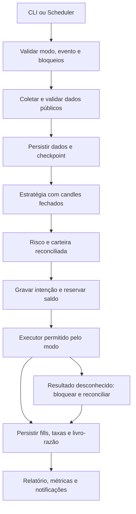

# Planejamento incremental — robô Binance Spot em Python

Data da análise: 24/10/2026. Raiz obrigatória e diretório de execução dos comandos: `/home/cams7/Dev/Cripto`.

**Estado: planejamento, nenhuma Sprint implementada.** Esta entrega cria somente este documento. Não autoriza provisionamento, envio de notificações ou ordens, acesso a credenciais nem alterações nos projetos de referência. Os caminhos futuros descritos abaixo são propostas, não arquivos existentes.

## 1. Visão do produto e premissas

Construir um sistema pessoal e modular que colete dados, avalie uma estratégia explicável, simule carteira e execução, controle risco e produza evidências para decidir se uma operação real limitada é justificável. Consistência operacional e resultados líquidos ajustados ao risco serão avaliados separadamente. Não existe promessa de rentabilidade; desempenho histórico não garante desempenho futuro.

Decisões estabelecidas: Python, Linux, AWS, início em `PAPER`, Binance Spot sem margem, empréstimos, vendas a descoberto ou alavancagem. Derivativos ficam apenas no horizonte do roadmap, sujeitos a nova análise e aprovação explícita, sem componentes antecipados.

Premissas de planejamento, revisáveis mediante evidência:

- Um operador, uma carteira simulada, uma estratégia e um par inicial, `BTCUSDT`, condicionado à disponibilidade do símbolo. O par é um exemplo de engenharia, não recomendação de investimento.
- Candles de 15 minutos, somente fechados; um ciclo por intervalo, sem exigência de execução no segundo exato. Consulta REST síncrona; nenhum WebSocket no MVP.
- Saldo fictício inicial de `10000.00 USDT`. USDT é a moeda de cotação do experimento e pode perder paridade; não equivale a saldo em reais ou dólares garantidos.
- Execução local até a avaliação histórica. Primeiro piloto AWS sem credenciais Binance, utilizando dados públicos e executor simulado.
- Região AWS definitiva pendente de verificação de acesso permitido à Binance, elegibilidade da conta, disponibilidade e custo. Avaliar `sa-east-1`; não transplantar automaticamente a região dos projetos de referência. As tarifas de Virgínia usadas adiante são apenas uma base comparativa.
- Não é necessário decidir capital real agora. Capital, moeda de reporte fiscal, perda monetária tolerada, atendimento a incidentes e limites reais são decisões bloqueantes apenas para a etapa de operação real.

## 2. Análise das referências consultadas

### 2.1 Método e limites da inspeção

Os seis diretórios estavam acessíveis. Foram lidos documentos, manifests, templates, workflows de CI e trechos de aplicação pertinentes. Não foram executados seus testes, aplicações, scripts de deploy ou consultas à conta AWS. Não foram lidos arquivos de credenciais, estados Terraform, perfis de navegador ou bases de produção. Uma busca de instruções encontrou permissões negadas em subdiretórios de dados MongoDB de `loto-bot`; esses dados não são necessários à análise arquitetural.

A raiz Cripto continha apenas os diretórios de metadados `.agents`, `.codex` e `.git`, sem código ou documentação de produto. Não foram encontrados arquivos `AGENTS.md` na raiz ou nos ancestrais consultados. A inspeção considera o conteúdo do checkout, que pode diferir do commit e da instalação AWS. Os hashes abaixo identificam o HEAD observado, não certificam ausência de alterações locais.

| Projeto e HEAD observado | Organização e funcionamento constatados | Reutilização proposta e limites |
|---|---|---|
| `mail-sender-aws` — `fd44378` | Python 3.12, handler nativo, schemas Pydantic, domínio/portas/caso de uso/adaptador SES v2. SAM, invocação Lambda por IAM, sem API Gateway no template; logs por sete dias; pytest com fakes. | Reaproveitar a separação das camadas e o contrato de notificação. Futuramente usar adaptador SES próprio ou integração explicitamente configurada; não depender da disponibilidade do LotoBot nem alterar a função existente. |
| `gmail-reader-aws` — `d66dade` | Python 3.12, handler, serviço, repositório, configuração e autenticação separados. OAuth local versus Secrets Manager na AWS; espera limitada; SAM, CloudWatch e X-Ray declarados; CI executa pytest, validação e build SAM. | Reutilizar configuração externa, limites de espera, proteção de logs e testes isolados. Gmail e autenticação por e-mail não pertencem ao fluxo Binance; não trazer esse componente. |
| `whatsapp-notify` — `e2e8d9f` | Python, FastAPI/Uvicorn, Playwright/Chromium com perfil persistente e autenticação QR; templates EC2, API privada na integração, testes e CI. | Referência útil de processo persistente e recuperação operacional. WhatsApp é canal opcional futuro; não usar navegador, QR Code ou HTTP administrativo no núcleo do robô. Alertas críticos precisam de canal independente. |
| `loto-bot` — `345269d` | API FastAPI, domínio/aplicação/infraestrutura, Playwright, adapters MongoDB/Beanie e DynamoDB, integrações locais/AWS. `PaymentAuthorization` bloqueia pagamento não autorizado. pytest, Ruff, cobertura e testes arquiteturais via grimp no manifest. | Reutilizar portas, relógio substituível, valor de autorização e mascaramento. Não importar automação de portal, modelos de aposta, MongoDB ou framework web. Tornar a separação de modos mais forte que um booleano. |
| `loto-scheduler-aws` — `f07a81f` | EventBridge Scheduler → Lambda Python; HTTP privado, DynamoDB para deduplicação e guard persistente, orçamento de tempo, Mail Sender para falhas. Agendamentos desabilitados por padrão; testes SAM com Moto, MockTransport, Stubber e bloqueio de sockets. Não foi encontrado `.github/workflows/ci.yml` neste checkout. | Reutilizar identidade do evento, persistência antes do efeito externo, retenção de bloqueio em incerteza, deadline e ensaio local. Não copiar a política de repetir POST de negócio após resposta incerta. |
| `loto-infra-terraform` — `5ee672c` | Terraform ≥1.10/<2 gerencia stacks CloudFormation; SAM prepara/publica artefatos; Ansible atualiza EC2 e faz recuperação. Fundação separada: rede IPv6, endpoints, bucket, contêineres de secrets, SES e tabelas. Implantação local, sem pipeline de deploy GitHub Actions. | Reutilizar separação de fundação/aplicação, artefatos identificáveis, plano antes de apply, pausa de agendamento e runbooks. Criar recursos e state próprios de Cripto; não importar stacks existentes. |

Evidências principais, todas somente consultadas:

- [README e organização do Mail Sender](/home/cams7/Dev/LotoBot/mail-sender-aws/README.md), [template efetivo](/home/cams7/Dev/LotoBot/mail-sender-aws/template.yaml) e [schema de entrada](/home/cams7/Dev/LotoBot/mail-sender-aws/src/api/schemas.py).
- [Gmail Reader](/home/cams7/Dev/LotoBot/gmail-reader-aws/README.md), [CI](/home/cams7/Dev/LotoBot/gmail-reader-aws/.github/workflows/ci.yml) e [logging](/home/cams7/Dev/LotoBot/gmail-reader-aws/src/infra/logger.py).
- [WhatsApp Notify](/home/cams7/Dev/LotoBot/whatsapp-notify/README.md) e [dependências](/home/cams7/Dev/LotoBot/whatsapp-notify/pyproject.toml).
- [Manifest do bot](/home/cams7/Dev/LotoBot/loto-bot/pyproject.toml), [autorização de pagamento](/home/cams7/Dev/LotoBot/loto-bot/src/domain/value_objects/payment_authorization.py), [logging](/home/cams7/Dev/LotoBot/loto-bot/src/infrastructure/logging/logging_config.py) e [CI](/home/cams7/Dev/LotoBot/loto-bot/.github/workflows/ci.yml).
- [README do scheduler](/home/cams7/Dev/LotoBot/loto-scheduler-aws/README.md), [store condicional](/home/cams7/Dev/LotoBot/loto-scheduler-aws/src/loto_scheduler_aws/infrastructure/store.py), [workflow](/home/cams7/Dev/LotoBot/loto-scheduler-aws/src/loto_scheduler_aws/application/workflow.py), [handler](/home/cams7/Dev/LotoBot/loto-scheduler-aws/src/loto_scheduler_aws/handler.py) e [SAM local](/home/cams7/Dev/LotoBot/loto-scheduler-aws/docs/SAM_LOCAL.md).
- [Integração Terraform](/home/cams7/Dev/LotoBot/loto-infra-terraform/README.md), [stacks](/home/cams7/Dev/LotoBot/loto-infra-terraform/main.tf), [fundação](/home/cams7/Dev/LotoBot/loto-infra-terraform/foundation/main.tf) e [deploy Ansible](/home/cams7/Dev/LotoBot/loto-infra-terraform/ansible/deploy.yml).

### 2.2 Pontos que exigem adaptação

1. **Idempotência financeira:** o README do scheduler reconhece que repetir uma aposta pode duplicar seu efeito; um correlation ID não é chave de idempotência da operação remota. O robô deve preservar intenção e investigar qualquer resultado desconhecido antes de decidir sobre novo envio.
2. **Documentação versus template:** o README do Mail Sender ainda contém instruções de `sam local start-api`, embora o template consultado não tenha eventos HTTP. No novo projeto, cada guia deve validar o entrypoint efetivamente empacotado, por `sam local invoke` quando aplicável.
3. **Observabilidade:** há correlação e mascaramento aproveitáveis; os formatadores de Gmail e LotoBot consultados são textuais. JSON estruturado será uma melhoria explícita, não algo presumidamente pronto em todos os repositórios.
4. **Cobertura:** alguns manifests exigem 100% com exclusões. Não transportar o número como prova de confiabilidade; testar invariantes financeiras, falhas entre etapas e o artefato distribuído.
5. **Rede e execução:** EC2 e navegador são necessários ao fluxo daqueles projetos, não ao acesso REST Binance. Não replicar túnel residencial/SOCKS nem usá-lo para contornar restrições geográficas. Validar acesso legítimo antes de escolher a região.
6. **Estado e segredos:** preservar o padrão de preencher secrets fora do Terraform. Não copiar IDs de conta, ARNs, nomes de tabelas, tokens ou configuração de produção. Endpoints privados, IPv6 e políticas `prevent_destroy=false` da referência não serão defaults indiscriminados.

## 3. Requisitos

### 3.1 Funcionais

| ID | Requisito | Evidência de aceite planejada |
|---|---|---|
| RF01 | Inicializar exclusivamente em `PAPER`; rejeitar outros modos até sua Sprint | Teste de CLI/configuração, sem construir cliente privado |
| RF02 | Coletar candles fechados, regras de símbolo e preços públicos, com paginação e checkpoint | Coleta repetida sem duplicação, lacunas identificadas |
| RF03 | Persistir dados brutos, versão normalizada e origem | Reprodução por manifesto e hash |
| RF04 | Simular saldos livres/reservados, posições, taxas e fills | Livro-razão reconciliado após reinício |
| RF05 | Gerar sinais explicáveis e separar decisão de execução | Mesmos sinais para mesma entrada/versão |
| RF06 | Aplicar limites antes de cada intenção; rejeitar dados inválidos | Testes de exposição, perda, precisão e freshness |
| RF07 | Backtest cronológico com custos e período não usado no desenvolvimento | Relatório reproduzível e teste contra look-ahead |
| RF08 | Executar `PAPER` contínuo, notificar incidentes e permitir pausa | Ensaio de falha e recuperação, sem ordens externas |
| RF09 | Integrar Spot Testnet somente após os gates | Contratos, fills e reconciliação demonstrados no ambiente isolado |
| RF10 | Habilitar Spot real somente após aprovação e limites explícitos | Checklist assinado, release e configuração identificados |

### 3.2 Não funcionais

- Tipagem explícita e validação nas fronteiras; domínio independente de HTTP, boto3, relógio de parede e variáveis de ambiente.
- Valores monetários em `Decimal`, recebidos de strings; proibir conversão intermediária por `float`, NaN e infinito. Persistir strings decimais canônicas em JSON/SQLite, com escala e arredondamento definidos por operação.
- Instantes UTC com timezone; registrar horário do mercado, de recebimento e de processamento. Relógio injetável nos testes.
- Execuções repetíveis, dependências travadas, versão do código/configuração/modelo de execução/dataset registrada.
- Estado durável antes de efeitos externos, transações locais e controle de concorrência. Nenhuma promessa de exactly-once entre banco e corretora.
- Em incerteza de estado, dados ou permissão, suspender novas ordens. Falha de notificação não reexecuta negociação.
- Primeira meta `PAPER`: p95 do ciclo <60 s, timeout de aplicação 90 s e Lambda 120 s, sujeitos a medição. Eventos com atraso >120 s não negociam; registrar e recuperar dados sem executar sinais antigos.
- Para candles de 15 min, exigir o último candle esperado fechado e contínuo; não aceitar automaticamente o anterior como atual. No futuro envio real, cotação de execução com idade máxima inicial de 5 s, a validar na homologação.
- Meta do piloto AWS: ≥99% dos ciclos elegíveis concluídos em 30 dias, exclusões de manutenção declaradas. Qualquer ordem duplicada ou divergência contábil inexplicada reprova o gate, mesmo com disponibilidade alta.
- Recuperação pretendida: RPO zero para lançamentos confirmados no store transacional; efeitos remotos pendentes exigem reconciliação. RTO de 30 min para o piloto é meta a testar, não SLA. Dados públicos podem ser coletados novamente.

## 4. Arquitetura proposta

### 4.1 Monólito modular e ferramentas

Um único pacote instalável, `cripto_bot`, e uma release por ambiente. Módulos internos têm interfaces claras; não há justificativa inicial para microsserviços, API web, fila para cada passo ou processamento assíncrono. Os casos de uso serão funções/objetos síncronos, compartilhados pela CLI e pelo futuro handler Lambda.

| Escolha | Justificativa e momento |
|---|---|
| Python 3.13, patch fixado na implementação | Runtime estável suportado no Lambda/AL2023; conserva proximidade com referências 3.12 sem exigir versão preview. Validar wheels no Linux e reconsultar suporte antes do deploy. [Runtimes AWS](https://docs.aws.amazon.com/lambda/latest/dg/lambda-runtimes.html). |
| `pyproject.toml`, setuptools e wheel | Empacotamento padrão, já utilizado nas referências; um pacote com origem em `modules/trading/src`. [Setuptools](https://setuptools.pypa.io/en/latest/userguide/pyproject_config.html). |
| uv com `uv.lock` versionado | Ambiente e resolução reproduzíveis; `uv sync --locked` no CI. Exportação de requirements para SAM deriva do lock, nunca é mantida separadamente. Fixar também a versão da ferramenta. [Lock e sincronização](https://docs.astral.sh/uv/concepts/projects/sync/). |
| dataclasses/Protocol/Decimal da biblioteca padrão | Objetos de domínio simples, portas testáveis e precisão sem dependências financeiras externas. |
| Pydantic nas entradas | Validar configuração, payloads e DTOs; parsers explícitos para strings decimais e UTC, evitando coerções permissivas. Não aplicar strict mode cegamente a strings de ambiente. [Validação estrita](https://docs.pydantic.dev/latest/concepts/strict_mode/). |
| HTTPX síncrono, a partir da Sprint 02 | Poucos endpoints públicos, timeouts e transporte substituível. Sem SDK comunitário amplo nem cliente de trading instalado antecipadamente. [Transportes e mocks](https://www.python-httpx.org/advanced/transports/). |
| pytest/pytest-cov, Ruff e mypy strict | Testes, cobertura de ramificações, lint/formatação e tipos são verificações complementares. Adicionar Hypothesis apenas quando invariantes contábeis justificarem testes gerativos. [pytest](https://docs.pytest.org/en/stable/), [Ruff](https://docs.astral.sh/ruff/), [mypy](https://mypy.readthedocs.io/en/stable/). |
| SQLite local; DynamoDB no piloto AWS | SQLite evita dependências de infraestrutura local. DynamoDB atende consultas conhecidas por carteira, intenção, execução e período, com escritas condicionais/transacionais; equivalência contratual precisa ser testada. |
| JSONL compactado e manifestos; S3 na AWS | Histórico bruto e relatórios fora do store operacional. Parquet fica condicionado ao volume e à necessidade analítica. |
| boto3 apenas na etapa AWS | Empacotar versão resolvida no lock em vez de depender do SDK embutido no runtime. |

Não fixar neste planejamento versões numéricas de todas as bibliotecas sem testar compatibilidade. A Sprint que introduzir cada dependência verifica documentação, manutenção, licença e resolução com Python 3.13, registrando versões exatas no lock.

### 4.2 Limites dos módulos

| Módulo interno | Responsabilidade | Interface/limite |
|---|---|---|
| `domain/market` e `adapters/binance` | Candle, metadados, cotação, coleta e tradução de erros | `MarketDataPort`; não acessa executor |
| `domain/strategy` | Transformar histórico fechado em alvo/sinal com justificativa | Sem I/O, dinheiro movimentado ou relógio implícito |
| `domain/risk` | Avaliar proposta com carteira, limites e dados atuais | Resultado permitido/rejeitado e motivos; não envia ordem |
| `domain/portfolio` | Saldos, reservas, custo, posições, taxas e patrimônio | Atualizado por fills/lançamentos, não por sinais |
| `application` | Coordenar coleta, estratégia, risco, persistência e recuperação | Recebe portas e unidade de trabalho; decide fluxo |
| `adapters/execution` | Implementar execução `PAPER`; Testnet/real apenas depois | `ExecutionPort`; executor não muda política de risco |
| `adapters/storage` | Repositórios, atomicidade, deduplicação e checkpoints | `UnitOfWork`, `ExecutionRepository`, `MarketRepository` |
| `adapters/notifications` e `observability` | Avisos, logs, métricas e correlação | Consome eventos persistidos; falha não desfaz fill |
| `entrypoints` | CLI e, depois, handler Lambda | Valida modo e compõe somente adapters autorizados |
| `infra/` e `scripts/` | Build, instalação, deploy e runbooks | Não contêm estratégia ou credenciais |

Portas e modelos surgem quando houver uso na Sprint, sem framework de plugins ou adapters vazios para integrações futuras.

### 4.3 Fluxo de dados



O backtest troca relógio e fonte de dados e utiliza um modelo histórico de execução. `PAPER` contínuo usa preços observados após a decisão. Testnet/real consomem confirmações externas. Estratégia e risco permanecem compartilhados; não fingir que os modelos de execução são equivalentes.

Dados mínimos: `run_id`, ambiente/modo, carteira, símbolo, timeframe, candle de decisão, versão de estratégia/configuração/dados, intenção, identidade externa quando existir, estado, timestamps UTC e motivo de cada transição. Ledger registra ativo, quantidade, contrapartida, taxa e referência única do fill. Fills duplicados não geram novos lançamentos.

Na AWS, acessos previstos: carteira por ID; intenção por ID; execução por horário programado; intenções pendentes por carteira; candles/ledger por símbolo ou carteira e intervalo. DynamoDB é escolhido por esses acessos, não por escala hipotética. Relatórios extensos leem exportações. Se passarem a exigir JOINs e consultas ad hoc no store primário, reconsiderar PostgreSQL gerenciado antes de proliferar índices/Scans. [Transações DynamoDB](https://docs.aws.amazon.com/amazondynamodb/latest/developerguide/transaction-apis.html).

Atualização de reserva, versão da carteira, intenção e lançamentos precisa ser atômica. No DynamoDB, utilizar transação e condições de versão; o token de transação tem janela limitada e não substitui a deduplicação persistente de negócio. Não colocar o banco SQLite no `/tmp` da Lambda nem tratar S3 como banco transacional. Exportação para S3 é posterior ao commit e recuperável por checkpoint/outbox.

### 4.4 Computação e infraestrutura AWS

| Opção | Quando cabe | Decisão inicial |
|---|---|---|
| EventBridge Scheduler + Lambda | Ciclos curtos, independentes e REST, sem conexão persistente | Preferida para `PAPER` AWS, condicionada ao benchmark e ao acesso permitido |
| ECS/Fargate | Processo duradouro, WebSocket, reconciliação frequente, backtest pesado em lote | Reavaliar se o ciclo crescer ou se Testnet/real precisar de conexão contínua |
| EC2 com systemd/container | Necessidade de IP estável com menor custo fixo, controle do host e disponibilidade operacional do responsável | Alternativa para real; assumir patching, recuperação e risco de instância única |

Scheduler possui precisão de 60 segundos; programar após o fechamento esperado, validar candle e tolerância, sem pressupor pontualidade. Lambda de eventos tem execução limitada, portanto backfills longos são paginados em jobs ou executados localmente/em container. Backtest pesado não ocupa o handler de negociação. [Scheduler](https://docs.aws.amazon.com/scheduler/latest/UserGuide/schedule-types.html).

No piloto `PAPER`, preferir Lambda fora da VPC, sem NAT ou IP estático, pois não precisa acessar serviços privados nem chaves de trading. Não supor que uma Lambda em subnet pública recebe IPv4 público. Para real, a restrição da chave por IP exige projeto de saída estável: EC2 com Elastic IP ou computação em subnets privadas com NAT de saída fixa, conforme custos e disponibilidade. IP público de task Fargate não deve ser tratado como permanente. Não reduzir segurança da chave para preservar a arquitetura barata de simulação.

Terraform será a autoridade de deploy: fundação própria com state remoto protegido e separado por ambiente; stack de aplicação gerenciada por `aws_cloudformation_stack`. SAM define Lambda, role da função, agendamento e seu papel IAM, logs e alarmes da aplicação; prepara e empacota artefatos. Terraform gerencia tabelas, buckets, estrutura de secrets e recursos de fundação, passando referências à stack. Não declarar o mesmo recurso nas duas ferramentas e não executar `sam deploy` por fora dessa autoridade. A bootstrap do backend é uma etapa explícita futura.

Agendamento começa desabilitado. Antes de atualizar: pausar novos disparos, aguardar/verificar execuções em andamento e bloqueios, salvar versão/configuração, publicar pacote imutável, testar, retomar explicitamente. Rollback de código não reverte ordens nem migrações de dados; esquema precisa manter compatibilidade ou procedimento de migração/reversão ensaiado. Ansible só entra se EC2 for escolhida. Não criar API Gateway, ALB, Step Functions ou um serviço separado de scheduler sem necessidade demonstrada.

## 5. Estrutura de diretórios prevista

Tudo abaixo permanece em `/home/cams7/Dev/Cripto`. Criar cada diretório apenas na Sprint que o usa; a primeira entrega contém somente `docs/planejamento.md`.

```text
/home/cams7/Dev/Cripto/
├── README.md
├── pyproject.toml
├── uv.lock
├── .python-version
├── .gitignore
├── docs/
│   ├── planejamento.md
│   ├── arquitetura.md
│   ├── decisoes/                 # ADRs numerados, em português
│   ├── sprints/sprint-XX.md
│   └── testes/sprint-XX-validacao.md
├── modules/trading/src/cripto_bot/
│   ├── domain/
│   ├── application/
│   ├── adapters/
│   ├── observability/
│   └── entrypoints/
├── tests/
│   ├── unit/
│   ├── integration/
│   ├── contracts/
│   ├── fixtures/
│   └── sam_local/
├── config/                       # exemplos públicos e não secretos
├── infra/
│   ├── terraform/foundation/
│   ├── terraform/application/
│   └── sam/template.yaml
├── scripts/
├── data/                         # gerado, ignorado pelo Git
└── reports/                      # gerado; evidências resumidas vão para docs/testes
```

Não criar repositórios adicionais agora. ADRs iniciais: monólito/portas, modos seguros e precisão decimal. Na etapa AWS: computação/rede, persistência e propriedade Terraform/SAM.

## 6. Negociação, estratégia e avaliação

### 6.1 Conceitos que influenciam o código

| Conceito | Consequência de implementação |
|---|---|
| Spot | Compra um ativo com saldo disponível e vende somente o que possui; reservar saldo antes da intenção |
| Candle OHLCV | Resume abertura/máxima/mínima/fechamento/volume; não revela a sequência intrabar nem garante um preço executável |
| Spread | Diferença entre melhor venda e melhor compra; compra paga ask, venda recebe bid |
| Slippage | Diferença entre referência e preço obtido; parametrizar impacto adverso, não assumir zero |
| Taxa | Pode ser cobrada em ativos diferentes; registrar ativo/quantidade original e conversão usada no relatório |
| Patrimônio | Caixa mais posições marcadas a mercado, descontadas obrigações; incluir resultado não realizado |
| Drawdown | Queda relativa ao maior patrimônio anterior; persistir o pico, sem reiniciá-lo para apagar perdas |
| Exposição | Valor das posições e compromissos de ordens dividido pelo patrimônio; limitar antes de enviar |
| Ordem a mercado/limitada | Mercado prioriza execução sem garantir preço; limitada restringe preço sem garantir execução |

### 6.2 Estratégia inicial proposta

Uma estratégia comprada ou em caixa por cruzamento de médias simples, SMA20/SMA50, em candles de 15 minutos. Após pelo menos 51 fechamentos válidos, comprar quando a média curta passar de menor/igual para maior que a longa; vender a posição quando passar de maior/igual para menor. Sem cruzamento, manter. Sem pirâmide, short, martingale ou compra adicional por queda. Registrar as médias, candle e motivo.

A estratégia propõe intenção, o risco decide quantidade. Limites didáticos exclusivos de `PAPER`: no máximo 10% do patrimônio por entrada e de exposição total, uma posição e uma intenção pendente; perda diária de 1% do patrimônio do início do dia UTC e drawdown de 5% suspendem novas entradas. O cálculo inclui custos e posições marcadas; aportes/retiradas exigem ajuste explícito para não distorcer retorno. Saídas para reduzir risco continuam sujeitas a dados, saldo e estado confiáveis.

Esses números são parâmetros de teste, não autorização de uso real. Não há stop intrabar na estratégia inicial, nem proteção garantida em 15 minutos. Se a operação real exigir reação mais rápida ou ordens protetoras da corretora, isso altera o escopo e deve ser especificado antes da Sprint 10.

### 6.3 Modelo de execução e custos

Backtest decide no fechamento de `t` e só admite fill em observação posterior, por exemplo abertura de `t+1`, com atraso e custos explicitados. `PAPER` contínuo usa bid/ask capturados depois do sinal. Não preencher a ordem retroativamente ao fechamento que gerou a decisão. Na ausência de cotação válida, não inventar execução.

Para o primeiro simulador, usar hipóteses configuráveis: taxa de 10 pontos-base por lado, spread total de 10 pontos-base e slippage adverso de 5 pontos-base por lado. São hipóteses sintéticas, não a tarifa da conta Binance. Um ponto-base equivale a 0,01%. No histórico com apenas preço de referência, aplicar metade do spread em cada lado; se usar bid/ask real, não cobrar spread novamente. Na futura integração privada, conferir a comissão aplicável ao símbolo/conta e tratar taxas em BNB ou outro ativo sem pressupor desconto.

Fill integral instantâneo é simplificação inicial identificada no relatório. Antes do gate Testnet, ensaiar fills parciais, cancelamento, reservas, saldo insuficiente, falta de liquidez e limite de participação no volume. Não afirmar execução de limit apenas porque máxima/mínima tocou seu preço. Filtros históricos desconhecidos devem constar como limitação do backtest; filtros atuais não são prova das regras antigas.

### 6.4 Metodologia de avaliação

1. Dataset versionado, origem e datas registradas; verificar duplicatas, lacunas, OHLC coerente, volume não negativo, fechamento e ordenação. Lacunas impedem decisão até completar a janela; nunca preencher silenciosamente preços.
2. Definir antes de rodar uma janela ideal de 24 meses, condicionada à qualidade/disponibilidade. Separação cronológica proposta: 60% desenvolvimento, 20% validação e 20% teste final intocado. Fixar datas reais no manifesto; janelas curtas não viram evidência forte por extrapolação.
3. Usar dados anteriores somente para aquecimento das médias; não treinar parâmetros no teste. Disponibilidade temporal das features precisa respeitar cada decisão. Teste de prefixo: adicionar candles futuros não pode mudar sinais já calculados.
4. Comparar mesma janela e capital: ficar em caixa na moeda de cotação e buy-and-hold do ativo, incluindo custos comparáveis. Explicitar risco da moeda de cotação e patrimônio final com ou sem liquidação.
5. Reportar retorno líquido, drawdown máximo, exposição média/máxima, número de trades fechados/fills, turnover, taxas, tempo em posição e rejeições. Apresentar patrimônio e resultados por subperíodo; não esconder amostra pequena com uma métrica anualizada.
6. Avaliar sensibilidade a custos dobrados, atraso de um candle, gaps e regimes de alta/baixa/lateral. Poucos parâmetros, sem busca exaustiva. Se alterar a estratégia após olhar o teste, aquele teste deixa de ser intocado e é preciso nova validação.
7. Aprovação de engenharia exige reprodutibilidade e contabilidade correta, mesmo com retorno negativo. Retorno negativo é resultado válido; pode impedir a promoção real. A hipótese de SMA deve poder ser descartada.

## 7. Segurança, confiabilidade e operação

### 7.1 Barreiras de modo

`mode` define onde ocorre execução (`PAPER`, futuramente `TESTNET`/`LIVE`); `data_source` define dados históricos, fixture ou mercado público. Backtest é um tipo de execução offline, não um modo que permita trading externo.

Na Sprint 01, somente o literal `PAPER` é aceito. Não há implementação, importação ou dependência de executor privado. Configuração com `LIVE`, `TESTNET`, símbolos de derivativos ou credenciais Binance deve falhar antes de qualquer I/O. Na Sprint 02, o cliente público expõe somente consultas GET autorizadas; não oferece método genérico de assinatura/envio. Testes bloqueiam rede por padrão e comprovam ausência de POST/DELETE de negociação.

Para Testnet/real: composição separada, lista fechada de hosts, credenciais/recursos por ambiente e validação de consistência modo-host-conta. A role `PAPER` não poderá ler o segredo real. Não permitir endpoint privado arbitrário em variável de ambiente nem promoção com simples troca de URL. Aprovação real deve vincular conta, release, estratégia e hash da configuração de limites, com prazo e responsável; qualquer mudança material invalida a aprovação.

### 7.2 Identidade, estados e falhas

- Chave de negócio determinística por ambiente/carteira/estratégia-versão/símbolo/timeframe/candle/ação. Separar essa chave da tentativa de transporte e de `run_id`.
- Persistir intenção e reserva antes do envio. Estados propostos: `CREATED`, `RISK_REJECTED`, `RESERVED`, `SUBMITTING`, `ACKNOWLEDGED`, `PARTIALLY_FILLED`, `FILLED`, `CANCELED`, `REJECTED`, `UNKNOWN`. Estado `UNKNOWN` bloqueia novos compromissos da carteira até resolução.
- Serializar o escritor da carteira com condição de versão e bloqueio durável; concurrency=1 na Lambda é defesa adicional, não coordenação suficiente com CLI ou outros workers. TTL não autoriza liberar uma intenção ambígua. Distinguir expiração de lease computacional de resolução do efeito financeiro.
- Para envio futuro, persistir `newClientOrderId` único antes do POST e nunca reciclá-lo para uma nova intenção. A unicidade da corretora não constitui garantia eterna de exactly-once. Consultar ordem por identidade, fills, ordens abertas e saldos antes de qualquer decisão de repetição. Uma resposta temporária de “não encontrada” não prova ausência definitiva da ordem.
- Timeouts/5xx de envio podem deixar resultado desconhecido; não executar retry automático de mutações pelo cliente HTTP. Retentativas de leituras são limitadas por deadline, com backoff/jitter. Respeitar `Retry-After`, tratar 429 e interromper diante de bloqueio 418. [Regras REST](https://developers.binance.com/en/docs/products/spot/rest-api) e [operações Spot](https://developers.binance.com/en/docs/catalog/core-trading-spot-trading/api/rest-api/trade).
- Reinício carrega checkpoints, reservas e pendências antes de aceitar eventos novos. Repetir evento confirmado devolve resultado anterior. Persistência indisponível impede negociação. Notificações usam identidade própria para evitar tempestades.

### 7.3 Filtros, credenciais e auditoria

Antes de executar, verificar status/permissão Spot do símbolo e os filtros aplicáveis de `exchangeInfo`: preço/tick, quantidade/step, quantidade de mercado, notional mínimo/máximo, restrições percentuais e limites de ordens/posição quando presentes. Metadados têm validade e versão. Quantidade arredondada para baixo deve ser revalidada quanto ao valor mínimo e à reserva de taxa; filtro desconhecido relevante bloqueia o símbolo. Não codificar casas decimais fixas. [Filtros oficiais](https://developers.binance.com/en/docs/products/spot/filters).

Chaves futuras exclusivamente com permissões necessárias, sem saque, sem margem/derivativos e com restrição de IP conforme suporte da conta. Secrets Manager para segredo; IAM por ambiente e ARN, sem chaves AWS estáticas no aplicativo. Não colocar valores secretos em tfvars/state, argumentos de CLI, logs ou artefatos de teste. Rotação exige pausa, validação e reconciliação; verificar requisitos reais da conta antes da integração.

Separar desenvolvimento, `PAPER`, Testnet e produção por configurações, nomes, roles, tabelas e buckets; preferir conta AWS de produção separada. Dados simulados nunca são migrados para saldo real. Logs JSON incluem correlação, modo, estratégia e motivos, omitindo segredos/assinaturas/headers privados. Guardar ledger/auditoria durável com acesso restrito; retenção operacional sugerida de 30 dias para logs, auditoria de 365 dias como premissa técnica, a revisar conforme obrigações aplicáveis. Não confundir log expurgável com histórico financeiro.

Métricas: atraso do candle/evento, duração, ciclos ausentes, rejeições, rate limit, intenções desconhecidas, divergência, taxa/slippage, exposição/drawdown e custo AWS. Alarmes iniciais: ausência de dois ciclos, qualquer `UNKNOWN`/divergência, falha de persistência e limite de risco. Evitar IDs únicos como dimensões de métricas. Notificações de teste são simuladas; envio externo real depende de configuração e autorização de destinatários na Sprint correspondente.

### 7.4 Interrupção e recuperação

Kill switch persistente consultado no início e imediatamente antes de enviar: bloqueia novas entradas. Pausar Scheduler impede novos disparos, mas não cancela execução em andamento. Para incidente: ativar bloqueio, pausar disparos, registrar estado, investigar ordens/saldos, cancelar pendências apenas por procedimento autorizado e reconciliar. Não liquidar tudo automaticamente como efeito colateral do botão de pausa.

Retomar exige integridade dos dados, pendências resolvidas, limites revistos, saúde da rede/credenciais e confirmação do operador registrada. Falha do serviço de controle impede novos envios. Ensaio de recuperação deve cobrir morte do processo antes/depois do POST e antes/depois do commit, além de perda da notificação.

O sistema controla admissão, quantidade solicitada, reservas e bloqueios. Não garante preço de fill, liquidez, disponibilidade da corretora, cancelamento a tempo ou perda máxima durante gaps/falhas. Um limite de drawdown dispara uma ação; não assegura que a perda realizada ficará abaixo dele.

## 8. Desenvolvimento e testes locais

O ambiente inicial precisa apenas de Python/uv. Docker e SAM entram quando houver um handler a validar; DynamoDB Local entra para contratos de persistência. Testes unitários usam fixtures, relógio fixo e rede desabilitada, sem AWS ou Binance. Marcadores separam `unit`, `integration`, `contract` e `external`; testes externos são opt-in e nunca usam capital real como requisito de CI.

| Camada | Verificação | Limitação |
|---|---|---|
| Domínio | Decimais, sinais, risco, contabilidade e estados | Não valida a corretora |
| SQLite | Reinício, rollback transacional e duplicação | Não prova comportamento DynamoDB |
| HTTPX MockTransport | Paginação, filtros, timeout, 429, dados inválidos | Não prova acesso regional/latência |
| Moto/Stubber | Chamadas e contratos AWS simulados | Não prova IAM, rede ou entrega real |
| DynamoDB Local | Contrato de repositório e conflitos | Não prova TTL, backup, IAM, escala ou serviço real |
| SAM em container | Empacotamento/handler/runtime com dependências falsas | Não emula integralmente Scheduler, VPC, quotas ou CloudWatch |
| AWS isolada `PAPER` | IAM, Scheduler, alarmes, persistência, restore e custo | Não prova execução financeira |
| Spot Testnet | Autenticação, filtros, ciclo de ordem e reconciliação | Liquidez, resets e comportamento não equivalem à produção |

A Sprint AWS deve adaptar o padrão `tests/sam_local` da referência: chamar handler real com transports falsos, impedir sockets externos, verificar JSON de resultado além do exit code e separar dependências de teste do ZIP de produção. Build em container não implica teste de integração AWS aprovado.

Cada guia `docs/testes/sprint-XX-validacao.md` conterá preparação, versões, comandos a partir da raiz, configuração sem segredos, dados e hashes, saída esperada, falhas/diagnóstico, recursos criados, limpeza/custos, evidência realmente obtida e pendências. Falta de Docker, conta ou rede deve resultar em “não executado”, nunca “aprovado”.

## 9. Roadmap sequencial

Toda Sprint depende da anterior concluída e de sua evidência revisada. O roadmap fixa incrementos e critérios; a especificação futura será refinada com resultados reais. Não iniciar trabalho dependente se um pré-requisito falhar. Estimativas de 2–5 dias úteis por Sprint de código são apenas capacidade orientativa; períodos de observação não podem ser comprimidos para caber nessa estimativa.

| Sprint | Incremento e caminhos previstos | Dependência e modo | Aceite/testes e evidência | Exclusões, risco e recuperação | Custo |
|---|---|---|---|---|---|
| 01 | Pacote/CLI segura, config, decimais, testes, README, arquitetura e ADRs | Este plano; `PAPER` offline | CLI instalada executa ciclo vazio; configuração perigosa falha; build/lint/tipos/testes passam; guia 01 | Sem coleta, carteira ou AWS; preservar arquivos e remover apenas artefatos regeneráveis | AWS zero |
| 02 | Coleta pública/normalização/checkpoint em `adapters/binance`, `adapters/storage`, `data/` | 01; `PAPER` | GETs públicos, candles fechados, paginação, duplicatas, gaps, 429 e timeout; guia 02 | Sem credenciais/ordens; retomar checkpoint sem preencher lacuna artificialmente | AWS zero; disco/rede local |
| 03 | Carteira, ledger, reservas, executor simulado e limites em `domain/portfolio`, `domain/risk`, `adapters/execution` | 02; `PAPER` | Compra/venda scripted em fixture, taxas e reinício; rollback e duplicação; guia 03 | Sem estratégia automática; falha contábil bloqueia e restaura snapshot de teste | AWS zero |
| 04 | SMA20/50 e ciclo integrado em `domain/strategy`, `application` | 03; `PAPER` | Sinais de fronteira, warm-up, nenhuma ordem sem risco, execução posterior ao sinal; guia 04 | Sem otimização/ML; fixar versão e reverter estratégia sem apagar ledger | AWS zero |
| 05 | Backtest, dataset/manifesto e relatórios em `application`, `reports/` | 04; `PAPER` histórico | Split temporal, prefixo invariável, custos, benchmarks e repetibilidade; guia 05 | Sem promoção por lucro isolado; dataset inválido exige nova coleta | AWS zero por padrão; lote AWS só se proposto depois |
| 06 | Piloto `PAPER` local contínuo, kill switch, partial fills de teste e recuperação em CLI/scripts | 05; `PAPER` público | Sete dias e drills de falha, nenhuma divergência inexplicada, relatórios diários; guia 06 | Sem daemon web; parar/reconciliar/retomar e preservar ledger | AWS zero; energia/disponibilidade local |
| 07 | Adapters AWS e pacote SAM em `adapters/storage`, `entrypoints`, `tests/sam_local`, `infra/sam` | 06; `PAPER` | Contratos SQLite/DynamoDB, conflitos, handler em container sem rede; guia 07 | Sem apply; incompatibilidade mantém piloto local | AWS zero; Docker/disco |
| 08 | Piloto AWS com Terraform/SAM, observabilidade e runbooks em `infra/`, `scripts/` | 07 e região/acesso/orçamento verificados; `PAPER` | IAM/entrega/alarmes/restauração reais; ≥30 dias e metas da seção 3; guia 08 | Sem segredo de trading; rollback de release e Scheduler pausado | Reserva estimada US$5–15/mês; recotar região |
| 09 | Integração Spot Testnet e reconciliação privada em adapter próprio | 08 e gates; somente `PAPER`/`TESTNET` | Ordem/fill/cancelamento, parcial, timeout ambíguo, reinício, reset e isolamento; guia 09 | Sem LIVE; indisponibilidade mantém bloqueio e execução PAPER | AWS conforme computação/rede; ativos de teste |
| 10 | Preparar release LIVE e piloto Spot de capital limitado | 09, aprovação explícita, capital/limites/rede definidos | Checklist, conta/chave/IP, consulta/reconciliação e execução limitada autorizada; guia 10 | Sem aumento automático de capital; kill switch e recuperação ensaiados | AWS + taxas + risco de perda do capital |

Após a Sprint 10: revisar estabilidade e resultados, sem obrigação de expandir. Múltiplos pares, estratégias, maior frequência e derivativos são decisões separadas. Derivativos exigem novo estudo de liquidação, margem, funding, permissões e aprovação; não há Sprint de implementação antecipada.

## 10. Gates entre ambientes e modos

| Transição | Condições objetivas propostas |
|---|---|
| Base → coleta PAPER | Sprint 01 concluída, rede falsa nos testes, nenhuma implementação privada |
| Simulação → avaliação histórica | Ledger fecha por ativo, reservas não negativas, custos reproduzíveis e teste de duplicação/reinício aprovado |
| Backtest → PAPER contínuo | Dataset e parâmetros congelados, relatório fora da amostra e limitações identificadas; não exige retorno positivo para aprender em simulação |
| Local → AWS PAPER | Sete dias locais, drills aprovados, build SAM, região/acesso permitido e orçamento definidos, recursos isolados |
| AWS PAPER → TESTNET | ≥30 dias, ≥99% dos ciclos elegíveis, zero duplicações e divergências inexplicadas, recuperação/kill switch ensaiados, evidência de custos e partial fills |
| TESTNET → LIVE | Pelo menos 14 dias de observação e todos os cenários funcionais exercitados; resets estendem observação quando invalidarem evidência. Amostra de ciclos de ordem deliberados em teste, não dependente só da frequência da estratégia. Conta elegível, IP fixo, segredo sem saque, reconciliação limpa e aprovação registrada |
| LIVE limitado → ampliação | Nova aprovação, dados reais suficientes e análise conjunta de risco/custo/execução; nenhuma promoção automática por tempo decorrido |

Antes de liberar LIVE, registrar critérios econômicos **antes** da avaliação final: perda e drawdown tolerados, custos reais, retorno líquido fora da amostra e comparação com benchmarks compatível com a exposição. Proposta inicial: retorno líquido fora da amostra positivo no cenário-base e drawdown dentro do limite aprovado também no cenário de custos dobrados. Se os resultados forem negativos, a amostra for pequena ou a vantagem depender de um único regime, permanecer em `PAPER` e revisar; não otimizar até fazer o gate passar. O responsável precisa aprovar esses critérios e os valores monetários reais; os limites didáticos não são transferidos automaticamente.

O endpoint de validação de ordem (`/api/v3/order/test`) não demonstra matching/fill. Spot Testnet usa ativos virtuais e pode resetar dados; não comprova rentabilidade ou qualidade de execução real. A documentação consultada apresenta Testnet disponível, mas seus endpoints, permissões e compatibilidade serão verificados novamente na Sprint 09. [Testnet oficial](https://developers.binance.com/en/docs/products/spot/testnet/general-info) e [operações de teste](https://developers.binance.com/en/docs/catalog/core-trading-spot-trading/api/rest-api/trade).

## 11. Custos, riscos e decisões pendentes

### 11.1 Estimativa AWS

Estimativa de planejamento em USD, sem impostos, câmbio, trabalho humano, taxas de negociação ou perdas. Não pressupõe Free Tier/créditos, recursos compartilhados gratuitos ou preços iguais entre regiões. Não foi consultada a fatura da conta. O piloto exige recotação regional antes do apply.

Carga-base: um ciclo de 15 min, 30 dias = 2.880 invocações; Lambda x86 de 512 MiB, 10 s em média. Com tarifas ilustrativas publicadas de US$0,0000166667/GB-s e US$0,20/milhão de requests, custo calculado de **US$0,2406/mês**; a 60 s, **US$1,4406/mês**. Cálculo: `2880 × 0,5 × duração × tarifa + 2880 × 0,20 / 1000000`. [Preço Lambda](https://aws.amazon.com/lambda/pricing/).

| Item | Premissa de uso | Provisão de orçamento mensal, não cotação regional |
|---|---|---|
| Lambda | 512 MiB, 10–60 s/ciclo | US$0,24–1,44 calculados acima |
| Scheduler | 2.880 disparos/mês | Reservar até US$0,10; conferir franquia/tarifa |
| DynamoDB | Até 1 GB, ~100 mil operações pequenas/mês; transações, backups e leituras consistentes contam separadamente | Reservar US$1–3 |
| S3 | Até 5 GB, até 10 mil PUT e 10 mil GET/mês | Reservar US$0,50–2; versionamento aumenta armazenamento |
| CloudWatch | Até 1 GB de logs/mês, retenção 30 dias, poucas métricas/alarmes | Reservar US$2–6; cardinalidade e consultas podem dominar |
| Segredos, avisos e tráfego | PAPER sem chave Binance; no futuro 1–2 secrets e poucos alertas | Reservar US$0–2,50; revisar canal, região e KMS |

Somando as faixas como provisões e arredondando com margem: **US$5–15/mês por ambiente PAPER pequeno**, fora de VPC e sem host permanente. Isso é uma reserva sujeita a medição, não um limite garantido. [Scheduler](https://aws.amazon.com/eventbridge/pricing/), [DynamoDB](https://aws.amazon.com/dynamodb/pricing/), [S3](https://aws.amazon.com/s3/pricing/), [CloudWatch](https://aws.amazon.com/cloudwatch/pricing/) e [Secrets Manager](https://aws.amazon.com/secrets-manager/pricing/).

Custos de alternativas: usando os exemplos Linux/x86 de Virgínia, Fargate contínuo com 0,25 vCPU e 0,5 GB fica aproximadamente **US$9/mês** por 730 h somente em computação. IPv4 público a US$0,005/h acrescenta **US$3,65/mês**; não significa IP estável da task. NAT a US$0,045/h acrescenta **US$32,85/mês por gateway/AZ**, mais processamento, IP e tráfego. Um desenho com NAT pode superar US$40–70/mês somando observabilidade/armazenamento; redundância aumenta essa ordem de grandeza. [Fargate](https://aws.amazon.com/fargate/pricing/) e [VPC](https://aws.amazon.com/vpc/pricing/).

EC2 precisa de cotação da instância, arquitetura, EBS, snapshots, IPv4, transferência e operação antes de comparação; não declarar EC2 gratuita por existir nas referências. Para `sa-east-1`, recalcular todos os itens. Não criar NAT, endpoints pagos ou múltiplos ambientes permanentes sem comparar o custo incremental.

Na Sprint 08, tags de projeto/ambiente, retenção explícita, orçamento inicial proposto de US$15/mês e alertas em 50/80/100%, revistos pela cotação regional. Alarme de orçamento não impõe teto de gasto. Limpeza deve pausar compute, preservar evidências e listar custos remanescentes de buckets, backups, logs, secrets, IPs e state.

### 11.2 Registro de riscos

| Risco | Mitigação e decisão de recuperação |
|---|---|
| Ordem duplicada após timeout | Intenção persistida, cliente único, estado UNKNOWN, reconciliação; nunca repetir cegamente |
| Modelo histórico otimista | Custos adversos, execução posterior ao sinal, fora da amostra e limites documentados |
| Poucos trades/sobreajuste | Ampliar observação sem alterar retrospectivamente critérios; manter PAPER |
| Dados incompletos ou relógio errado | Checkpoint, UTC, validação de continuidade/idade e bloqueio |
| Falha de banco após efeito externo | Reserva/identidade prévias e recuperação por ordens/fills/saldos |
| Mudança de API/filtros | Contratos, snapshots de metadados, reconsulta de documentação por Sprint |
| Acesso regional/conta incompatível | Validar elegibilidade e conectividade antes de implantação; não contornar restrições |
| Perda de paridade/custódia | Reportar risco da moeda/corretora e limitar capital; software não elimina esse risco |
| Notificação indisponível | Alarme independente, fila/outbox persistente e deduplicação; trading não depende de WhatsApp |
| Vazamento de segredo/state | Segredos fora do IaC, acesso mínimo, redaction e rotação ensaiada |
| Overlap CLI/Scheduler ou split-brain | Bloqueio e versão no store compartilhado; impedir dois escritores por carteira |
| Custo de rede maior que compute | Cotar NAT/endpoints/IP; começar PAPER sem VPC quando permitido |
| Rollback destrutivo | Separar fundação, proteger dados e validar esquema antes da reversão |

Decisões bloqueantes futuras: região e orçamento antes da Sprint 08; conta/endpoints Testnet antes da 09; capital, perda máxima monetária, política de saída, atendimento operacional, IP fixo e aprovação antes da 10. Não impedem a Sprint 01 offline. Perguntas ao responsável serão feitas quando essas decisões precisarem ser tomadas e não puderem ser verificadas nos artefatos disponíveis.

## 12. Sprint 01 detalhada — base local segura

### Objetivo e dependências

Produzir um pacote Python instalável e uma CLI que valida configuração e executa um ciclo vazio `PAPER` offline, com tipos, decimais, logs e testes. Dependência: leitura deste plano e inspeção do estado atual. Sem Sprint anterior de código. Revalidar Python 3.13 e ferramentas disponíveis; não instalar em diretórios externos à raiz sem autorização do ambiente.

### Escopo e exclusões

Incluir CLI `cripto-bot check-config` e `cripto-bot run-once`, configuração por arquivo de exemplo TOML e overrides documentados, modelo mínimo de modo/valor decimal, composição de caso de uso vazio e log JSON. `run-once` retorna `NOOP`, `mode=PAPER`, `orders_sent=0`, sem simular uma carteira ainda inexistente.

Excluir HTTP, Binance SDK, boto3, banco, estratégia, scheduler, containers, Terraform/SAM, API web, backtest, notificações reais e qualquer executor Testnet/LIVE. `PAPER` sem configuração explícita é o default seguro; modos desconhecidos ou diferentes falham. Valores não reconhecidos não podem ser silenciosamente ignorados.

### Entregáveis previstos

- Raiz: `README.md`, `pyproject.toml`, `uv.lock`, `.python-version`, `.gitignore`.
- `config/paper.example.toml`: apenas parâmetros sintéticos e não secretos.
- `modules/trading/src/cripto_bot/__init__.py`, `domain/models.py`, `application/run_once.py`, `adapters/config.py`, `observability/logging.py`, `entrypoints/cli.py`, com arquivos de pacote necessários.
- `tests/unit/test_config.py`, `test_decimal.py`, `test_run_once.py`, `test_logging.py` e `tests/integration/test_cli.py`; fixture e bloqueio de rede onde necessários.
- `docs/arquitetura.md`, `docs/decisoes/0001-monolito-modular.md`, `0002-modos-e-decimais.md`, `docs/sprints/sprint-01.md`, `docs/testes/sprint-01-validacao.md`; atualização criteriosa deste plano.

### Tarefas

1. Inspecionar arquivos/instruções e preservar alterações anteriores. Registrar divergências do plano.
2. Criar pacote src layout com setuptools; fixar Python 3.13 e versão de uv usada, gerar lock e instalar ambiente na raiz.
3. Configurar pytest, cobertura, Ruff e mypy strict. Definir dependências de produção mínimas (Pydantic se necessário à fronteira) e ferramentas em grupo dev.
4. Implementar parse decimal explícito a partir de string, rejeitando float, booleano, NaN/infinito e valores fora do domínio. Demonstrar precisão de `0.1 + 0.2 = 0.3` sem float.
5. Validar `PAPER` antes de executar/compor qualquer adapter. Rejeitar campos de credencial Binance e modo diferente; não imprimir valores fornecidos em erros.
6. Criar caso de uso vazio e CLI com exit codes estáveis: zero no sucesso, não zero em configuração inválida. Composição e erros devem ser testáveis sem subprocesso externo adicional, além de um smoke test do pacote instalado.
7. Logs JSON com `run_id`, modo, evento e UTC. Testar que segredos sintéticos não aparecem em stdout/stderr.
8. Gerar wheel e testar sua instalação em ambiente separado dentro da raiz, fora da resolução por `PYTHONPATH` do checkout.
9. Executar verificações e escrever guia em português com resultados reais e limitações. Marcar Sprint concluída somente quando critérios forem atendidos.

### Critérios de aceite e comandos planejados

Os comandos abaixo são o contrato proposto para a implementação, **não foram executados nesta entrega**. O executor deverá ajustar comandos incompatíveis com as versões efetivamente fixadas e registrar o motivo. O arquivo de exemplo deverá ser aceito pelo argumento `--config`.

```bash
cd /home/cams7/Dev/Cripto
uv sync --locked --group dev
uv run --locked ruff check .
uv run --locked ruff format --check .
uv run --locked mypy modules/trading/src
uv run --locked pytest -q --cov=cripto_bot --cov-branch --cov-report=term-missing
uv build
uv run --locked cripto-bot check-config --config config/paper.example.toml
uv run --locked cripto-bot run-once --config config/paper.example.toml
```

Aceite: todos os comandos aplicáveis passam; o comando de ciclo termina sem rede com `NOOP/PAPER/orders_sent=0`; configuração LIVE/TESTNET, segredo sintético e decimal inválido falham antes do caso de uso; logs são JSON parseável e sem segredo. Testes de subprocesso e do wheel devem comprovar o entrypoint instalado. Exigir cobertura das ramificações de segurança/validação e explicar lacunas; não maquiar cobertura excluindo os caminhos críticos.

Casos negativos obrigatórios: modo omitido/default, modo inválido, arquivo ausente, campo desconhecido, número passado como float, NaN/infinito, tentativa de configurar credenciais, captura de stderr e tentativa de socket durante teste. Verificar precedência entre arquivo e ambiente; override perigoso não pode ser ignorado em favor do default.

### Evidências, riscos e recuperação

Guia 01 registra versões de Python/uv, comandos/exit codes, resumo de testes e cobertura, nome/hash do wheel, saída NOOP e matriz de rejeições. Em falta de acesso para instalar dependências, registrar bloqueio e não declarar aceite. Custo AWS zero, sem chaves. `.venv`, cache e `dist` são regeneráveis; remover somente artefatos identificados, preservando documentos, fixtures, código e mudanças preexistentes. Nenhum rollback toca os repositórios LotoBot.

### Prompt autossuficiente de execução da Sprint 01

```text
Implemente somente a Sprint 01 do robô Binance Spot em Python.

Raiz obrigatória: /home/cams7/Dev/Cripto. Execute comandos a partir dela;
todos os arquivos produzidos devem permanecer nela. Leia instruções locais,
docs/planejamento.md (especialmente seções 3, 4, 7, 8 e 12), README.md,
docs/arquitetura.md e docs/decisoes/ se já existirem. Inspecione módulos,
testes, configuração e alterações atuais antes de editar. Os documentos
ausentes previstos nesta Sprint deverão ser criados. Repositórios LotoBot
são somente leitura e não são dependências de execução.

Dependência: planejamento disponível; não há Sprint de código anterior.
Se o plano estiver ausente ou um pré-requisito indispensável falhar, registre
o impedimento em docs/testes/sprint-01-validacao.md e não avance trabalho
dependente. Não execute Sprints seguintes.

Modo permitido: exclusivamente PAPER offline e Spot. Não implemente HTTP,
Binance SDK, boto3, banco, estratégia, carteira, infraestrutura, agendamento,
notificações ou executor TESTNET/LIVE. Não leia credenciais de produção.

Entregue pyproject.toml, uv.lock, .python-version, .gitignore, README.md,
config/paper.example.toml e pacote cripto_bot em modules/trading/src.
Use Python 3.13, uv, setuptools, pytest/pytest-cov, Ruff e mypy strict.
Verifique compatibilidade e fixe as versões resolvidas. Crie os componentes
mínimos domain/models.py, application/run_once.py, adapters/config.py,
observability/logging.py e entrypoints/cli.py. Exponha cripto-bot check-config
e run-once com --config. run-once deve retornar NOOP, PAPER e orders_sent=0,
sem rede, saldo ou execução financeira inventados. PAPER é o default seguro;
outros modos, campos desconhecidos e configuração de credenciais falham
antes do caso de uso, sem revelar valores. Use Decimal a partir de strings,
rejeitando float, booleanos, NaN e infinito; timestamps UTC e logs JSON.

Crie testes unitários e de CLI para defaults, precedência, modos proibidos,
arquivo ausente, decimais, campos desconhecidos, ausência de rede, redaction
e resultado NOOP. Execute uv sync --locked --group dev, Ruff check/format,
mypy, pytest com cobertura de branches e uv build conforme o plano.
Teste também o wheel instalado em ambiente separado dentro da raiz, sem
depender do PYTHONPATH do checkout. Se algum comando não puder rodar,
registre a causa e mantenha o aceite pendente; não invente aprovação.

Documente em português docs/arquitetura.md, ADRs 0001-monolito-modular e
0002-modos-e-decimais, docs/sprints/sprint-01.md e
docs/testes/sprint-01-validacao.md. O guia deve conter pré-requisitos,
comandos reproduzíveis desde a raiz, configuração sem segredos, saídas
esperadas/obtidas, testes negativos, versões, evidência do wheel, diagnóstico,
limpeza e custos (AWS zero). Atualize docs/planejamento.md com o estado real.

Conclua somente com pacote instalado funcionando offline, verificações
aprovadas, todas as ramificações de segurança cobertas e documentação
coerente. Informe arquivos alterados, resultados e pendências sem iniciar
a Sprint 02, provisionar recursos, enviar mensagens ou ordens.
```

## 13. Prompts para detalhar e revisar as próximas Sprints

Os prompts desta seção são de planejamento/revisão, não autorizações de implementação. Ao detalhar uma Sprint, o agente produzirá seu prompt de execução completo, substituindo referências genéricas por caminhos, dependências e critérios verificados. Não basta copiar o roadmap ou deixar placeholders para decisões críticas.

### 13.1 Detalhar a próxima Sprint elegível

```text
Atue como arquiteto e revisor do robô Binance Spot. Trabalhe exclusivamente
em /home/cams7/Dev/Cripto. Leia docs/planejamento.md, docs/arquitetura.md,
docs/decisoes/, docs/sprints/ e docs/testes/, além de pyproject.toml, lock,
módulos em modules/trading/src/cripto_bot e testes pertinentes existentes.
Inspecione o estado atual sem sobrescrever trabalho anterior. Não altere
repositórios de referência e não consulte segredos.

Identifique a primeira Sprint ainda não concluída no roadmap e confira as
evidências de todas as dependências. Só detalhe trabalho dependente se elas
estiverem aprovadas; caso contrário, registre o impedimento no documento
da Sprint correspondente e especifique a correção necessária, sem avançar.

Produza somente docs/sprints/sprint-XX.md da Sprint elegível e atualizações
necessárias em docs/planejamento.md. Não implemente código, não provisione,
não envie notificações ou ordens. Consulte documentação oficial vigente
para cada nova API, dependência ou serviço, registrando links e data.

Use o incremento da seção 9 como limite. Para 02–08, somente PAPER; para 09,
PAPER/TESTNET após gates; para 10, apenas preparar o plano de LIVE limitado,
sem ativá-lo nem presumir aprovação do responsável. Derivativos excluídos.

Especifique objetivo, escopo/exclusões, pré-requisitos comprovados, arquivos
e interfaces afetados, tarefas pequenas, critérios objetivos, testes positivos,
negativos e de falha parcial, evidências esperadas, limitações, recuperação,
custos com premissas e limpeza. Defina o incremento funcional demonstrável.
Atualize estimativas com resultados reais, sem mudar gates para esconder falhas.

Inclua um prompt de execução completo e autossuficiente: raiz absoluta,
documentos e módulos a consultar, dependências numeradas, modo permitido,
entregáveis/caminhos, comandos/testes, critérios de conclusão e obrigação
de inspecionar estado, preservar trabalho, registrar impedimentos e atualizar
docs/testes/sprint-XX-validacao.md. Delimite ações que ainda dependem de
aprovação, especialmente produção, sem tratar este planejamento como ela.

Faça perguntas somente sobre decisões que alterem materialmente arquitetura
ou risco e não possam ser respondidas pelos artefatos. Para escolhas menores,
registre premissa justificada. Não crie diretórios de implementação vazios.
```

### 13.2 Revisar a especificação antes de executar

```text
Revise a especificação da próxima Sprint elegível em /home/cams7/Dev/Cripto.
Leia docs/planejamento.md, docs/arquitetura.md, ADRs, a especificação em
docs/sprints/sprint-XX.md, evidências anteriores em docs/testes/, código e
testes afetados. Identifique a Sprint pelo estado registrado; se não houver
uma especificação elegível, registre essa pendência em vez de inventá-la.

Não implemente, não provisione, não envie mensagens/ordens e não altere
referências externas. Mantenha PAPER em 02–08; TESTNET somente no escopo 09;
LIVE na 10 exige aprovação explícita independente e limites monetários.

Verifique pré-requisitos reais, tamanho do incremento, dependências, precisão
decimal, isolamento de modos, dados temporais, idempotência, reconciliação,
falhas entre persistência e envio, recuperação, cobertura dos critérios e
separação de ownership Terraform/SAM quando pertinente. Confira documentação
oficial para APIs/serviços alterados. Revise custo de rede, armazenamento,
logs, IAM e artefatos sem credenciais. Verifique que o prompt de execução é
autossuficiente e cita caminhos, modo, testes, evidências e conclusão.

Registre na própria especificação achados por gravidade, bloqueios, ajustes
propostos e decisão PRONTA ou BLOQUEADA com justificativa. Não classifique
teste planejado como aprovado. Atualize planejamento apenas para refletir
o estado da revisão, preservando o histórico e o escopo sequencial.
```

### 13.3 Revisar a entrega e liberar apenas o próximo planejamento

```text
Em /home/cams7/Dev/Cripto, audite a última Sprint implementada indicada em
docs/planejamento.md. Leia sua especificação em docs/sprints/, guia em
docs/testes/, arquitetura/ADRs e arquivos alterados. Confirme dependências,
modo permitido e critérios de aceite. Não execute ordens reais, notificações
externas, deploy ou testes destrutivos. Não altere projetos de referência.

Reproduza verificações locais pertinentes com configuração sintética e rede
bloqueada por padrão. Testes AWS/Testnet não executados devem permanecer
pendentes, salvo evidência verificável da execução autorizada. Confronte
logs, saídas, versão de artefato e cenários de falha com o que o guia afirma.
Revise os bloqueios de LIVE, ausência de segredos, contabilidade, duplicação,
reconciliação, ausência de look-ahead e recuperação conforme o escopo.

Registre em docs/testes/sprint-XX-validacao.md o que foi de fato verificado,
as limitações e a decisão APROVADA ou PENDENTE. Atualize o planejamento.
Só declare a próxima Sprint elegível se todas as dependências passarem.
Não inicie sua implementação nem promova modo automaticamente. Se houver
falha, descreva correção e teste de regressão necessários, sem mascarar o
problema com mudança do critério de aceite.
```

## 14. Fontes e registro da validação desta entrega

Fontes oficiais consultadas em 24/10/2026, além dos arquivos locais ligados na seção 2:

- Binance: [REST e limites](https://developers.binance.com/en/docs/products/spot/rest-api), [filtros](https://developers.binance.com/en/docs/products/spot/filters), [dados de mercado](https://developers.binance.com/en/docs/catalog/core-trading-spot-trading/api/rest-api/market), [ordens](https://developers.binance.com/en/docs/catalog/core-trading-spot-trading/api/rest-api/trade) e [Spot Testnet](https://developers.binance.com/en/docs/products/spot/testnet/general-info).
- AWS: [runtimes Lambda](https://docs.aws.amazon.com/lambda/latest/dg/lambda-runtimes.html), [precisão do Scheduler](https://docs.aws.amazon.com/scheduler/latest/UserGuide/schedule-types.html) e [transações DynamoDB](https://docs.aws.amazon.com/amazondynamodb/latest/developerguide/transaction-apis.html).
- Preços: [Lambda](https://aws.amazon.com/lambda/pricing/), [Fargate](https://aws.amazon.com/fargate/pricing/), [VPC](https://aws.amazon.com/vpc/pricing/), [DynamoDB](https://aws.amazon.com/dynamodb/pricing/), [S3](https://aws.amazon.com/s3/pricing/), [CloudWatch](https://aws.amazon.com/cloudwatch/pricing/), [Scheduler](https://aws.amazon.com/eventbridge/pricing/) e [Secrets Manager](https://aws.amazon.com/secrets-manager/pricing/).
- Ferramentas: [uv](https://docs.astral.sh/uv/concepts/projects/sync/), [setuptools](https://setuptools.pypa.io/en/latest/userguide/pyproject_config.html), [Pydantic](https://docs.pydantic.dev/latest/concepts/strict_mode/), [HTTPX](https://www.python-httpx.org/advanced/transports/), [pytest](https://docs.pytest.org/en/stable/), [Ruff](https://docs.astral.sh/ruff/) e [mypy](https://mypy.readthedocs.io/en/stable/).

Realizado nesta etapa: inspeção somente leitura dos seis projetos, verificação do conteúdo inicial da raiz, consulta de documentação oficial e cálculo programático dos exemplos de custo. A análise é arquitetural, não auditoria integral dos repositórios ou da instalação AWS. Endpoints, versões, tarifas e permissões precisam ser reconfirmados na Sprint que os utilizar.

Na revisão do documento, foram verificados os 21 links locais (todos existentes) e o balanceamento dos blocos de código Markdown. O arquivo `docs/prompt_robo_cripto_261024.md`, observado na verificação final do workspace, foi preservado; não foi criado nem alterado por esta entrega.

Não realizado: implementação, instalação de dependências do robô, testes funcionais, benchmark, coleta Binance, teste de acesso regional, autenticação, notificações, provisionamento, backtest ou ordens. Nenhuma Sprint está aprovada. Próxima ação prevista: executar a Sprint 01 mediante nova solicitação, usando o prompt da seção 12.
